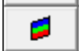

Discretization the model.

All excavation surfaces are automatically discretized by concentrating elements where results are requested

View > Render > Discretize

Analysis results are calculated on DD surfaces and on a series of user defined grid planes

CAD > Build > Grid Plane

or at user defined points

#### Analysis > Options > MSCALC

The grid planes are automatically discretized into a series of field points at which displacements, strains and stresses are calculated.

The discretization analysis can be repeated as many times as desired with different control parameters.

The user has complete control over the way in which the model is discretized by specifying various control parameters (Element Length _AL_ , Grid Spacing _AG_ , Element Discretization _DON_ , Grid Discretization _DOL_ )

#### Analysis > CParams

and by specifying the maximum element width for 3D FF blocks and DD planes

CAD > Edit > Entities > Maximum Element Width

as well as for field point grids

CAD > Edit > Entities > Maximum Element Width

Refer to Discretization and Lumping for a thorough discussion on how to set up these control parameters.

Options:

Analysis > Options > MSCALC Analysis > Options > LERD/LSS Analysis > Options > Lumping

Related Topics:

Analysis Dialog Analysis > Suspend Analysis > ABORT Analysis > Restart
