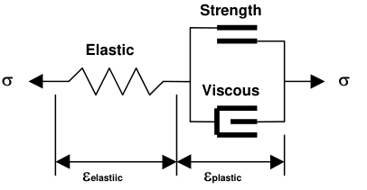

Conduct elasto-visco-plastic creep analysis.

This feature is used only in non-linear analyzes (3D FF blocks in Map3D Non-Linear and DD planes in Map3D Fault-Slip). The creep model can be used simply as a technique for damping the non-linear deformations or if this creep option is activated, for real time dependant creep simulation.

At each creep step the stress state on all yielding elements (elements where the stress exceeds the strength) is calculated as the strength plus the creep resistance. This limits the size of plastic creep increment Deplastic on each yielding element

s = _Strength_ + _C_ Deplastic /D _t_

_C_ = _G_ D _t_

where the creep resistance is determined as the creep coefficient _C_ , times the plastic strain rate Deplastic /D _t_ . Note that the user must select both the creep coefficient _C_ , and the time step size D _t_ , then specify the quotient of these as the viscous modulus _G_ . The contribution to the stress s, made by the creep increment is the excess stress given by

Ds  = _C_ Deplastic /D _t_

The maximum excess stress for all yielding elements is indicated by Plot > Surface Components > Ferr

If this creep option is activated, Map3D will execute only one creep increment for each mining step. Thus the elapsed time can be determined as the product of the current time step number _is_ (Analysis Dialogue) with the user defined time step size D _t_ .

Total Elapsed Time = _is_ D _t_

The user may wish to repeat several mining steps without adding any new mining simply to allow the model to creep for a controlled number of steps.

If this creep option is not activated, Map3D will execute as many creep increments as is required to reduce _fer_ below the stress tolerance _STOL_ , before moving onto the next mining step.

In either case, the accumulated plastic strain eplastic, is determined as the sum of the plastic creep increments Deplastic, for all creep steps.

Related Topics:

Plot > Surface Components > DTs Excess Shear Stress

Plot > Surface Components > DEs Incremental Shear Strain

Plot > Surface Components > Ts Shear Stress

Plot > Surface Components > Es Shear Strain

This function must be checked before conducting the Map3D BEM analysis

Analysis > BEM Analysis
