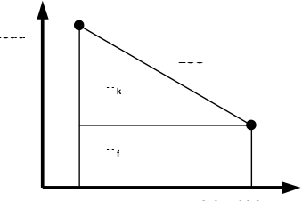
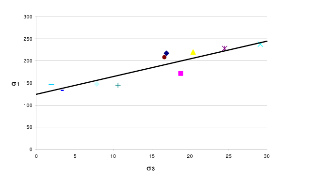
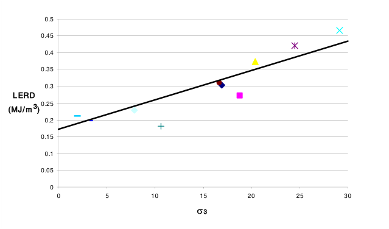
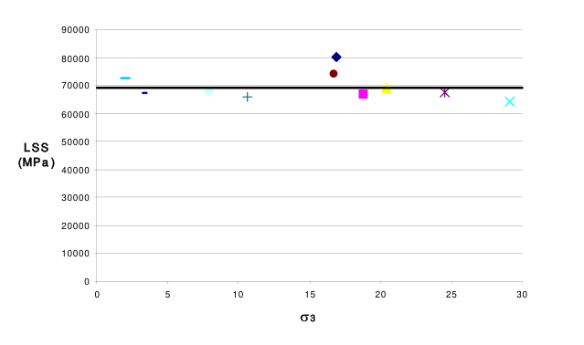

Calculate energy release rate and loading system stiffness – during Map3D BEM analysis.

This routine enables the user to calculate energy release rate ( _ERR_ ) at any desired location and provides a wide range of flexibility for controlling how the calculation is conducted. An alternative

method is available where _ERR_ is calculated ahead of an excavation face only Plot > Surface Components > ERR

When you select LERD/LSS, you will be prompted for a data file name where the results from the LERD/LSS calculations are to be written. The default extension for this file is ".ERR".

Results will be written to this file in the following format:

If the test block is constructed as a 3D block (using FF elements)

**Block# Volume Area   Wk  Wf  Ev  LSS   x y z** s **1  t1  p1** s **2  t2  p2** s **3  t3  p3**

where s **i  ti  pi** represent a principal stress component, its trend and plunge.

If the test block is constructed as a planar feature (using DD elements)

**Block# Volume Area   Wk  Wf  Ev  LSS   x y z** t **s  ts  ps** s **n  tn  pn**

where t **s  ts  ps** represent the maximum in-plane shear stress, its trend and plunge, and s **n  tn  pn** represent the normal stress, its trend and plunge.

In both cases, **x y z** are the coordinates of the centre of the test block where the stresses are calculated.

**Wk  Wf** and **LSS** are defined below.

**Ev** is the volume change that occurs during the LERD/ERR calculation.

In addition, the total energy release associated with new excavations made during for the current mining step will also be calculated. Note that no test blocks need to be specified for this calculation to take place. Results will be reported as follows:

#### Stp# Volume Area Wk Wf Ev LSS

A useful indicator of the nature of the response expected during yielding are the loading system stiffness ( _LSS_ ) and local energy release density ( _LERD_ ). At different locations in a model one can

expect these indicators to change owing to geometric effects. At locations where the _LSS_ is stiffer that the post peak response of the yielding rock, one can expect controlled failure that progresses in sequence with the advancing mining. However, at locations where the _LSS_ is softer that the post peak response of the yielding rock, one can expect uncontrolled failures. The amount of excess energy available can be expected to correlate with the magnitude of the event.

In order to determine the _LSS_ or _LERD_ in a numerical model it is necessary to flex the model and observe the loading system response. This is done by specification of the Material Code for the LERD/LSS calculation using

#### CAD > Edit > Entity Properties > Matl Code LERD/LSS

This special Material Code is used to temporarily alter the material properties or boundary conditions in the test area to cause the model to deform in some way.

Since the _LSS_ is expected to change from one location to another, it is necessary do this at all locations of interest. By carefully monitoring the loading system response during this deformation, the _LSS_ and the various amounts of energy transferred can be calculated.

Consider the simple example of a fault plane passing through a mining zone, and ask the question "How would this fault respond if it were to yield?". One could simply substitute a lower friction angle and observe how the rock mass deformed. Let's call "Stage I" the model with the fault at its normal friction angle, and "Stage II" the same model but with the fault at some reduced friction angle. At some location on the fault plane we can expect the following type of response.

The _LSS_ is simply the slope of the load deformation response curve. The maximum amount of energy that can be released as kinetic energy is the area of the upper triangle labelled as Wk (one should expect this to correlate with observed event magnitude). The minimum amount of energy that can be dissipated in the frictional deformation of the fault is the area of the lower rectangle labelled as Wf (one should expect this to correlate with the amount of damage observed at the event source). This calculation must be conducted at all locations on the fault plane in order to get the total energy transferred as a result of the reduction in friction angle. Note that depending on how the material properties are set up there could be normal deformations (dilation occurring with the shear response) that this must be included in the energy calculations.

The same calculations can be done for a pillar between two drifts. For this case let's call "Stage I" the model with the pillar intact. In order to flex the model we could substitute a different material into the pillar and call this "Stage II". All of the above calculations and interpretations for Wk and Wf can then be taken again. Note that as above, there will be contributions from both normal and shear components included in the energy calculations.

Since Map3D calculates the stresses acting on boundary elements, the total energy transfer can be calculated as the integral of the stresses through their deformations over all elements. In the case of the pillar example above, if we actually excavate the pillar to obtain stage II, then divide Wk by the volume of the pillar, we obtain the local energy release density ( _LERD_ ). This has been found to correlate very well with violent failure episodes. (Note that for the case of tabular mining, if you divide Wk by the area (in the plane of mining), you obtain the classical energy release rate, _ERR_ ).

To reinforce this concept let's consider a real example. Consider multiple pillar bursts that occurred over several years of mining. For each failure, a numerical model was run to determine the stress state at the time and location of the failure. If we plot all of these stress predictions on a set of s **1** versus s **3** axes we obtain the following:

This figure illustrates that there is a strong correlation between the stress state at the time of each burst and a linear strength criterion. The coefficient of correlation of this data is 0.90. Stated in a different way, the mean error in prediction of s **1** is approximately 17 MPa. This gives a coefficient of variation of only 9%.

The _LERD_ at the time of the burst as each location also shows a strong correlation between the stress state at the time of each burst and a linear criterion. The coefficient of correlation of this data is 0.88.

Stated in a different way, the mean error in prediction of _LERD_ is approximately 0.045 MPa/mª. This gives a coefficient of variation of only 14%.

While the Wk and Wf components are readily calculated in this way, the definition of _LSS_ is not so straightforward. However a representative _LSS_ can be determined as follows:

Identify a representative area for which the _LSS_ is to be determined. This is done by building a test block that should encompass the anticipated yield zone.

You construct the test block as you would any other feature, but identify this block as a "test block" by specifying the desired Material Code for the LERD/LSS calculation using

#### CAD > Edit > Entity Properties > Matl Code LERD/LSS

The Material Code for the Mining Steps should be set according to how you want this zone to be treated during the mining sequence. These blocks can be used as alternate material zones and excavated if desired.

Assuming that this test block is filled with a fictitious material whose post-peak stiffness exactly matches the loading system response, and that the behaviour of the test block can be described by

s **1 =** **_LSS_** e **1** s **2 =** **_LSS_** e **2** s **3 =** **_LSS_** e **3**

The energy density can be calculated as

**½ (** s **1** e **1 +** s **2** e **2 +** s **3** e **3 )**

The mean energy density can be estimated as

**( Wk + Wf ) /** **_Volume_**

Hence the loading system stiffness can determined from

**_LSS_ = ½ (** s **1² +** s **2² +** s **3² )** **_Volume_ / ( Wk + Wf )**

If we do this calculation for the data presented above we obtain the following plot.

The _LSS_ at the time of the burst as each location shows a strong stress independent value. The mean error in prediction of _LSS_ is approximately 4730 MPa. This gives a coefficient of variation of only 7%.

This _LSS_ calculation is only representative provided the stresses are uniformly distributed throughout the test block. In cases where this is not true, poor correlation with _LSS_ is found.

#### Notes

This function must be checked before conducting the discretization analysis

Analysis > Discretization
