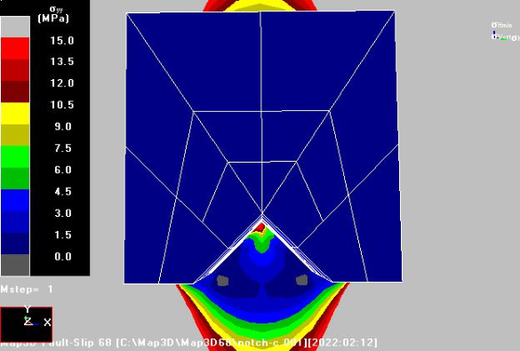

Use higher order boundary elements – during Map3D BEM analysis.

The Boundary Element Method utilizes a numerical approximation of how the intensity of the surface components of stress or displacement discontinuity are distributed over the boundaries. The simplest assumption is to assume that these surface components are distributed uniformly over each boundary element. Experience with Map3D has shown that accurate results are obtained with this approximation for all but a limited class of problems where there are significant bending effects involved. Even for this later type of problem, accurate results are still obtained at all locations except near the boundary surfaces.

To obtain accurate results near the boundaries of problems where there are significant bending effects involved it is necessary to implement higher order boundary elements. Bending effects normally become important for problems with large spans that are irregularly shaped. This is particularly important near kinks in the boundary that can arise due to intersections between various features.

When neither **linear** or **quad** are checked, the intensity of the surface components of stress or displacement discontinuity are distributed as **constant** values.

When the **linear** option is checked, the intensity of the surface components of stress or displacement discontinuity are distributed over the boundary elements using a linear order polynomial distribution. For triangles the following distribution is used

_a + b x + c y_

For quadrilaterals, the following distribution is used

_a + b x + c y + d xy_

When the **quad** option is checked, the intensity of the surface components of stress or displacement discontinuity are distributed over the boundary elements using a quadratic order polynomial distribution. For triangles the following distribution is used

_a + b x + c y + d x_ ² _+ e xy + f y_ ²

For quadrilaterals, the following distribution is used

_a + b x + c y + d x_ ² _+ e xy + f y_ ² _+ g x_ ²y _+ h x_ ² _y_ ² _+ i y_ ²x

Notes:

This function must be checked before conducting the Map3D BEM analysis

#### Analysis > BEM Analysis

This option will increase problem size and hence analysis time, since higher order elements require more interpolation nodes on the bounding surfaces.

If the user is uncertain about the sensitivity of their model to this approximation, it is suggested that some subset of the actual model is run with and without linear elements for comparison.

In the example below, an excavation with a notch is illustrated. The vertical stress is contoured for the three cases of neither **linear** or **quad** , then **linear** , then **quad** . Note the anomalous stress concentration at the tip of the notch with the constant distribution. This effect is eliminated using either the **linear** distribution, and further reduced using the **quad** distribution.

#### linear distribution

**quad** distribution

