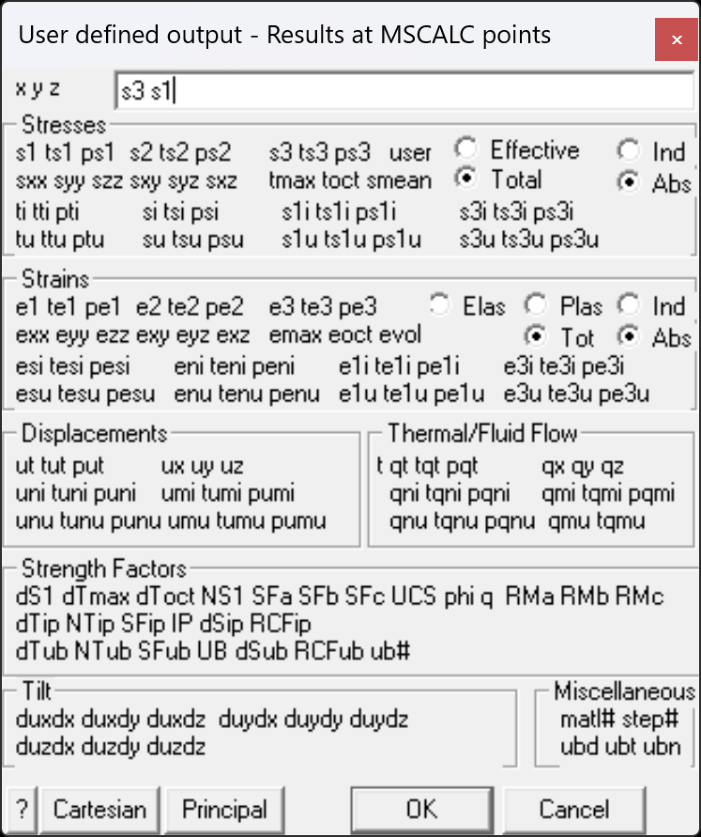

Calculate results at user defined points – during Map3D BEM analysis.

Analysis results can be calculated at user defined coordinate locations.

When you select MSCALC, you will be prompted for a data file name and the desired output format as follows.

#### Data file format:

The data file contains is simply a text file (*.txt) with a list of the coordinate locations where the results are to be calculated.

The format of this file requires one set of coordinates per line

x1 y1 z1 x2 y2 z2 x3 y3 z3 x4 y4 z4 ...

where x y z represent the coordinates of each point.

If desired, you can specify x y z dipub ddrub And in addition, you can also specify x y z dipub ddrub so phi

Here dipub ddrub represent respectively dip and direction of desired UB plane

- these would only be used if you are calculating some UB components such as su tu

so and phi represent respectively the cohesion and friction angle

- these would only be used if you are calculating some UB strength parameters such as sfu rcfu dsu ntu

#### Output file format:

Results are written back to the same data file with x y z coordinates followed by user specified parameters.

#### Stresses:

s1 ts1 ps1 major principal stress s1 its trend and plunge. s2 ts2 ps2 intermediate principal stress s2 its trend and plunge. s3 ts3 ps3 minor principal stress s3 its trend and plunge. user User defined value. sxx syy szz sxy syz sxz Cartesian stress components. tmax maximum shear stress tmax=½ ( s1 - s3 ) toct octahedral shear stress toct=¹/3 [( s1 - s2 )² + ( s2 - s3 )² +( s3 - s1 )²]1/2 smean mean stress smean=¹/3 ( s1 + s2 + s3 ) ti tti pti maximum shear stress in the grid plane, its trend and plunge. si tsi psi normal stress in the grid plane, its trend and plunge. s1i ts1i ps1i maximum stress tangential to the grid plane, its trend and plunge. s3i ts3i ps3i minimum stress tangential to the grid plane, its trend and plunge. tu ttu ptu maximum shear stress in the ubiquitous-plane, its trend and plunge. su tsu psu stress normal to the ubiquitous plane, its trend and plunge. s1u ts1u ps1u maximum stress tangential to the ubiquitous plane, its trend and plunge. s3u ts3u ps3u minimum stress tangential to the ubiquitous plane, its trend and plunge. The orientation of the ubiquitous-plane is specified in

Plot > Strength Factors > Ubiquitous Parameters Effective/Total effective stress or total stress components. These options are only used in Map3D Thermal-Fluid Flow, as this code allows for calculation of steady state pore pressure distributions. Induced/Absolute Induced stress is the stress without the pre-mining stress contribution. This represents the stress change since the pre-mining condition. Absolute stress is the stress including the pre-mining stress contribution.

#### Strains:

e1 te1 pe1 major principal strain e1 its trend and plunge. e2 te2 pe2 intermediate principal strain e2 its trend and plunge. e3 te3 pe3 minor principal strain e3 its trend and plunge. exx eyy ezz exy eyz exz Cartesian strain components. emax maximum shear strain emax=½ ( e1 - e3 ) eoct octahedral shear strain eoct=¹/3 [( e1 - e2 )² + ( e2 - e3 )² +( e3 - e1 )²]1/2 evol volumetric strain evol=( e1 + e2 + e3 ) esi tesi pesi maximum shear strain in the grid plane, its trend and plunge. eni teni peni normal strain in the grid plane, its trend and plunge. e1i te1i pe1i maximum strain tangential to the grid plane, its trend and plunge. e3i te3i pe3i minimum strain tangential to the grid plane, its trend and plunge. esu tesu pesu maximum shear strain in the ubiquitous-plane, its trend and plunge. enu tenu penu strain normal to the ubiquitous plane, its trend and plunge. e1u te1u pe1u maximum strain tangential to the ubiquitous plane, its trend and plunge. e3u te3u pe3u minimum strain tangential to the ubiquitous plane, its trend and plunge. Elastic/Plastic/Total elastic, plastic or total strain components. These options are only used in Map3D Non-Linear, as this code allows for calculation of non-linear strains. Induced/Absolute Induced strain is the strain without the pre-mining contribution. This represents the strain change since the pre-mining condition. Absolute strain is the strain including the pre-mining strain contribution.

#### Displacements:

ut tut put total displacement, its trend and plunge. ux uy uz Cartesian displacement components. uni tuni puni displacement normal to the grid plane, its trend and plunge. umi tumi pumi maximum displacement tangential to the grid plane, its trend and plunge. unu tunu punu displacement normal to the ubiquitous plane, its trend and plunge. umu tumu pumu maximum displacement tangential to the ubiquitous plane, its trend and plunge.

#### Flow:

t temperature/head.

qt tqt pqt total flow, its trend and plunge. qx qy qz Cartesian flow components.

qni tqni pqni displacement normal to the grid plane, its trend and plunge.

qmi tqmi pqmi maximum displacement tangential to the grid plane, its trend and plunge. qnu tqnu pqnu displacement normal to the ubiquitous plane, its trend and plunge. qmu tqmu pqmu maximum displacement tangential to the ubiquitous plane, its trend and plunge.

#### Strength:

- ds1 excess major principal stress Ds1 = s1 - ( _UCS_ + _q_ s3 )

- dtmax excess maximum shear stress Dtmax = ½(s1 - s3) - [ _UCS_ + ½(s1+s3) ( _q_ -1) ]/( _q_ +1) = [s1 - ( _UCS_ + _q_ s3) ]/( _q_ +1)

- dtoct excess octahedral shear stress Dtoct = toct - [ _UCS_ + ( _q_ –1) smean ] Ö(2) /( _q_ +2)

- NS1 probability using the Normal distribution N(Ds1 /std)

- SF-A Strength/Stress can be determined as ( _UCS_ + _q_ s3 )/ s1

- SF-B Strength/Stress can be determined as ( _UCS_ + _q_ s3 - s3 )/(s1 - s3)

- SF-C Strength/Stress can be determined as [ _UCS_ + ½(s1+s3) ( _q_ -1) ]/[ ½(s1 - s3)( _q_ +1) ]

- dTip excess in-plane shear stress Dtip = tip - [ Cohesion + sip tan(j) ]

- NTip probability using the Normal distribution N(Dtip /std)

- SFip Strength/Stress can be determined as [ Cohesion + sip tan(j) ] / tip

- dSip excess in-plane wall stress Dsip = [ 3 s1i - s3i ] - UCS

- RCFip Rock Condition Factor for the in-plane wall stress RCFip = [ 3 s1i - s3i ]/UCS

- dTub excess ubiquitous-plane shear stress Dtub

- NTub probability using the Normal distribution N(Dtub /std)

- SFub Strength/Stress can be determined as [ Cohesion + sub tan(j) ] / tub

- dSub excess ub-plane wall stress Dsub = [ 3 s1ub - s3ub ] - UCS

- RCFub Rock Condition Factor for the ub-plane wall stress RCFip = [ 3 s1ub - s3ub ]/UCS

- UB# Plots the UB set number (1, 2 or 3) that has the largest value of Dtub

#### Miscellaneous:

matl# the number of the material within which the point is located. The host material is material number 1. In problems where multiple materials are used, results may be calculated in an alternate material zone.

step# the mining step number.

ubd, ubt, ubn represent respectively the dip, dip direction and normal of the ubiquitous plane.

#### Other:

Cartesian   configures for output of cartesian stress components. Principal   configures for output of principal stress components.

#### Notes:

This function must be checked before conducting the discretization analysis

Analysis > Discretization.

Any desired number of points can be specified.

The model is discretized according to the locations of the specified points.
