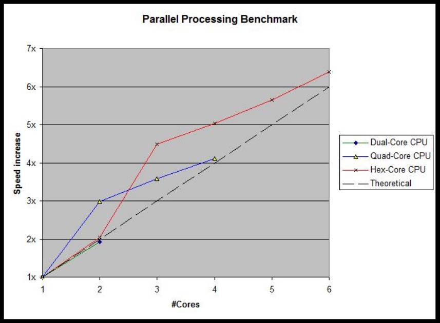

Displays the number of cores/threads active.

Map3D fully supports parallel processing and parallel disk I/O with the multi-processor/multi-drive option.

If you are licensed to use the multi-processor/multi-drive option, Map3D will conduct all analysis procedures in parallel distributed among all available processors.

**CPU:** Recent CPU's are now available as dual, quad and hex cores. Map3D V58 now supports parallel processing which allows faster computational rates. This results in more than 6x reduction in matrix assembly and grid assembly times. Multi-CPU computers would go even faster.

The following parallel processing benchmark clearly shows that you can expect dual cores CPU's to perform more than twice as fast,

quad cores to perform more than 4 times as fast and hex-cores to perform more than 6 times faster. In hyper-threading enabled CPUs, 2 computational threads are superimposed on the same core. This is the reason why Map3D-MP actually achieves performance better than the theoretical maximum.

In order to achieve these performance gains it is necessary to improve both the processing power and/or disk I/O rate Analysis > Options > Drive #.
