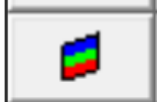
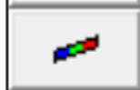

Activate the Build toolbar.

This toolbar is meant to provide quick access to the entity building functions that are used in the model building and editing stage of the Map3D BEM analysis Analysis > Go to CAD.

CAD > Build > FF Loop Build a multi-cornered 3D, FF type block used for excavations and alternate material zones.

CAD > Build > DD Loop Build a multi-cornered DD type block used for tabular mining, thin seams or fault planes.

CAD > Build > Grid Plane Build a grid plane where analysis results are calculated.

CAD > Build > Grid Line Build a grid line where analysis results are calculated.

CAD > Build > Construction Lines Build construction lines to define detailed locations of underground features such as excavations, contacts structure etc.

CAD > Build > Enter Point Enter coordinate values for a point.

CAD > Build > Offset Remaining Offset remaining points.

CAD > Build > Undo Point Undo last point selection.

CAD > Build > Redo Point Redo last point selection.

Pressing the space-bar automatically activates the build edit function that was used.
