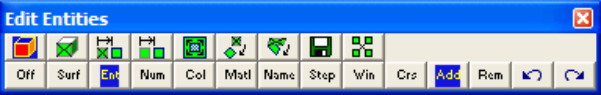

This routine can be initiated either by picking any edit function (e.g. button) or simple right-clicking on any entity.

When you initiate any entity editing routine you will first be prompted to build a list of entities that you wish to edit

- If Tools > Shift-key Selection is checked, you must hold down the shift key to make multiple selections.

- By default, selected entities are added to the list, however if the Ctrl-key is held down, selected entities will be removed from the list.

- While holding down the Shift-key or Ctrl-key, you can drag open a crossing window.

- Pressing the space-bar automatically activates the last edit function that was used.

- Holding the Alt-key when you right-click automatically repeats the last edit function that was used.

This toolbar controls the various functions used in list building.

Aborts editing. Select entities by picking one surface at a time. Select entities by picking whole groups making up a block. Include all entities with the selected number.

Include all entities with the selected colour.

Include all entities with the selected material number.

- The same block may have different materials in it depending on the currently active mining step.

- When using this function, make sure to select the appropriate mining step File > Mining Step

Include all entities excavated with the selected mining step number.

Include all entities within the selected window.

- Entities will only be selected if the entire entity is contained within the window.

- If (surface select mode) is active, only surfaces will be included.

- If (entity select mode) is active, all surfaces making up the block will be included.

Include all entities within the crossing window.

- Entities will be selected if even a part of the entity is within the window.

- This function can also be activated by holding down the Shift-key or Ctrl-key and dragging open a crossing window.

- If (surface select mode) is active, only surfaces will be included.

- If (entity select mode) is active, all surfaces making up the block will be included.

- Selected entities will be added to the list.

Selected entities will be removed from the list. Undo last selection.

Redo the last section.

Once you have selected the desired entities, you can either pick any of the edit buttons:

CAD > Edit > Entity Properties Edit block type, colour, mining sequence etc.

CAD > Edit > Erase Entities Erase selected entities. CAD > Edit > Move Entities Move selected entities. CAD > Edit > Copy Entities Copy selected entities. CAD > Edit > Scale Entities Scale selected entities. CAD > Edit > Rotate Azimuth Rotate the azimuth of selected entities. CAD > Edit > Rotate Dip Rotate the dip of selected entities. CAD > Edit > Dump to File Dump selected entities to a file. CAD > Edit > Group Group selected entities into a single block.

- double click on any vertex to execute the highlighted function,

- right click for a list of options.

Once you have completed any edit operation you have one chance to undo the modifications by selecting

#### Undo

You can also restore the same selection set and modify the same set of entities again be selecting

Redo

You can adjust the double click time using

Tools > Double Click Time
