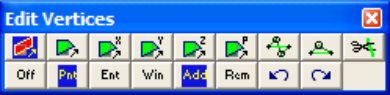

This routine can be initiated either by picking any edit function (e.g. button) or simple right-clicking on any vertex.

When you initiate any entity editing routine you will first be prompted to build a list of vertices that you wish to edit.

   - If Tools > Shift-key Selection is checked, you must hold down the Shift-key to make multiple selections.

   - By default, selected entities are added to the list, however if the Ctrl-key is held down, selected entities will be removed from the list.

   - While holding down the Shift-key or Ctrl-key, you can drag open a selection window.

   - Pressing the space-bar automatically activates the last edit function that was used.

- Holding the Alt-key when you right-click automatically repeats the last edit function that was used.

This toolbar controls the various functions used in list building.

Aborts editing.

Select vertices by picking one at a time.

Select vertices by picking groups.

Include all entities within the selected window.

- Entities will only be selected if the entire entity is contained within the window.

- This function can also be activated by holding down the Shift-key or Ctrl-key and dragging open a crossing window.

Selected entities will be added to the list.

Selected entities will be removed from the list.

Undo last selection.

Redo the last section.

Once you have selected the desired entities, you can either pick any of the edit buttons:

CAD > Edit > Stretch Vertices

CAD > Edit > Move Vertices to Point

CAD > Edit > Move Vertices to X CAD > Edit > Move Vertices to Y CAD > Edit > Move Vertices to Z CAD > Edit > Move Vertices to Plane CAD > Edit > Smooth Construction Lines CAD > Edit > Remove Construction Vertex CAD > Edit > Subdivide Construction Lines

- double click on any vertex to execute the highlighted function,

- right click for a list of options.

Once you have completed any edit operation you have one chance to undo the modifications by selecting

#### Undo

You can also restore the same selection set and modify the same set of entities again be selecting

Redo

You can adjust the double click time using

Tools > Double Click Time
