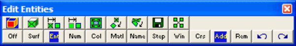
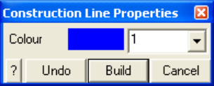

Edit construction line colour.

When you initiate this routine you will first be prompted to build a list of entities that you wish to edit

- If Tools > Shift-key Selection is checked, you must hold down the shift key to make multiple selections.

- Use of this toolbar is detailed in Build A List of Entities for Editing

- Pressing the space-bar automatically activates the last edit function that was used.

Once you have selected the desired entities, you can either pick any of the edit buttons:

CAD > Edit > Entity Properties Edit block type, colour, mining sequence, CAD > Edit > Erase Entities Erase selected entities, CAD > Edit > Move Entities Move selected entities, CAD > Edit > Copy Entities Copy selected entities, CAD > Edit > Scale Entities Scale selected entities, CAD > Edit > Rotate Azimuth Rotate the azimuth of selected entities, CAD > Edit > Rotate Dip Rotate the dip of selected entities, CAD > Edit > Dump to File Dump selected entities to a file, CAD > Edit > Group Group selected entities into a single block,

- double click on any vertex to execute the highlighted function,

- right click for a list of options.

If any of the fields in the dialogue box read "Variable" it is because some of the blocks you have selected have different properties for that field. If you wish to leave these properties as they are (i.e. different for each block), leave the field as "Variable". If you wish to change the value of that field for all selected blocks, enter the desired value.

Colour - specifies the colour number that will be used to display the construction line.

- A total of 10 colours are available for display. These are numbered respectively 1 through 10,

11 through 20,

21 through 30, etc.,

- such that the same colour is displayed for numbers

- 1, 11, 21..., 2, 22, 32..., 3, 23, 33..., etc.

OK - completes editing of construction lines and modifies any properties that have been changed.

Cancel - aborts editing of entities.

Once you have completed any edit operation you have one chance to undo the modifications by selecting

#### Undo

You can also restore the same selection set and modify the same set of entities again be selecting

#### Redo

You can adjust the double click time using

#### Tools > Double Click Time

For examples on the use of construction lines in model building refer to:

Model Building Tutorials
