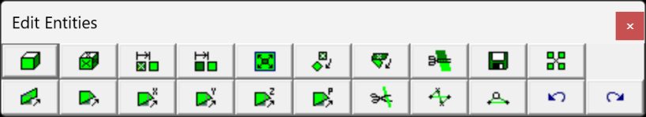

Activates the edit toolbar.

This toolbar is meant to provide quick access to the edit functions that are used in the model building and editing stage of the Map3D BEM analysis Analysis > Go to CAD

Edit functions are grouped into two sections depending on whether you want to modify blocks or coordinates.

#### Modify blocks:

CAD > Edit > Entity Properties Edit block type, colour, mining sequence etc. CAD > Edit > Erase Entities Erase selected entities. CAD > Edit > Move Entities Move selected entities. CAD > Edit > Copy Entities Copy selected entities. CAD > Edit > Scale Entities Scale selected entities.

CAD > Edit > Rotate Azimuth Rotate the azimuth of selected entities.

CAD > Edit > Rotate Dip Rotate the dip of selected entities. CAD > Edit > Slice Entities Slice selected entities.

CAD > Edit > Dump to File Dump selected entities to a file. CAD > Edit > Group Group selected entities into a single block.

#### Modify coordinates:

CAD > Edit > Stretch Vertices Stretch selected vertices. CAD > Edit > Move Vertices to Point Move selected vertices to a point. CAD > Edit > Move Vertices to X Move the x-coordinate of selected vertices. CAD > Edit > Move Vertices to Y Move the y-coordinate of selected vertices. CAD > Edit > Move Vertices to Z Move the z-coordinate of selected vertices. CAD > Edit > Move Vertices to Plane Move selected vertices to a plane.

CAD > Edit > Subdivide Construction Lines Subdivide a construction line.

CAD > Edit > Smooth Construction Lines Smooth construction lines. CAD > Edit > Remove Construction Vertex Remove a construction vertex.

#### Undo - Redo

Once you have completed any edit operation you have one chance to undo the modifications by selecting

#### Undo

You can also restore the same selection set and modify the same set of entities again be selecting

Redo

Pressing the space-bar automatically activates the last edit function that was used.
