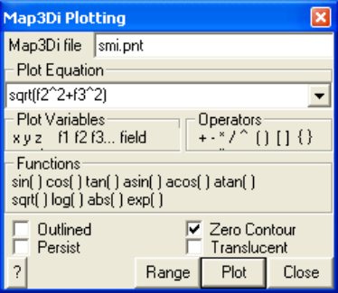

This option enables visualization of Map3Di data.

#### Map3Di File:

The Map3Di data file is simply an ASCII data file with the default extension ".PNT".

Refer to CAD > Properties > Map3Di for details concerning data format.

Refer to Visualization > Plane > Make Map3Di File for details concerning data format.

#### Plot Equation:

Defines the parameter that will be plotted.

The pull-down window allows you to store up to 20 different equations. These are stored between Map3D sessions in the map3d.ini file.

#### Plot Variables:

f1 f2 f3… - data fields in the event file.

#### Functions:

sin() cos() tan() - sine, cosine and tangent trigonometric functions. asin() acos() atan() - Inverse trigonometric functions. sqrt() - square root function. log() - natural logarithmic function. abs() - absolute value.

exp() - exponential function (antilogarithm).

#### Location:

x y z - coordinate of grid point.

#### Operators:

+ - * / ^   addition, subtraction, multiplication, division and exponentiation operators. Note that exponentials are computed first, followed by multiplication and division and finally addition and subtraction.

() [] &#123;&#125;   styles of brackets. Pairs of brackets must match.

>   maximum value. For example if the plot equation is specified as f1 > 10, the larger of f1 or 10 will be plotted.

&lt;   minimum value. For example if the plot equation is specified as f1 &lt; 10, the smaller of f1 or 10 will be plotted.

#### Point Plotting Options:

Outlined – Map3Di data patches are outlined.

#### Other:

Persist – when checked, the points will be re-plotted each time the model is reoriented, translated or zoomed. Since this may be time consuming for large models this option may not always be desired. Translucent - draws the points as translucent spheres.

Zero Contour - when unchecked, contours below the minimum contour range are not drawn. This is useful for displaying contours where only the upper part of the contour range is important. Range – specifies the minimium, maximum and interval for radius scaling and contouring.

Plot - regenerates the plot. This button can be placed on either the View Toolbar (Tools > View Toolbar Configure) or the Contour Toolbar (Tools > Contour Toolbar Configure).
