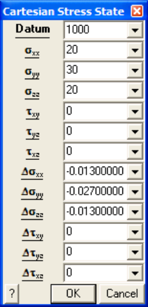

The pre-mining stress state is specified as a linear variation with depth in either Cartesian or principal components.

The variation of each of the Cartesian components is described as a linear variation with depth as (for example for the sxx component)

- sxx + Dsxx ( _z_ - _Datum_ )

To determine appropriate values for each of these components the user must first select a depth

- ( _z_ = _Datum_ )

where the stresses have known values. These later values are the

sxx  syy  szz  txy  tyz  txz

constant values.

The variation of each component with depth can then be specified as

Dsxx  Dsyy  Dszz  Dtxy  Dtyz  Dtxz

variation values. If you have set up your coordinate system with _z_ positive up, then the variations should be specified as negative quantities so that the stresses increase with depth.

For example if you know that the sxx component has a value of

30 MPa at _z_ = -1000m

and varies as ( _z_ is positive up)

- 0.027 MPa/m

you would specify

Datum = -1000 sxx = 30 Dsxx = -0.027
