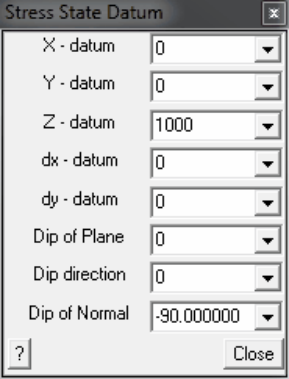

The variation of each of the stress components is described as a linear variation in either principal or Cartesian components.

If desired this can be specified as a variation in the x, y and z directions by defining a sloping datum. This is meant to be used at locations where the topography has a dominant slope.

To define a sloping datum, you are required to specify a point on the plane that represents the datum ( _X-datum_ , _Y-datum_ and _Z-datum_ ),

as well as the slope of the plane. The slope is specified as a gradient in the X ( _dx-datum_ ) and Y ( _dydatum_ ) directions.

For user convenience, the slope of the place can be specified using either the "Dip" and "Dip direction" of the plane, or the "Dip direction" and "Dip of the Normal" to the plane. The gradients are automatically determined from these later values as follows:

_dx-datum_ = -sin(q) sin(j) _dy-datum_ = -cos(q) sin(j)

hence

tan(q)= _dx/dy_ tan(j)=sqrt( _dx_ ^2+ _dy_ ^2)

Defined in this way, the stresses vary both with depth and horizontal position.
