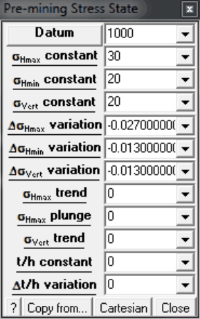
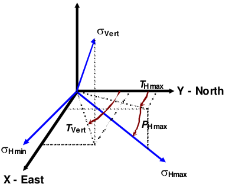

Datum - The pre-mining stress state is specified as a linear variation with depth in either principal or Cartesian components.

Copy from... - allows you to copy the stress state from another material.

- Only the stress state is copied.

- Other material properties are left unchanged.

Cartesian - The pre-mining stress state is specified as a linear variation with depth in either principal or Cartesian components.

The three principal stress components are referred to as the _Hmax_ , _Hmin_ and _Vert_ components.

- sHmax is the maximum (nearly) horizontal stress.

- sHmin is the minimum (nearly) horizontal stress.

- sVert is the (nearly) vertical stress.

These stress components are perpendicular to one another.

The horizontal and vertical components do not need to be exactly horizontal or vertical. The trend and plunge of sHmax can be adjusted using _THmax_ and _PHmax_ . The trend of sVert can be adjusted using _TVert_ .

The variation of each of these components is described as a linear variation with depth as (for example for the sHmax component)

sHmax + DsHmax ( _z_ - _Datum_ )

To determine appropriate values for each of these components the user must first select a depth _z_ where the stresses have known values.

_Datum_ should be set to this _z_ value.

The magnitude of the stress at this depth is specified by the following constant values

sHmax sHmin sVert

The variation of each component with depth can then be specified by the following variation values

DsHmax DsHmin DsVert

If you have set up your coordinate system with _z_ positive up, then the variations should be specified as negative quantities so that the stresses increase with depth.

For example if you know that the _Hmax_ component has a value of

30 MPa at _z_ = 1000m

and varies as ( _z_ is positive up)

0.027 MPa/m

you would specify

Datum = 1000 sa = 30 Dsa = -0.027

Finally, the trend and plunge of the _Hmax_ component and the trend of the _Vert_ component uniquely define the stress state orientation.

The parameters

_t/h_ constant

D _t/h_ variation

refer to the ambient temperature/head distribution and are specified in the same manner as the stresses.
