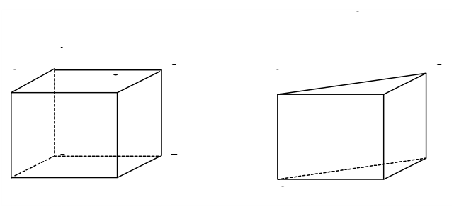
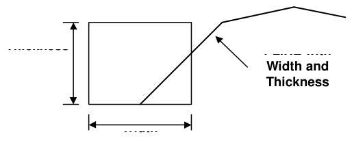
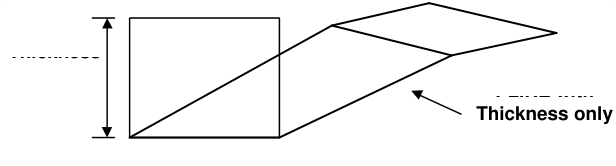
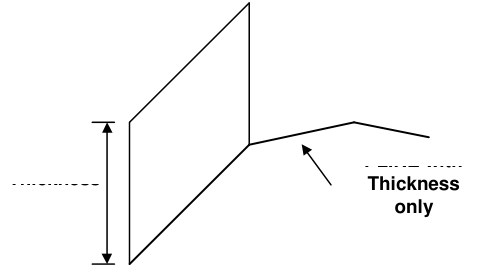
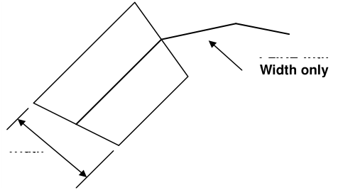
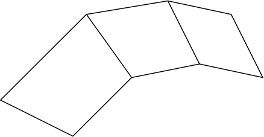
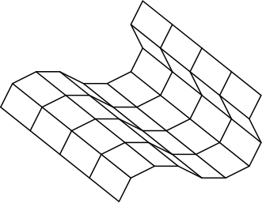

DXF format is an AutoCAD drawing exchange file with the extension ".DXF".

This format is useful for exchanging model data with other CAD software.

#### Three-Dimensional Block Type AutoCAD Entities

The most reliable method of generating Map3D compatible data is to use three-dimensional AutoCAD entities. This type of entity generates blocks, which are structured identically to Map3D 3D FF blocks and thus can be passed directly through to Map3D. Closure of all surfaces is guaranteed when using this command since each three-dimensional entity defines a closed block. There are many ways of generating such objects from within AutoCAD as described below.

#### 3DMESH

The recommended method of defining three-dimensional AutoCAD entities is to use the 3DMESH command, with AutoCAD THICKNESS and WIDTH set equal to zero. These 3DMESH's can be specified with any desired values of M and N. If N is set equal to 3 or 4, these entities will come into Map3D as blocks. This approach is the most general, but also the most complex to specify since the layout of both the floor and back of the drift must be defined along its length.

#### PLINE, POLYLINE or ELLIPSE with WIDTH and THICKNESS

The simplest technique for generating a drift or stope with a regular rectangular cross-section, and uniform height, is to use the AutoCAD PLINE command. One simply defines an AutoCAD UCS (user coordinate system) for the drift, then defines the floor elevation centre line of the drift using the AutoCAD PLINE command. The width of the drift is then specified using the AutoCAD PEDIT command. Either a constant width or changing width at each vertex can be specified. The AutoCAD COLOUR (Map3D block number) and AutoCAD THICKNESS (drift height) of the drift are specified using the AutoCAD CHANGE PROPERTIES command. The AutoCAD POLYLINE and ELLIPSE commands can also be used to create drifts with specified AutoCAD WIDTH and THICKNESS.

#### PLINE, POLYLINE or SOLID with THICKNESS Only

Another simple method of defining a drifts or stopes with a rectangular cross-section is to use either of the AutoCAD PLINE, POLYLINE or SOLID commands with a specified AutoCAD THICKNESS (drift height), and AutoCAD WIDTH set equal to zero (see Figure 32). Although this approach is more general than PLINE, it is also more complex to specify since the floor plan of the drift must be defined along its length. If either the AutoCAD PLINE or POLYLINE commands are used, one must form a closed loop with either 3 or 4 line segments.

#### Other Three-dimensional AutoCAD Entities

AutoCAD supplies routines to generate several three-dimensional objects including spheres, toruses, boxes, cones etc. These can all be used if desired. The user is responsible to close the open ends of shapes such as hemispheres and cones.

#### Two-Dimensional Plate Type AutoCAD Entities

Map3D compatible data can also be specified in terms of two-dimensional AutoCAD entities. This technique is not as reliable as the methods described above because closure of all surfaces is no longer guaranteed. The user must define excavations with a series of surface plates (all assigned the same AutoCAD colour number), which must join along their edges and completely envelope the excavation with a continuous surface skin. These surfaces are structured identically to Map3D surface plates. Closure of all surfaces is not guaranteed when using this method since the user may leave out a surface patch, thus forming a hole in the excavation surface. The user must take care to place all plates such that all surfaces close perfectly.

#### LINE, PLINE, 3DPOLY, POLYLINE and ELLIPSE - THICKNESS Only

These entities can be used to define two-dimensional plates. One simply defines an AutoCAD UCS (user coordinate system) for the plate, then defines the edge of the plate using any of the AutoCAD LINE, PLINE, 3DPOLY, POLYLINE or ELLIPSE commands. The AutoCAD COLOUR (Map3D block number) and AutoCAD THICKNESS (plate width) are specified using the AutoCAD CHANGE PROPERTIES command. The AutoCAD WIDTH must be set equal to zero.

#### LINE, PLINE, 3DPOLY, POLYLINE and ELLIPSE with WIDTH Only

Using these entities, one defines the centre line of the plate using any of the AutoCAD LINE, PLINE, 3DPOLY, POLYLINE or ELLIPSE commands. The width is then specified using the AutoCAD PEDIT command. Either a constant width or changing width at each vertex may be specified. The AutoCAD THICKNESS must be set equal to zero.

#### 3DFACE, POLYLINE or LWPOLYLINE

Two-dimensional surfaces can also be generated using the AutoCAD 3DFACE command. This method is more general, but since all corners of the AutoCAD 3DFACE must be specified, it is also more complex.

#### 3DMESH

Complex two-dimensional surfaces can be generated using types of 3DMESHs with N larger than 4 (e.g. Rulesurf, Tabsurf, Revsurf etc.). For these shapes, the DXF conversion routine creates a series of 3DFACEs to describe the excavation surface. These surfaces are structured identically to Map3D surface plates. Surface closure is fairly easy to ensure for these cases owing to the regular nature of the construction.

#### Unsupported AutoCAD Entities

There are a number of unsupported AutoCAD entities, meaning that Map3D was not designed to reconstruct these as they appear from within AutoCAD. These entities include the CIRCLE, ARC and DOUGHNUT entities. These entities may be supported in future Map3D updates. Note that most shapes can be generated by alternate means using the AutoCAD ELLIPSE command, or 3DMESH command.

#### AutoCAD DXF EXTENDED ENTITY DATA

DXF EXTENDED ENTITY DATA (EED) is part of the DXF specification. EED allows you to tag each DXF ENTITY with custom data attributes. Below are a list of the EEDs supported by Map3D.

Most CAD systems will allow you to add these EEDs to your DXF. For example Deswik calls these "attributes", hence from within Deswik you can now create Map3D geometries including specification of Map3D block names, colours and mining sequence:

- Export each block using DXF-POLYLINE/POLYFACEMESH - this is the Deswik default.

- It is recommended that you do not use DXF-3DFACE.

- In Deswik attributes are exported to DXF as AutoCAD Extended Entity Data.

- The attribute names (attributes names are not case sensitive) are defined as follows: `o` MAP3D_BLOCKNAME - name of the block (default is blank).

   - MAP3D_BLOCKCOLOR or MAP3D_BLOCKCOLOUR - Map3D colour number (default is the Deswik defined colour number).

   - MAP3D_BLOCKTYPE - 1 for FF, 2 for DD, 98 for inactive FF, 99 for inactive DD, 0 for grid plane (default is 1 for FF).

   - MAP3D_MSTEP# - # is the mining step number (default is mined at step 1).

   - Ø For example to excavate at mining step 2, create an attribute called MAP3D_MSTEP2 then specify 0 (excavation) as the attribute value.

   - Ø For example to backfill at mining step 3, create an attribute called MAP3D_MSTEP3 then specify 4 (where is the material number representing the backfill) as the attribute value.

   - MAP3D_BLOCKNUMBER - unique block identifier number (default is a different unique number for each DXF-POLYLINE/POLYFACEMESH or each DXF-3DFACE).

- Attributes names are not case sensitive.

- All attributes can be defined as strings (group code 1000), integers (group code 1070 or 1071) or real numbers (group code 1040).

- All attributes are optional - defaults are supplied as specified above.

- Note that if no Map3D defined attributes are specified, the DXF will read in successfully provided you are using DXF-POLYLINE/POLYFACEMESH.

- Map3D will simply assume that each DXF-POLYLINE/POLYFACEMESH is a separate block.

- If you are using multiple DXF-3DFACEs, Map3D may have difficulty grouping these into blocks.

- Problems with this occur only where adjacent blocks share their corners and have the same name.

- MAP3D_BLOCKNUMBER can be used to identify the DXF-3DFACEs that belong to separate blocks.
