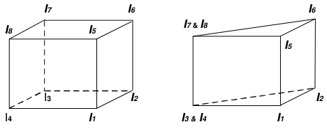
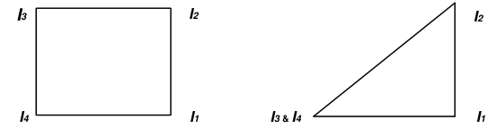
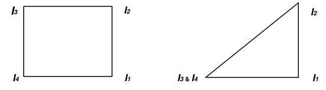
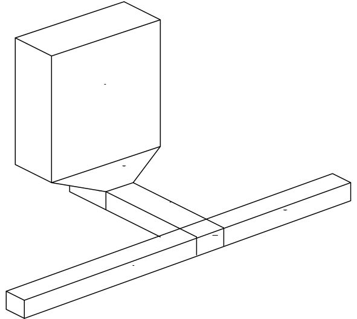
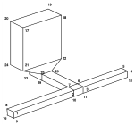
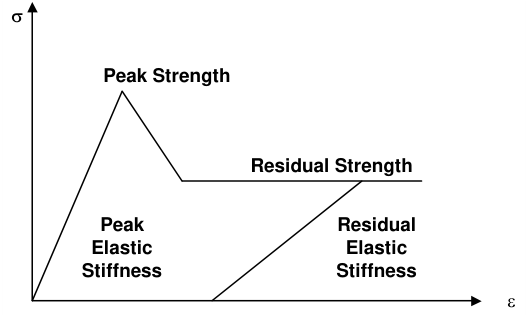

INP format is an editable ASCII data file with the extension ".INP".

This is the recommended Map3D model format. All Map3D functionality is supported with this format.

The file is organized into 7 sections:

1. Job Title

2. Control Parameters

3. Block Specification

4. Coordinate Specification

5. Material Property Specification

6. Grid Specification

7. Mining Step Specification

Comment lines must start with an asterisk "*" in column 1.

Blank lines are skipped.

Maximum line length is 256 characters.

Commas or spaces can be used to separate data fields.

#### 1. Job Title

This section permits the user to specify a descriptive project title: 1 line of data must be specified. Quotation marks are not necessary. Only the first 70 characters will be used.

#### 2. Control Parameters

This section permits the user to specify job control parameters.

#### _NLD,NIT,NPS RPAR,STOL AL,AG DOL,DON DOC,DOE,DOG,DOR_

1 line of data must be specified. All parameters must appear on one line.

Only the first 7 parameters ( **_NLD,NIT,NPS  RPAR,STOL  AL,AG_** ) must be specified. The remaining parameters will be assigned default values, which may or may not be appropriate for your application.

For a detailed description of parameters refer to CAD > Properties > Control Parameters

**_NPS_** This item specifies the number of planes of symmetry to be used in the analysis. Normally no planes of symmetry are used. If symmetry is used, the far field stresses (Stress State) must be aligned with the axis of symmetry.

**_NPS_** =0   no symmetry **_NPS_** =1 _x_ &lt;=> _-x_ , the geometry is reflected in the _y-z_ plane **_NPS_** =2 _x_ &lt;=> _-x_ and _y_ &lt;=> _-y_ , the geometry is reflected in the _y-z_ and _x-z_ planes **_NPS_** =3 _x_ &lt;=> _-x, y_ &lt;=> _-y_ and _z_ &lt;=> _-z_ , the geometry is reflected in the _y-z_ , _x-z_ , and _x-y_ planes

**_RPAR_** During the matrix solution process, the relaxation parameter is continuously modified by the program in an attempt to obtain convergence with as few as possible iterations. This parameter limits the maximum value that will be used. The suggested value of 1.2 is recommended for wellconditioned problems. For very poorly conditioned problems a value of 0.8 should be used.

#### 3. Block Specification

This section permits the user to define the model geometry. 3D FF Blocks and DD planes are constructed here.

**_N  'Block_Name' I_ 1** **_,I_ 2** **_,I_ 3** **_,I_ 4** **_I_ 5** **_,I_ 6** **_,I_ 7** **_,I_ 8** **_Type  Thickness,Width_**

1 line of data per block must be specified.

All parameters must appear on one line. Only the first 5 parameters ( **_N I_ 1** **_,I_ 2** **_,I_ 3** **_,I_ 4** ) must be specified. Use **_N_** =0 to end the list of blocks. For a detailed description of parameters refer to

CAD > Build > Block

CAD > Build > FF Loop

#### CAD > Build > DD Loop

- **_N_** specifies the block colour number. It is used to identify this block when setting material codes, and also to set the colour of the block for graphics display. Different colour numbers should be used to represent logical groupings of blocks (e.g. for different levels, sections or logical mining units such as development, stoping etc.). As many blocks as possible should use the same block identification number.

A total of 10 colours are available for display. These are numbered respectively

1 through 10, 11 through 20, 21 through 30, etc.,

such that the same colour is displayed for numbers

1, 11, 21...,

- 2, 22, 32...,

3, 23, 33..., etc.

- **_'Block_Name'_** specifies a descriptive name for the Block (e.g. 4540 stope). The program will use this name when supplying information concerning the block volume, errors and warnings. The block name is optional, but if used it must appear in single quotation marks. Only the first 20 characters of any block name will be used.

- **_I_ 1** **_,I_ 2** **_,I_ 3** **_,I_ 4** **_I_ 5** **_,I_ 6** **_,I_ 7** **_,I_ 8** represent the numbers of coordinate points that form the block corners, These are described in detail below.

- **_Type_** specifies which type of boundary element to use. Inactive elements (98 or inactive FF and 99 for inactive DD) can be used to display features that are to be included for visualization purposes only and not to be used for the actual stress analysis.

- For three-dimensional features such as excavations, alternate material zones, back-filled stopes etc., **_Type_** =1 (Fictitious Force) type elements should be used.

- The first 4 corners ( **_I_ 1** **_,I_ 2** **_,I_ 3** **_,I_ 4** ) represent coordinate numbers that define one side (e.g. the bottom) of a 6 sided block. The next 4 corners ( **_I_ 5** **_,I_ 6** **_,I_ 7** **_,I_ 8** ) define the opposite side of the block (e.g. the top). The corners can be entered in either clockwise or counter clockwise orientation. Any of the corners can be repeated to define 3 sided shapes and wedges. Blocks can be linked together to form larger more complex excavation shapes by using common coordinate numbers to specify adjacent blocks.

- If desired, surfaces can be constructed using 3 or 4 sided surfaces by using only the first 4 corners ( **_I1,I2,I3,I4_** ). The next 4 corners ( **_I5,I6,I7,I8_** ) should be specified as zeros. The corners can be entered in either clockwise or counter clockwise orientation. Any of the corners can be repeated to define 3 sided shapes and wedges.

- These surfaces can be linked together to form larger more complex excavation shapes by using common coordinate numbers to specify adjacent plates. The user must take care to ensure that complete closing surfaces are constructed leaving no holes or missing plates.

- **_Type_** =2 (Displacement Discontinuity) type elements should be used for tabular mining excavations, fractures and fault planes.

- Surfaces are constructed using 3 or 4 sided surfaces by using only the first 4 corners ( **_I_ 1** **_,I_ 2** **_,I_ 3** **_,I_ 4** ). The next 4 corners ( **_I_ 5** **_,I_ 6** **_,I_ 7** **_,I_ 8** ) should be specified as zeros. The corners can be entered in either clockwise or counter clockwise orientation. Any of the corners can be repeated to define 3 sided shapes and wedges.

- These surfaces can be linked together to form larger more complex shapes by using common coordinate numbers to specify adjacent surfaces.

- **_Thickness_** This parameter is only used for type 2 (displacement discontinuity) elements, where it is used to specify the apparent thickness of the in-filling material (i.e. fault gouge, seam width, mining width or pillar height). Normal displacement (closure) of this feature when in-filled will be limited to this thickness. Also, the normal displacement (closure) and shear displacement (ride) are divided by the _Thickness_ to determine the strain occurring in the in-filling material. This parameter should be specified in the same units that are used to specify the coordinate positions (i.e. metres or feet).

- **_Width_** specifies the maximum width permitted.

- This parameter can be used to force uniform discretization on selected entities. Extreme caution should be used in specifying this value since a small value can easily lead to enormous problem size.

- In general this parameter should be left blank (i.e. not used), and discretization should be left to the **_AL_** and **_AG_** parameters. These latter parameters will concentrate elements only where analysis results are requested thus optimizing the use of elements and minimizing problem size.

- For an example of the use of this parameter refer to Tabular Mining Example.

#### A Simple Example

To illustrate the use of model building using three-dimensional building blocks consider the construction of a simple drawpoint configuration. This model has been assembled out of 7 blocks. Blocks 1, 2 and 3 form the extraction drift, block 4 forms the crosscut, blocks 5 and 6 represent the drawpoint, and block 7 represents the stope. Map3D recognizes and deletes the surfaces, which are common to adjacent blocks.

Many blocks can share the same block number (colour) thus permitting a group of blocks to be used to construct complex excavation shapes. An important consideration here is that, as few as possible block numbers should be used since all surfaces between blocks, which have different block numbers, will be maintained in the database.

The coordinate numbers for the same drawpoint configuration are required if one wants to construct the model using the Map3D input file specification. The blocks would be numbered as follows:

- Block Specification

- N 'Block Name' I1,I2,I3,I4 I5,I6,I7,I8 Type,Thic,Width

- 1 'Block 1' 1 2 7 8 9 10 15 16 1 0 0

- 1 'Block 2' 2 3 6 7 10 11 14 15 1 0 0

- 1 'Block 3' 3 4 5 6 11 12 13 14 1 0 0

- 1 'Block 4' 7 6 26 25 15 14 30 29 1 0 0

- 2 'Block 5' 25 26 27 28 29 30 31 32 1 0 0

- 2 'Block 6' 21 22 23 24 25 26 27 28 1 0 0

- 2 'Block 7' 17 18 19 20 21 22 23 24 1 0 0

0

#### 4. Coordinate Specification

This section permits the user to specify coordinate locations that are used to define the corners of Blocks, DD planes and Grid planes.

#### _M X,Y,Z_

1 line of data per coordinate point must be specified. All parameters must appear on one line. All 4 parameters ( **_M X,Y,Z_** ) must be specified. Use N=0 to end the list of coordinates.

**_M_** This parameter is the coordinate number. Coordinates may be entered in any desired order.

- **_X,Y,Z_** These parameters represent the coordinate location. It is recommended that **_X_** is used for East, **_Y_** is used for North, and **_Z_** is used for elevation (positive up). The values should be specified in units of length (metres or feet).

#### 5. Material Property Specification

This section permits the user to specify the properties for each material used in the model. The properties for each material are defined in groups of three lines specifying respectively the stress state, constitutive parameters and strength parameters.

**_M_ sa, sb, sc   Dsa, Dsb, Dsc** **_Ta,Pa,Tc   Datum   t/h_ ,D** **_t/h Mt   E_ p** **_,E_ r** **_v_ p** **_,v_ r** **_G_ n** **_,G_ s** **_A,C   'Material Name'_**

#### _Mf T_ o p , _T_ o r _UCS_ p , _UCS_ r _Cohesion_ p , _Cohesion_ r fp , fr fi

For a detailed description of parameters refer to CAD > Properties > Material Properties

- 3 lines of data per material must be specified, use _N=0_ to end the list.

#### Material Property Specification - Line 1 - Stress State

This line of data sets up the starting stress state for material number **_N_** . Material number 1 is reserved for the host rock mass.

**_M_ sa, sb, sc   Dsa, Dsb, Dsc** **_Ta,Pa,Tc   Datum   t/h_ ,D** **_t/h_**

1 line of numeric data per material must be specified. All parameters must appear on one line. Only the first 4 parameters ( **_M_ sa, sb, sc** ) must be specified. For a detailed description of parameters refer to Stress State

#### Material Property Specification - Line 2 - Constitutive Properties

Constitutive properties are specified in five different ways,

**_Mt_ =1** **_E_ p** **_,E_ r** **_v_ p** **_,v_ r** **_G_ n** **_,G_ s** **_0,0   A,C   'Material Name'_**

- where **_E_ p** **_,E_ r** **_v_ p** **_,v_ r** represent respectively the peak and residual values for Young's (rock mass scale - deformation) modulus, Poisson's ratio

#### _E_ = 9 _BS_ /(3 _B_ + _S_ )

#### _v_ = (3 _B_ -2 _S_ )/(6 _B_ +2 _S_ )

**_G_ n** **_,G_ s** represent respectively the normal and shear viscous moduli,

- **_A,C_** represent respectively the expansion coefficient and conductivity (only used in Map3D Thermal-Fluid Flow).

For more details refer to

**Mohr-Coulomb in 3D FF Blocks**

**Mohr-Coulomb in DD Planes**

- **_Mt_ =2** **_B_ p** **_,B_ r** **_S_ p** **_,S_ r** **_G_ n** **_,G_ s** **_0,0   A,C   'Material Name'_**

   - where **_B_ p** **_,B_ r** **_S_ p** **_,S_ r** represent respectively the peak and residual values for the bulk and shear moduli,

**_B_ =** **_E_ (1-2** **_v_ )/3**

**_S_ =** **_E_ / [ 2(1+** **_v_ ) ]**

**_G_ n** **_,G_ s** represent respectively the normal and shear viscous moduli,

   - **_A,C_** represent respectively the expansion coefficient and conductivity (only used in Map3D Thermal-Fluid Flow).

- **_Mt_ =3** **_Kn_ p** **_,Kn_ r** **_Ks_ p** **_,Ks_ r** **_G_ n** **_,G_ s** **_0,0   A,C   'Material Name'_**

   - where **_Kn_ p** **_,Kn_ r** **_Ks_ p** **_,Ks_ r** represent respectively the peak and residual values for the normal and shear stiffness,

#### _K_ n = _N/Thickness K_ s = _S/Thickness_

**_G_ n** **_,G_ s** represent respectively the normal and shear viscous moduli,

- **_A,C_** represent respectively the expansion coefficient and conductivity (only used in Map3D Thermal-Fluid Flow).

This material type can only be used in DD planes.

**_Mt_ =4** **_N_ p** **_,N_ r** **_S_ p** **_,S_ r** **_G_ n** **_,G_ s** **_B,Et   A,C   'Material Name'_**

- where **_N_ p** **_,N_ r** **_S_ p** **_,S_ r** represent respectively the peak and residual values for the normal and shear moduli,

- **_G_ n** **_,G_ s** represent respectively the normal and shear viscous moduli,

- **_A,C_** represent respectively the expansion coefficient and conductivity (only used in Map3D Thermal-Fluid Flow).

This material type can only be used in DD planes.

For more details refer to **Fault-Gouge in DD planes**

**_Mt_ =5** **_N_ p** **_,N_ r** **_S_ p** **_,S_ r** **_G_ n** **_,G_ s** **_B,Et   A,C   'Material Name'_**

- where **_N_ p** **_,N_ r** **_S_ p** **_,S_ r** represent respectively the peak and residual values for the normal and shear moduli,

- **_G_ n** **_,G_ s** represent respectively the normal and shear viscous moduli,

- **_B,Et_** represent respectively the compression limit and transition strain,

- **_A,C_** represent respectively the expansion coefficient and conductivity (only used in Map3D Thermal-Fluid Flow).

This material type can only be used in DD planes. For more details refer to **Backfill-Hyperbolic in DD planes**

For the host rock mass and non-homogeneous zones enclosed by FF elements, the value for **_Mt_** must be 1 or 2. For in-filling material placed in DD elements, any value of **_Mt_** may be used.

For elastic analysis, only the peak value is used. In non-linear analysis (fault-slip or material yielding in Map3D Non-Linear), the residual value is only used after the material yields.

#### Material Property Specification - Line 3 - Strength Parameters

1 line of numeric data per material must be specified.

All parameters must appear on one line.

All parameters must be specified if **_Mf_** is non-zero. Strength parameters may be specified in four different ways:

#### _Mf_ =0

No failure criterion used.

**_Mf_ =1** **_To_ p** **_,To_ r** **_UCS_ p** **_,UCS_ r** **_Cohesion_ p** **_,Cohesion_ r wp** **_,_ wr wi**

These parameters are defined in detail in

**Mohr-Coulomb in 3D FF Blocks**

**Mohr-Coulomb in DD Planes**

**_Mf_ =2** **_To_ p** **_,To_ r sc p** **_,_ sc r** **_m_ p** **_,m_ r** **_s_ p** **_,s_ r** These parameters are defined in detail in

**Hoek-Brown in 3D FF Blocks**

#### _Mf_ =3 _To_ p _,To_ r _UCS_ p _,UCS_ r _Cohesion_ p _,Cohesion_ r wp _,_ wr

These parameters are defined in detail in

**Drucker-Prager in 3D FF Blocks**

#### 6. Grid Specification

This section permits the user to define the location of grid planes where analysis results will be calculated.

**_N  'Gird_Name' I_ 1** **_,I_ 2** **_,I_ 3** **_,I_ 4** **_I_ 5** **_,I_ 6** **_,I_ 7** **_,I_ 8** 0,0,0,0

**_N  'Grid_Name' I_ 1** **_,I_ 2** **_,I_ 3** **_,I_ 4** **_I_ 5** **_,I_ 6** **_,I_ 7** **_,I_ 8** **_Type  Thickness,Width_**

1 line of data per block must be specified.

All parameters must appear on one line.

Use **_N_** =0 to end the list of grids.

- **_N_** This parameter is the grid number. Grids should by numbered consecutively from 1, but may be entered in any desired order.

**_I3 I2_**

**_I4 I1_**

- **_'Grid_Name'_** This parameter permits the user to specify a descriptive name for the Grid (e.g. HW grid through 4540 stope). The program will use this name when supplying information concerning the grid. The grid name is optional, but if used it must appear in single quotation marks. Only the first 20 characters of any grid name will be used.

- **_I_ 1** **_,I_ 2** **_,I_ 3** **_,I_ 4** These parameters represent the numbers of coordinate points that form the grid corners.

Grids are constructed using 4 sided planes. The corners can be entered in either clockwise or counter clockwise orientation.

**_I_ 5** **_,I_ 6** **_,I_ 7** **_,I_ 8** These parameters are not used and should be specified as zeros. **_Thickness_** This parameter is not used and should be specified as zero. **_Spacing_** specifies the maximum spacing permitted.

- This parameter can be used to force uniform discretization on the grid. Extreme caution should be used in specifying this value since a small value can easily lead to enormous problem size.

- In general this parameter should be set to zero (i.e. not used), and discretization should be left to the **_AL_** and **_AG_** parameters. These latter parameters will concentrate elements only where analysis results are requested thus optimizing the use of elements and minimizing problem size.

#### 7. Mining Step Specification

This item permits the user to specify the material code to be assigned to the selected entities at each mining step.

#### _'Mining_Step_Title'_

#### _N, Mc_

1 line of numeric data per block specification must be specified.

All parameters must appear on one line.

2 parameters ( **_N,Mc_** ) must be specified.

The mining sequence is defined by repeatedly specifying a list of material codes. Each list is ended by using **_N_** =0. At each mining step, only the material codes that change need to be specified. Blocks will remain inactive until a material code is assigned.

Blocks which are never assigned a material code will be assigned a block type of 98 or 99 (i.e. inactive), these blocks will be included in the database for visualization purposed only, they will not be used in the analysis, nor will intersections be created for these surfaces.

- **_'Mining_Step_Title'_** This parameter permits the user to specify a descriptive name for each mining step. The program will use this name when supplying information concerning the mining step. This is optional, but if used it must appear in single quotation marks.

- **_N_** This parameter is the block identification number used to identify which blocks are assigned the specified material code. These may be entered in any desired order. 0 specifies the end of each mining step list.

**_Mc_** This parameter sets the material code for the block. **_Mc_** _=0_ surface stresses equal to zero. This is normally used to indicate stress free excavation surfaces.

**_Mc=-M_** A negative material number inserts (applies) the initial stress state for the material as a boundary condition. This allows you to specify any desired surface loading conditions. This is actually equivalent to inserting a material that has a zero stiffness, and thus can neither accumulate nor dissipate stress. This is normally used to indicate excavations with some internal stress state due to ground support, backfill or active pressurization.

For most analyzes, the host is so stiff compared to the backfill that the amount of accumulate or dissipation of stress is insignificant. The exception would be non-linear material deformation or large closure areas.

**_Mc=+M_** A positive material number **_M_** specifies insertion of material number **_M_** at the initial stress state specified for that material. The material is placed with the starting stress state equal to the initial stress state for the material, then is allowed to accumulate or dissipate stress with deformation. The amount of stress change will depend on the stiffness of the inserted materialThis option is used assign alternate material properties to zones defined by type 1 blocks, or to place gouge or backfill material into type 2 elements (displacement discontinuities) to simulate faults or backfilled tabular mining zones.

- A simple example illustrating this feature is given in the following table:

* Mining Step Specification * Mining Step #1 * N,Mc

'Block #1 is assigned properties of Ore Material #2' 1   2 0

'Block #1 is excavated'

1   0 0 'Block #1 is backfilled with Material #3' 1   3 0
