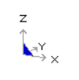
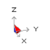

The orientation of the model is indicated by an orientation icon located at the bottom left corner of the display. This icon indicates the direction of the axes (X for East, Y for North and Z up).

In the view above, the Y-axis points mostly into the screen and a bit to the right, the X-axis points mostly to the right and a bit out of the screen, and the Z-axis points straight up. Note that the backside of the icon is shaded in blue.

In the view above, the Y-axis points mostly to the right and a bit into the screen, the X-axis points mostly out of the screen and a bit to the right, and the Z-axis points straight up. Note that the inside of the icon is shaded in red.

There are three selectable rotation models:

1. Rotations can be applied to the current geometry. This mode allows for a non-horizontal horizons

2. Rotations can be applied such that the horizon always remains horizontal assuming the Z+ axis is up (Tools > Global Transform Z+ up). This causes the mouse rotation to occur in the opposite way to Tools > Global Transform Z- up.

3. Rotations can be applied such that the horizon always remains horizontal assuming the Z- axis is up (Tools > Global Transform Z- up).

This causes the mouse rotation to occur in the opposite way to Tools > Global Transform Z+ up. The model can be rotated by holding down the left mouse button and wait for the drag mouse pointer

to appear, then drag the orientation icon around to the desired position. Dragging towards the top or bottom rotates the model up or down. Near the bottom of the screen, dragging towards the left or right rotates the model left or right. Near the top of the screen, dragging towards the left or right rotates the model counter clockwise or clockwise. This operation can be customized using Tools > Rotation Toolbar.

The model can also be rotated using touch screen controls by dragging either 1 or 2 fingers across the screen, and pinching for zoom. This operation can be customized using Tools > Rotation Toolbar.

Notes:

Before rotating the model, you should set the desired centre of rotation

#### View > Centre

You can adjust the drag wait time using

#### Tools > Drag Wait Time

Rotation and translation operations can be repeated automatically by typing n# before selecting the operation. For example to produce an animated display of a stress plot, specify

Plot > Options > Persist Plot > Stress > Sigma:1 View > Rotation Increment > 10 type in 35# from the keyboard

select rotate right (either from the rotation toolbar or the PageDown key)

Press the Esc key to cancel the animation.

Entering 0# will repeat the operation indefinitely. Press the escape key to stop.

Related Topics:

Translating the model Selecting special view positions

#### Index

#### - 0 -

001 002 ... files     510, 600

**- 3 -**

3D excavation shapes     27, 29, 30

#### - A -

Aborting a Map3D analysis     461 About Map3D     2 Absolute strain     223, 299 Absolute stress     209, 299 Accuracy     45, 308, 381, 462, 482 AG - grid spacing     45, 300, 301, 302, 308, 381, 462 AL - element size     45, 300, 301, 308, 381, 462 Alternate material zones     30

Analysis dialogue box     172, 308, 328, 381, 461, 462, 463, 464, 465, 489, 490

Analysis Options dialogue box     329, 465, 466, 467, 468, 469, 471, 473, 477, 478, 482, 484, 485, 486, 487, 489

Analysis results     164, 171, 172, 173, 186, 510, 524, 600

Analysis time     45, 308, 381, 462 Animation     184, 508 Applications of Map3D     11 As-built models     27 Automated discretization     45, 300, 301, 302, 308, 381, 462 Average value of contour points     317

#### - B -

Backfilling     30, 33, 477, 487 Batching analyses     466

BEM analysis     317, 390, 433, 461, 462, 465, 466, 467, 469, 471, 473, 477, 478, 482, 484, 485, 486, 487, 489, 490, 569, 594, 595, 597, 598

Bitmap dump of the screen     173, 174, 184, 185, 508 Block models     29, 30 BMP     173, 174, 184, 508 Boolean intersections     467 Boundary Element Method     12, 13, 477, 482, 487, 570

Build toolbar     331, 335, 341, 348, 358, 360, 362, 364, 365, 366, 367, 368, 369, 436, 494, 507 Building 3D FF blocks     331, 335, 341, 348, 364, 365, 366, 367, 368, 369, 390, 394, 395, 397, 398, 400, 402, 407, 408, 410, 412, 413, 415, 416, 418, 421, 423 Building construction lines     362, 364, 365, 366, 367, 368, 369, 498

Building DD planes     331, 335, 341, 348, 364, 365, 366, 367, 368, 369, 390, 394, 395, 397, 398, 400, 402, 407, 408, 410, 412, 413, 415, 416, 418, 421, 423

Building field point grid lines     358, 360 Building field point grid planes     358, 360, 364, 365, 366, 367, 368, 369, 494, 496

Building field point lines planes     364, 365, 366, 367, 368, 369

Building Tunnels     331, 335, 341, 348, 364, 365, 366, 367, 368, 369 Bulk mining - Model building tutorial     85

#### - C -

CAD     426, 427, 428, 429 CAD > Build     331, 335, 341, 348, 358, 360, 362, 364, 365, 366, 367, 368, 369 CAD > Build menu     494, 507

CAD > Edit     390, 394, 395, 397, 398, 400, 402, 407, 408, 410, 412, 413, 415, 416, 418, 421, 423 CAD > Edit menu     495, 496, 498 CAD > Properties     308, 317, 381, 390 CAD > Properties menu     313, 314, 386, 387 CAD > Propertiesu     313, 386 CAD > Snap     369, 370, 371, 372, 373, 376, 377, 378, 379

CAD > Snap menu     494 CAD menu     303, 425 CAD toolbar     436, 494, 507

Cartesian strain     221 Cartesian stress     208 Clearing construction line data     169 Clearing model data     165 Closure and overlap checking     467 Coefficient matrix     471, 484, 485, 487 Common problems when model Building     39 Conclude the current analysis     489, 490 Conducting a BEM stress analysis     462 Conducting a Map3D analysis     328 Configuring toolbars     196, 432, 433, 434, 435, 436 Console mode     466 Construction line data     169, 170, 171, 508, 510, 511 Contact and intersection analysis     464 Contour plot options     304 Contour range     302 Contouring toolbar     432, 433, 594, 595, 597, 598 Copying model data     397 Creep elasto-viscoplastic     469 Custom button font     439 Custom colours     437, 438, 439

**- D -**

DD plane thickness     496 DD planes     27, 35, 36 depth buffer     440, 441 Deswick     511 Digitizer support     426, 502 Discretization analysis     462, 484, 485, 569 Discretization and Lumping     45, 300, 301, 302, 308, 381, 462 Discretized view display of     600 Discretizing a model     462 Disk performance test     441 Disk space requirements     45, 308, 381, 462, 484, 485 Displacement components     224 Displacement discontinutity elements     27, 35, 36 Displacement toolbar     224 Display a saved screen image     184, 185, 508

Divergent solutions     45, 300, 301, 308, 381, 462 DOC - matrix lumping     45, 300, 301, 308, 381, 462 DOE - element lumping     45, 308, 381, 462 DOG - grid lumping     45, 308, 381, 462 DOL - solution accuracy     45, 300, 301, 302, 308, 381, 462 DON - matrix conditioning     45, 300, 301, 308, 381, 462 DOR - element aspect ratio     45, 308, 381, 462 Drag rotation of the model     431, 601 Drag translation of the model     431, 599 Drag zooming the model     431, 599 Drucker-Prager in 3D FF Blocks     232, 238, 240, 243, 246, 248, 251, 254, 256, 533 Dump analysis results     175, 180 Dump the screen image     173, 174, 175, 508 DXF construction line file format     510, 511 DXF dump of the screen     174 DXF model file format     511, 525 DXF screen image file format     174

**- E -** Edit toolbar     390, 394, 395, 397, 398, 400, 402, 407, 408, 410, 412, 413, 415, 416, 418, 421, 423, 436, 495, 496, 498, 499, 501 Editing model data     390, 430, 495, 496, 498, 499, 501 Effective stress     209 Elastic strain     222, 298 Elasto-viscoplastic creep     469 Element lumping     45, 300, 301, 308, 381, 462 Element size     45, 300, 301, 308, 381, 462 Energy release rate calculation     478 Erasing model data     394 ESS     200, 202, 203, 205 EVP files     443, 446 Excess stress     232, 238, 240, 243, 246, 248, 251, 254, 256, 259, 263, 265, 266, 268, 272, 276, 526, 531, 533, 535, 547, 556, 595 Expansion coefficient and conductivity     568 EXTENDED ENTITY DATA     511 Extruding planes into blocks     365

#### - F -

Failure criterion     232, 238, 240, 243, 246, 248, 251, 254, 256, 259, 263, 265, 266, 268, 272, 276, 526, 531, 533, 535, 547, 556, 595

Far field stress state specification     503, 505 Fault planes     36 Fault-Gouge in DD Planes     259, 263, 265, 266, 268, 272, 276, 535

Fictitious force elements     27, 29 File > Output menu     173, 174, 175, 180 File menu     164, 165, 166, 167, 168, 169, 170, 171, 172, 173, 184, 185, 186, 507, 508, 524, 525 Find a specified coordinate point in the model     195 Flow components     230 Flow rules     526, 535, 547, 556, 568 Flow toolbar     230 Fluid/thermal flow analysis     568 Freehand sketching - Model building tutorial     60

Hyperbolic-Backfill in DD Planes     259, 263, 265, 266, 268, 272, 276, 556

#### - I -

In situ stress state specification     503, 505 Inactive blocks     39 Induced strain     223, 299 Induced stress     209, 299 Initial stress state specification     503, 505 Initialize all viewing parameters     195 INP model file format     515, 525

In-plane     259, 263, 265, 266, 268, 272, 276 In-plane strain     213, 215, 216, 218 In-plane stress     200, 202, 203, 205 Interpretation of results     15, 23, 478 Intersection analysis     464, 467, 468, 485, 569 Introduction     2

#### - J -

#### - G -

GIF     173, 174, 184, 508

Going to graphics at the current analysis stage     463 Going to the model building and editing stage     463 Grid lumping     45, 300, 301, 302, 308, 381, 462 Grid selection     303, 425, 436

Grid spacing     45, 300, 301, 302, 308, 381, 462 Ground surface     35 Grouping model data     408

#### - H -

Help menu     456, 457

hidden surface removal     440, 441 Hide block colours toolbar     189, 190, 196, 435 Hide Cline Colours toolbar     190 Hide construction line colours toolbar     190, 196, 435 Hide toolbar     186, 196, 435 Hiding various parts of the model     186 Hoek-Brown in 3D FF Blocks     232, 238, 240, 243, 246, 248, 251, 254, 256, 531

JPEG     173, 174, 184 JPG     173, 174, 184

#### - L -

Leasing Map3D     2

Limitations and shortcomings     15

Loading a model from a file     164, 165, 167, 464, 507, 525

Loading analysis results from a recently file     186

Loading analysis results from a recently used directory 524

Loading analysis results from a restart file     164, 171 Loading construction line data from a file     169, 170 Loading model data from a recently used directory 524

Loading model data from a recently used file     186 Loading system stiffness calculation     478 Local energy release rate calculation     478 Lumping and discretization     45, 300, 301, 302, 308, 381, 462

#### - M -

Map3D     2, 9, 11, 12, 13, 569, 570 Map3D analysis options     329 Map3Di     314, 387, 453 Material codes     33 Material property specification     313, 386, 464, 503, 505, 526, 531, 533, 535, 547, 556, 568 Matrix conditioning     45, 300, 301, 308, 381, 462 Matrix lumping     45, 300, 301, 308, 381, 462 Matrix solution     465, 467, 486 Maximum shear strain     212 Maximum shear stress     199 Mean stress     207 Mean value of contour points     317 Menu Commands - Analysis dialogue box     172, 308, 381, 461, 462, 463, 464, 465, 489, 490 Menu Commands – Analysis dialogue box     328 Menu Commands - Analysis Options dialogue box 465, 466, 467, 468, 469, 471, 473, 477, 478, 482, 484, 485, 486, 487, 489 Menu Commands – Analysis Options dialogue box 329

Menu Commands - CAD     426, 427, 428, 429 Menu Commands - CAD > Build     331, 335, 341, 348, 358, 360, 362, 364, 365, 366, 367, 368, 369 Menu Commands - CAD > Build menu     494, 507 Menu Commands - CAD > Edit     390, 394, 395, 397, 398, 400, 402, 407, 408, 410, 412, 413, 415, 416, 418, 421, 423

Menu Commands - CAD > Edit menu     495, 496, 498 Menu Commands - CAD > Properties     308, 313, 314, 317, 381, 386, 387, 390 Menu Commands - CAD > Snap     369, 370, 371, 372, 373, 376, 377, 378, 379 Menu Commands - CAD > Snap menu     494 Menu Commands - CAD menu     303, 425 Menu Commands  File     169, 170 Menu Commands - File     164, 165, 166, 167, 168, 169, 171, 172, 173, 184, 185, 186 Menu Commands - File > Output     173, 174, 175, 180 Menu Commands - File menu     507, 524, 525 Menu Commands - Help menu     456, 457

Menu Commands - Plot     302 Menu Commands - Plot > Displacement     224 Menu Commands - Plot > Flow     230 Menu Commands - Plot > Miscellaneous     302 Menu Commands - Plot > Properties     308, 313, 317, 381, 386, 390

Menu Commands - Plot > Strain     210, 212, 213, 215, 216, 218, 220, 221, 222, 223, 226, 298, 299 Menu Commands - Plot > Strength Factors     232, 238, 240, 243, 246, 248, 251, 254, 256, 259, 263, 265, 266, 268, 272, 276

Menu Commands - Plot > Stress     198, 199, 200, 202, 203, 205, 207, 208, 209, 226, 299

Menu Commands - Plot > Surface Components     279, 280, 281, 282, 283, 284, 285, 286, 287, 292, 294, 295, 296, 297, 298, 300, 301

Menu Commands - Plot menu     594, 595, 597, 598 Menu Commands – Plot menu     304, 317 Menu Commands - Seismic     443, 446, 453, 456, 492 Menu Commands - Tools     196, 430, 431, 432, 433, 434, 435, 436, 437, 438, 439, 440, 441, 442 Menu Commands – Tools menuMenu Commands - ToolsTools menu     439

Menu Commands - View > Find Coordinate     195 Menu Commands - View > Hide     186 Menu Commands - View > Hide Block Colours     189, 190

Menu Commands - View > Hide Cline Colours     190 Menu Commands - View > Initialize     195 Menu Commands - View > Length     196, 435 Menu Commands - View > Pan     196, 435 Menu Commands - View > Render     192, 194, 600 Menu Commands - View > Zoom     196, 435 Menu Commands - View > Zoom Extents     195 Menu Commands - View menu     196, 197 Menu Commands -File menu     508 Merge adjacent surfaces     468 Merge coordinate points that are close to one another 467 Merging model data     507, 525 Mine design     23 Mining step selection     173 Mining step sequence     33

Model building     12, 27, 29, 30, 33, 35, 36, 39, 60, 85, 106, 314, 331, 335, 341, 348, 358, 360, 362, 387, 390, 394, 395, 397, 398, 400, 402, 407, 408, 410, 412, 413, 415, 416, 418, 421, 423, 426, 463, 467, 468, 485, 486, 494, 496, 498, 507, 525 Model data     164, 165, 166, 167, 168, 186, 314, 387, 464, 467, 486, 507, 509, 511, 515, 524, 525, 569 Model orientation icon     601 Mohr-Coulomb in 3D FF Blocks     232, 238, 240, 243, 246, 248, 251, 254, 256, 526 Mohr-Coulomb in DD Planes     259, 263, 265, 266, 268, 272, 276, 547 Moving field points that are very close to boundary surfaces     473 Moving model data     395, 412, 413, 415, 416, 418

#### - N -

Numerical Modelling     9, 11, 12, 13, 15, 23

#### - O -

OBJ dump of the screen     175 OBJ screen image file format     175 Octahedral shear strain     220 Octahedral shear stress     207 Open pits     36 OpenGL     440, 441 Ore zones     27, 29, 30 Overview of Map3D     9 Overview of model building     12

#### - P -

Parametric studies     15 PDF 3D  dump of the screen     175 PDF 3D screen image file format     175 Pick box size     442 Plastic strain     222, 298 Plot > Displacement     224 Plot > Flow     230 Plot > Miscellaneous     302 Plot > Properties     308, 313, 317, 381, 386, 390

Plot > Properties menu     313, 386

Plot > Strain     210, 212, 213, 215, 216, 218, 220, 221, 222, 223, 226, 298, 299 Plot > Strength Factors     232, 238, 240, 243, 246, 248, 251, 254, 256, 259, 263, 265, 266, 268, 272, 276 Plot > Stress     198, 199, 200, 202, 203, 205, 207, 208, 209, 226, 299 Plot > Surface Components     279, 280, 281, 282, 283, 284, 285, 286, 287, 292, 294, 295, 296, 297, 298, 300, 301 Plot menu     302, 303, 304, 317, 425, 594, 595, 597, 598 Plot options     304 Plotting surface components during analysis     461, 462 PNG     173, 174, 184, 508 PNT construction line file format     508, 510 PNT dump of analysis results     175, 180 PNT dump of the screen     175, 508 PNT model file format     509, 525 PNT screen image file format     175, 508 Poorly conditioned problems     45, 300, 301, 308, 381, 462 Principal strains     210 Principal stresses     198 Probability     232, 238, 240, 243, 248, 251, 256, 259, 263, 265, 266, 268, 272, 276 Problem size     45, 308, 381, 462

#### - R -

RAM for matrix storage     485, 487 Range for plotting contours     302 Recently used directories     524 Recently used files     186 Reliability of modelling predictions     15 Rendering the contours     304 Rendering the model     192, 194 Renumbering surfaces so the volume is positive     486 Reset all viewing parameters     195 Restart files     510, 600 Restarting an analysis     172 Restoring a previously saved view position and contour range     185

Rock mass response predictions     15, 23, 478 Subtracting analysis results     172 Rotating model data     400, 402 Support and sales     2 Rotating the model     197, 431, 601 Support placement     30, 33, 477, 487 Rotation Toobar     431 Surface Components toolbar     279, 280, 281, 282, Running multiple consecutive analyses     466 283, 284, 285, 286, 287, 292, 294, 296, 297, 298, 300, 301, 598 **- S -** Surface Components toolbarr     295 Surface models     27, 30 Suspending a Map3D analysis     489 Sales and support     2

Sales and support     2 Saving a model to a file     166 Saving a model to a new file name     166, 168 Saving construction line data to a file     171 Saving construction line data to a new file name     171 Saving model data     407 Saving the current view position and contour ranges 185 Scaling model data     398 Screen dump     173, 174, 175, 184, 185, 508 Seismic     443, 446, 453, 456, 492 Seismic menu     443, 446, 453, 456, 492 Seismic Moment     317 Smooth scrolling in the analysis dialogue box     442 Smoothing construction lines     421, 423 Snap toolbar     369, 370, 371, 372, 373, 376, 377, 378, 379, 436, 494, 502 Solution accuracy     45, 300, 301, 302, 308, 381, 462, 482

#### - T -

Tabular mining - Model building tutorial     106 Tabular mining zones     36 Terzaghis Observational Approach     15 Testing disk performance     441 Thermal/fluid flow analysis     568 Three-Dimensional excavation shapes     27, 29, 30 Toolbars     431, 433, 436, 594, 595, 597, 598 Tools menu     196, 430, 431, 432, 433, 434, 435, 436, 437, 438, 439, 440, 441, 442 Total strain     222, 298 Total stress     209 Translating and zooming the model     599 Translating the model     196, 431 Translation toolbar     431 Tutorial     60, 85, 106

Solve toolbar     433, 434 Special view positions     197 Steady state thermal/fluid flow analysis     568 Strain toolbar     210, 212, 213, 215, 216, 218, 220, 221, 222, 223, 226, 298, 299, 597 Strength criterion     232, 238, 240, 243, 246, 248, 251, 254, 256, 259, 263, 265, 266, 268, 272, 276, 526, 531, 533, 535, 547, 556, 595 Strength Factors toolbar     232, 238, 240, 243, 246, 248, 251, 254, 256, 259, 263, 265, 266, 268, 272, 276, 595

#### - U -

Ubiquitous-plane     259, 263, 265, 266, 268, 272, 276 Ubiquitous-plane strain     213, 215, 216, 218 Ubiquitous-plane stress     200, 202, 203, 205 Update results file     172 User defined button font     439 User defined colours     437, 438, 439 User defined contour plots     443, 446, 453, 456, 492 User defined dump of analysis results     175, 180 User defined plots     226 User defined points for stress calculation     473

Stress Orientation Icon     599 Stress toolbar     198, 199, 200, 202, 203, 205, 207, 208, 209, 226, 299, 594 Stretching model data     410 Subdivide non-planar quadrilaterials into triangles 485

#### - V -

View > Hide Block Colours  Menu     189, 190 View > Hide Cline Colours Menu     190 View > Hide Menu     186 View > Render Menu     192, 194, 600 View menu     195, 196, 197, 435 View toolbar     189, 190, 196, 435 Viewing grid planes     303, 425, 436 Viewing mining steps     173 VRML dump of the screen     175 VRML screen image file format     175

#### - W -

WRL dump of the screen     175 WRL screen image file format     175 [www.map3d.com/how_to_buy](https://www.map3d.com/how_to_buy)     2

#### - Z -

z-buffering     440, 441 Zoom so that all entities are visible     195 Zooming the model     197, 431
