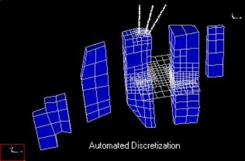
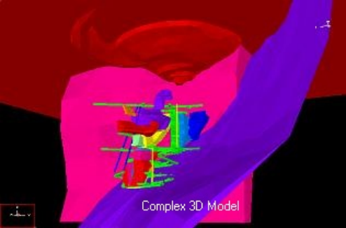
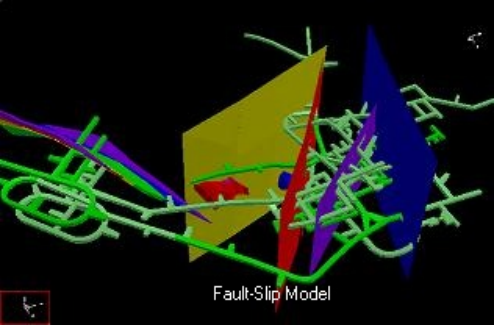
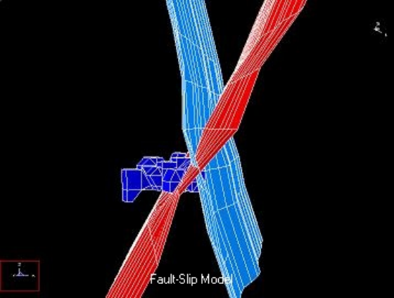
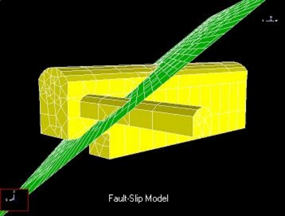

**Map3D Fault-Slip** - elastic rock mass and fully plastic fault-slip stress analysis.

This module is used for conducting stress analysis of 3D models. This software is used for civil, geological and mining projects.

Includes the 3D CAD modeller (Map3D Modeller), results viewer (Map3D Results Viewer) and the GIS visual database.

The stress analysis utilizes the BEM (boundary element method) and has many features:

- Very large problem sizes. Map3D can conduct stress analysis on models with thousands of excavations (over one million degrees of freedom). This allows for detailed representation of the geometry and eliminates the need to simplify large models (over simplification is a primary source of error in modelling). Mine widemodels can by readily simulated.

- Full 3D complex excavation shapes. As-built detailed models and complex 3D shapes can readily be analyzed. Since the stress analysis is based on the boundary element method (BEM), only the surfaces of the excavations (and other features) needs to be specified. There is no need for definition (subdivision into elements) of the pillars between adjacent excavations. Any arbitrary shapes are readily combined into a single large model ready for analysis.

- Multiple elastic zones with different moduli (stiff dykes or soft ore). Map3D is fully capable of incorporating alternate material zones. This makes consideration of stiff or soft rock types easy to consider.

- Zones with different pre-mining stress states.

- Tabular mining with yielding pillars. This approximation is often appropriate for large narrow vein mines.

- Discrete non-planar fault planes that slip and dilate elasto-visco-plastically (including creep). These features are implemented using the displacement discontinuity method. Elasto-visco-plastic flow rules are implemented to accommodate a variety of different types of behaviour. Fault slip analysis for both mining as well as earthquake simulation is readily accommodated.

- Cracks and fractures can be simulated including energy release rate and stress intensity calculations. Fracture propagation can be simulated as a series of discrete steps.

- Multiple mining steps are required to consider effects such as backfill placement or crack propagation. Map3D currently allows for 40 steps. Various materials can be substituted into excavations or fractures at any stage.

- Automatic Boolean intersections allows for excavations, faults and fractures to cross and overlap. Without this capability, modelling of intersecting features would be practically impossible for complex models. Map3D handles these situations with ease.

- Automated discretization. Models can be manually discretized if desired, or this can be left to the automated routines built into the program. These routines ensure that elements are concentrated only where needed providing consistently high accuracy while optimizing for analysis time.

A demonstration version of Map3D Fault-Slip is available at no charge. All features are available except the user is only permitted to run small size problems. This version is extremely useful for teaching the fundamentals of modelling, visualization and 3D CAD.

Map3Di Integrated Seismicity
