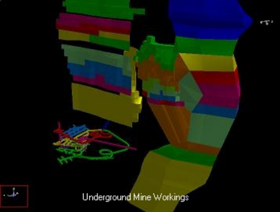
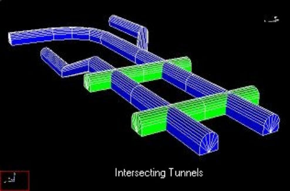
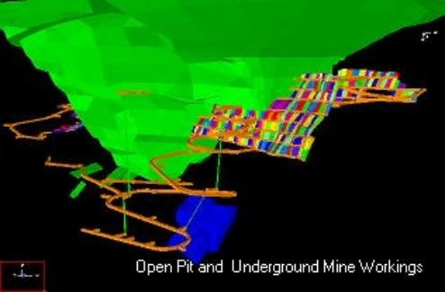
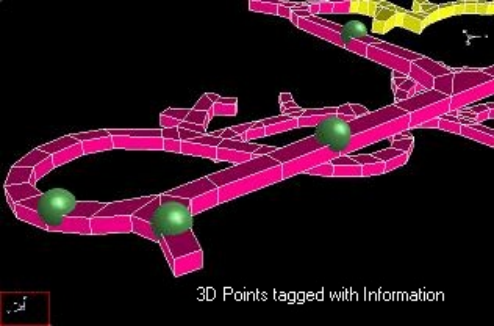
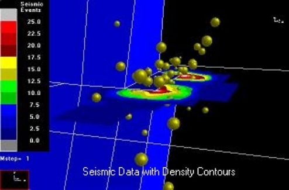

**Map3D Modeller** - 3D CAD and GIS visual database.

This module is used for constructing and visualizing 3D models. This software is used for civil, geological and mining projects.

Easy to use 3D CAD (OpenGL based) system includes free-hand sketching, digitizing or object picking to build and edit 5 basic entity types:

- 3D blocks. These entities are used to construct stopes, ore zones, dykes and tunnels. Construction is most easily approached by defining a series of cross-sections or level

plans (each can have a different shape and different number of points). Map3D can readily simplify these if desired and then interpolate between the loops to form complex 3D shapes.

- 2D features. These entities are used to construct faults, tabular mining, ground topography and fractures. These features need not be planar. Curved and offset fractures and faults are fully supported.

- Grid planes. Cross-sections can be defined for contouring or simply slicing the model.

- · Grid lines. These are particularly useful for representing the location of bore holes and ground support. Instrument locations and orientations are easily identified.

- Construction lines. Simple survey data such as drift centre lines are most easily represented using construction lines. This allows for easy import/export to other CAD packages (full dxf and pnt capability) as well a quick way of displaying line data.

- Light source shaded models. OpenGL light source shading is supported for enhanced model representation.

Includes a full suite of editing functions including copy, move, stretch, flatten, scale, rotate and more. This allows for easy graphical manipulation of the above entities.

The GIS visual database can be used store, analyze and display a database of any desired information including seismic data and geologic information such as grade, rock mass quality etc.

3D points can be tagged with a series of:

- numeric values (e.g. colour, magnitude, orientation, time etc.),

- keywords (for filtering),

- text messages,

- file names (e.g. graphics files, documents, spreadsheets, drawings etc.).

Display of these items can be filtered in various ways. The location of each point can be displayed as colour shaded spheres with size and colour scaled according to various combinations of parameters. Point magnitude density can be contoured on a plane according to user defined density functions. Contour planes can be user defined of fitted using automated linear-regression.

Map3D Results Viewer
