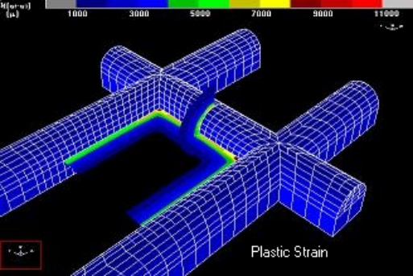
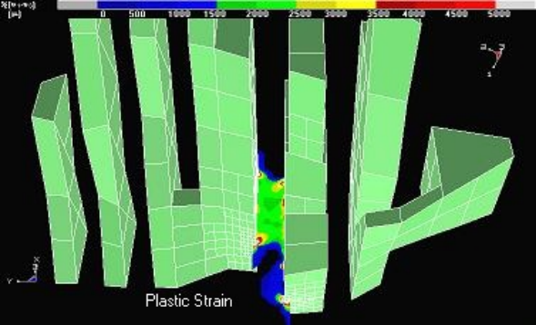
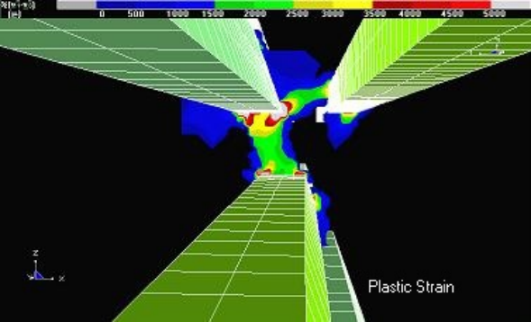
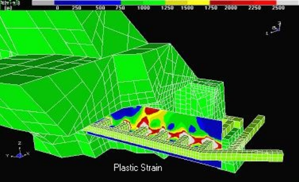

**Map3D Non-Linear** - non-linear rock mass response.

Includes all capabilities from Map3D Fault-Slip and adds the capability for the 3D rock mass to yield to loads that exceed the rock strength, and deform non-linearly to dissipate the excess stresses. This feature is useful for simulation of thick seams, over-stressed pillars, abutments, backfill and creep response. This formulation solves the non-linear problem on the surface of the boundary elements and interpolates these effects between these boundaries. This represents a first approximation to inelastic modelling that boasts the advantage of large problem sizes and very fast execution speeds.

Map3D Visco-Plastic
