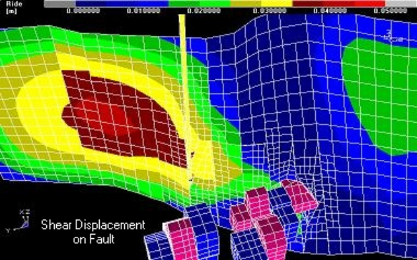
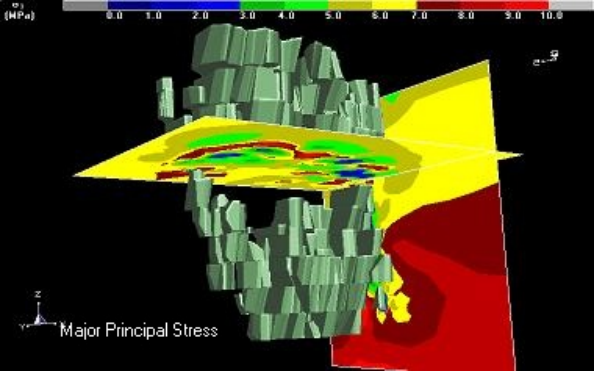
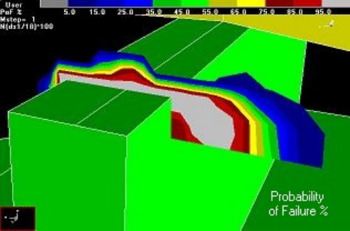
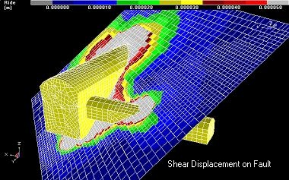
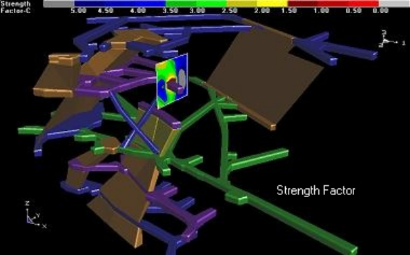

**Map3D Results Viewer** - viewing and analysis of stress analysis results.

Includes the GIS visual database but not the CAD system.

- views stress analysis results generated by Map3D stress analysis codes

- displays contours on cutting planes, along lines and at specific points

- user defined contouring functions

- direct export to Excel for plotting x-y graphs

- display of 3D trajectories

- display of all stress, strain, displacement and strength parameters including principal components and resultant values on user defined planes and lines

- export in dxf and pnt format for compatibility with other CAD and display systems

- probability of failure contours

- safety factor contours

- light source shaded models

- topographical contours

**Map3D Fault-Slip**
