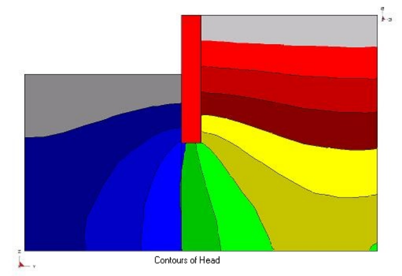
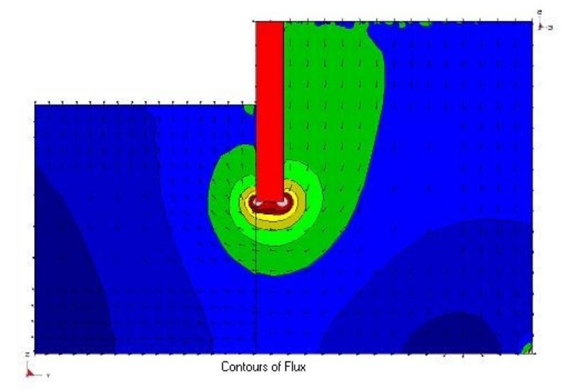

**Map3D Thermal-Fluid Flow** - thermal stress - fluid flow analysis.

Includes all capabilities from Map3D Fault-Slip and adds simultaneous solution of steady state thermal stress - fluid flow. The program is set up so that the user need only specify the temperature/head boundary conditions, then the thermal stress problem is solved simultaneously. This feature is useful for simulation of heating/cooling effects and drained/undrained response.

Map3D Non-Linear
