**Map3D Visco-Plastic** - 3D elasto-visco-plastic rock mass response (still under development - not available commercially at this time).

Includes all capabilities from Map3D Fault-Slip and adds the capability for the 3D rock mass to behave elasto-visco-plastically. This model features a full solution of the non-associated incremental plasticity equations and adds the capability for the 3D rock mass to yield to loads that exceed the rock strength, and deform non-linearly to dissipate the excess stresses. This simulation capability provides the large displacements required to simulate ground support and backfill interaction studies. This feature is useful for simulation of thick seams, over-stressed pillars, abutments, backfill and creep response. This formulation solves the non-linear problem throughout specified zones in the rock mass.

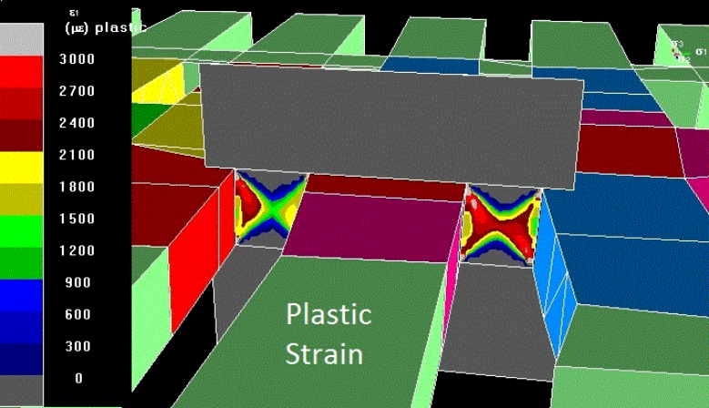

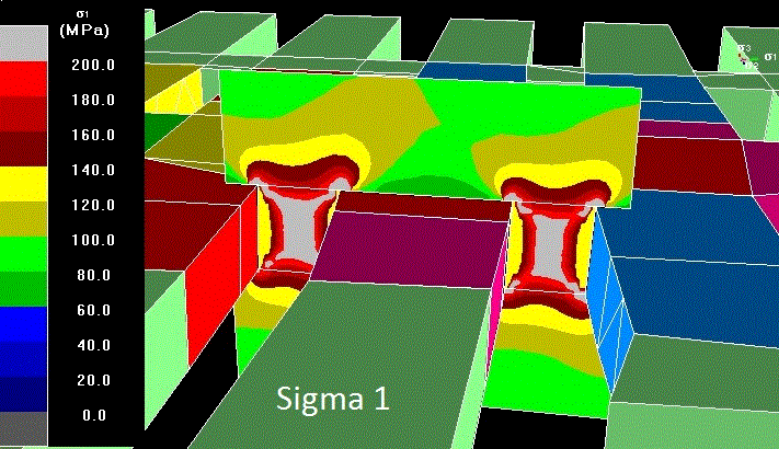

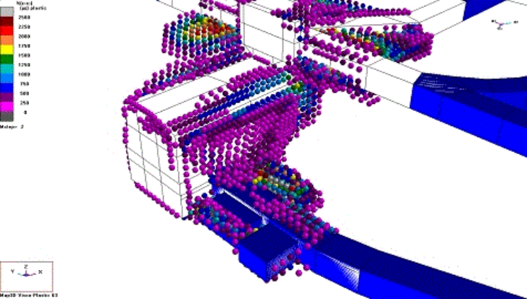

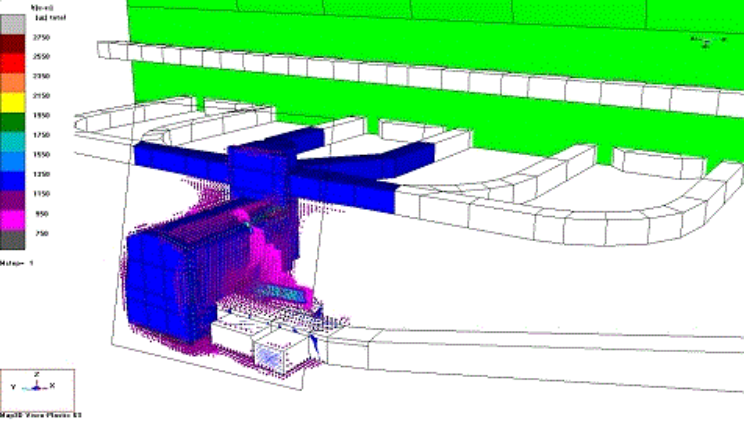

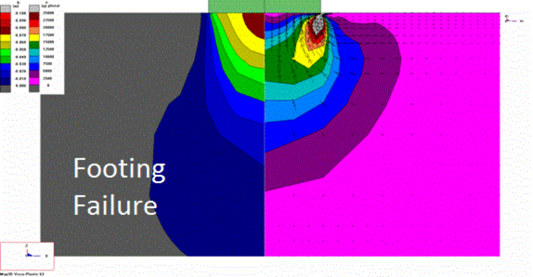

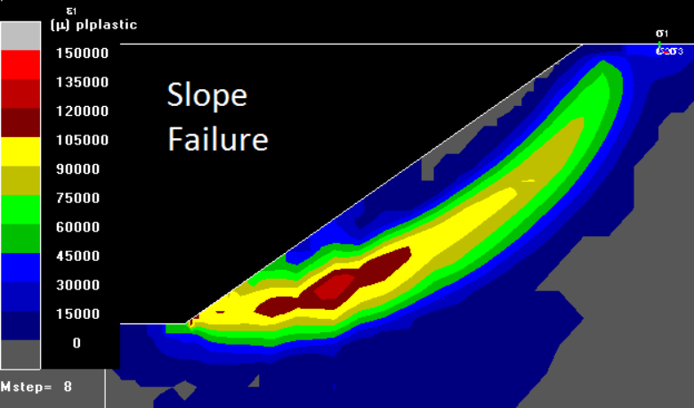

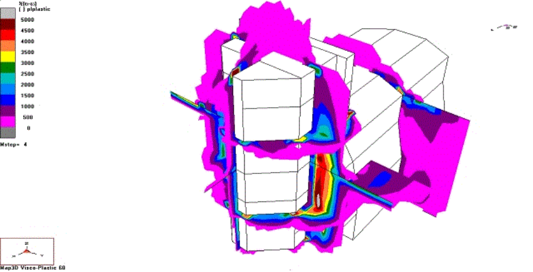

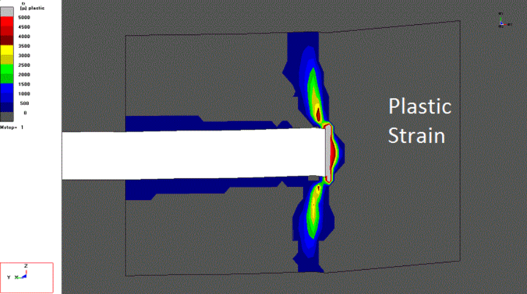

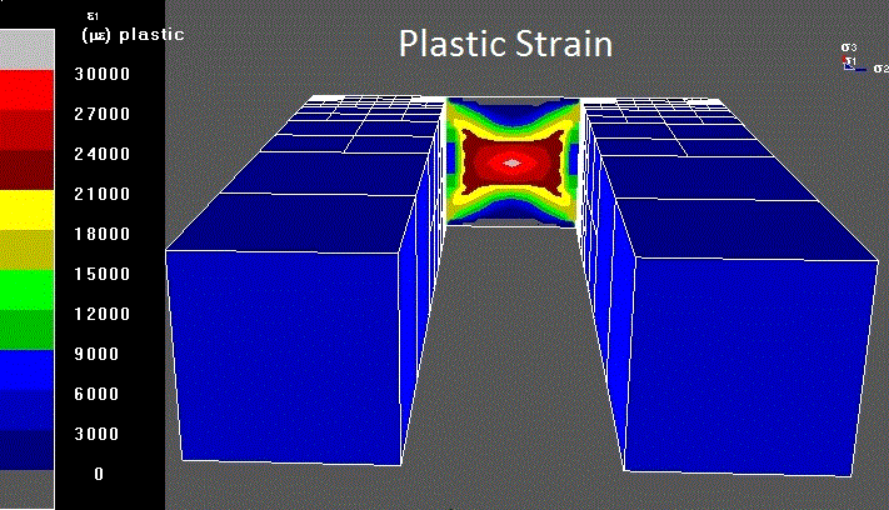

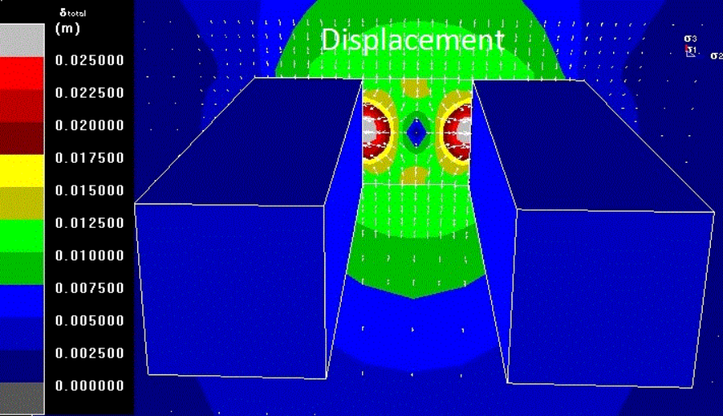

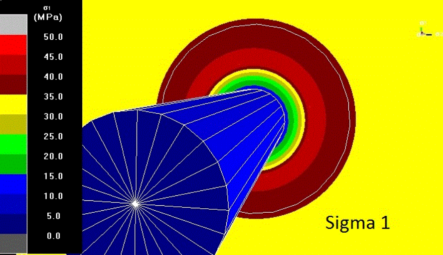

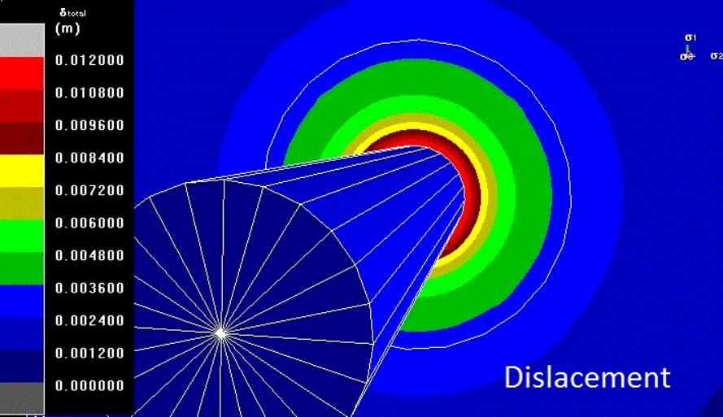

Map3D Overview
