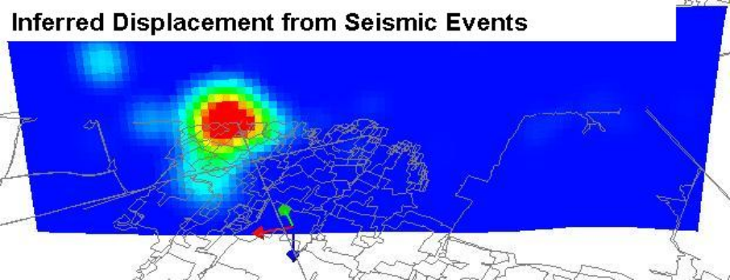
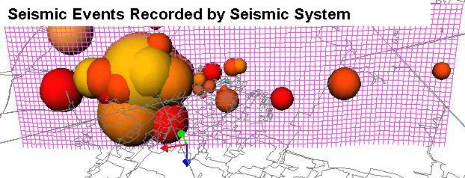
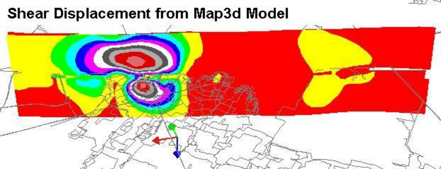

**Map3Di Integrated Seismicity** - superimpose external field loading effects into the stress analysis.

Includes all capabilities from Map3D Fault-Slip and adds field loading effects. The field loading effects can be imported from any database of thermal heating, fluid pressure, non-linear behaviour and deformations indicated by seismicity. These effects can be used to characterize 2D and 3D geologic features, accommodate changing lithology and incorporate seismic loading effects into the stress analysis.

Numerical modelling allows one to predict the rock mass response as a result of advancing mining excavations. While the effect of geologic features such as faults or changing lithology can be readily incorporated into the model, often the location, orientation and behavioural

properties of such features is uncertain. This can result in modelling results of low reliability and hence of limited use to mine operators. Map3Di allows one to superimpose external field loading effects into the Map3D model. The field loading can come from thermal heating, fluid pressure, non-linear behaviour, etc. In addition, these can be determined from many forms of in situ monitoring including for example fluid pressures (e.g. well drawdown, dams, hydrofracturing), heating (e.g. natural heating, nuclear waste storage), and deformations (e.g. monitored with extensometers).

Another important source of in situ field loading information comes from seismic activity. By definition, the presence of seismicity indicates that the rock mass is yielding to load and hence deforming in some way. The seismicity could indicate shearing on a fault plane or 3D material non-linearity possibly resulting due to a weak lithological feature. Map3Di allows you to superimpose the deformations indicated by the seismicity onto your Map3D mine model. For example, if your seismicity is telling you that you are getting shearing at some location, then this can be enforced in the model, thereby redistributing the stresses to accommodate this effect.

The concept behind Map3Di is to superimpose some known field loading along with regular modelling features (pre-mining stress, model geometry, dykes, faults, etc.) to provide a composite prediction of the stresses, strain and displacements throughout the rock mass. The integration of numerical modelling with seismic monitoring through the Map3Di boundary element method allows one to superimpose the deformations indicated by the seismicity into your numerical model. This effectively characterizes geologic features and accommodates the effect these have on rock mass response.

The field loading information boils down to specification of: ride and dilation on a segment of a slip plane, and/or deformation of a 3D zone. But where does such information come from:

- Suppose you measure the temperature distribution throughout your mine and you want to apply this field loading to a Map3Di model. This would be applied by subdividing the whole rock mass up into small 3D zones then specifying the temperature in each zone. You would then need to calculate the "free thermal expansion" for each zone. You then simply tell Map3Di to use this field loading. Map3Di conducts the necessary calculations to determine the stress contribution of the integrated field loading.

- Suppose you inject some heavy grout into a fracture, then after this sets, drill some holes to determine the amount of dilation you caused in the fracture, and you want to apply this field loading to a Map3Di model. This would be applied by subdividing the fracture into small planar zones then specifying the dilation in each zone. You then simply tell Map3Di to use this field loading. Map3Di conducts the necessary calculations to determine the stress contribution of the integrated field loading.

- Suppose from your seismicity you determine that portions of your rock mass are deforming and other parts are not. This would be applied by subdividing the whole rock mass up into small 3D zones then calculating the deformation in each zone. You then simply tell Map3Di to use this field loading. Map3Di conducts the necessary calculations to determine the stress contribution of the integrated field loading.

Note that the Map3Di model can contain all of the regular features including excavations, stiff dykes, faults etc. The effects of the field loading and all of these other features will be superimposed to provide a final composite prediction of the stresses, strains and displacements throughout the rock mass.

How does Map3Di assist us in overcoming the shortcomings in applying Terzaghi’s Observational Approach to Design? There are many possible benefits from adopting this approach:

- First let’s recognize that we intend to apply known field loading conditions measured from field data (seismicity, temperature, fluid pressures or deformations). This in itself can be considered to be a calibration or fine-tuning exercise, as opposed to making a prediction. We are literally adding information to our model.

- The wealth of information that comes from seismic monitoring is enormous. Seismic monitoring provides the volume and spatial distribution of information on the rock mass response that can be obtained in no other way at reasonable cost. Map3Di provides a mechanism to directly use this information for model calibration. Owing to the real-time nature of seismicity, it becomes practical to traverse the mine/monitor/redesign loop for every increment of mining. Thus instead of spending years making visual observations to develop a history of rock mass response, there is potential to calibrate your model much more quickly.

- Perhaps the most important part of this is that it provides the possibility of adapting to changing rock mass conditions in real-time. This allows one to recognize and adapt to rapidly changing local conditions such as lithology or jointing. You can update your model calibration as conditions change. This has the potential to significantly improve the reliability of predictions.

- Finally, by incorporating for example some fault slip indicated by seismicity, you have in fact characterized the effect of that fault slip and incorporated its effect into your model. For example, if your seismicity is telling you that you are getting shearing at some location, then this can be enforced in the model, thereby redistributing the stresses to accommodate this exact effect.

Map3D Thermal-Fluid Flow
