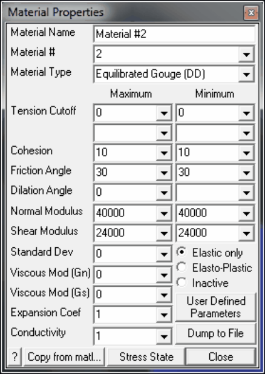
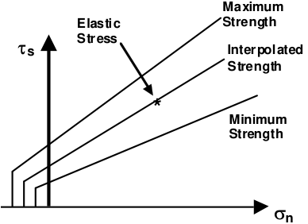
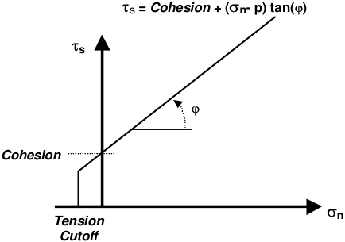
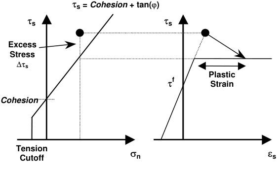
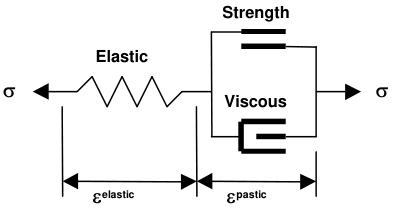

Equilibrated-Gouge material can be used to describe non-linear response in DD planes in both Map3D Fault-Slip and Map3D Non-Linear.

This material is similar to the Fault-Gouge material type but automatically adjusts the strength parameters to place the gouge into critical equilibrium at the first mining step.

At step 1 of the stress analysis, the elastic stresses are calculated at all locations on the DD fault plane. From this information, the required strength parameters (Cohesion and friction angle) are determined by interpolation such that every location is exactly at the point of failure.

This is done by linearly interpolating between the specified minimum and maximum strength values. If the elastic stress falls below the minimum, the minimum is used. If the elastic stress falls above the maximum, the maximum is used.

The interpolated strength values are then used for all subsequent mining steps.

This can be considered to be the worst case scenario where any mining induced stress change has the potential to case slip on the fault.

#### Equilibrated-Gouge in DD planes

Material Name - specifies a descriptive name for the material.

Material # - specifies the material number.

- Material #1 is reserved for the host material.

- Other material numbers are used to define alternate material zones such as ore, fault gouge, backfill etc.

Material Type - specifies the material type (Mohr-Coulomb, Hoek-Brown, Drucker-Prager, Fault-Gouge, Hyperbolic-Backfill, Quadratic-Backfill, Equilibrated-Gouge, Yielding-Pillar or none).

- Fault-Gouge - defines the failure envelope as a straight line in the same as Mohr-Coulomb in DD planes but without _UCS_ .

- Strength is defined in terms of in-plane shear and normal stresses as follows:

#### Fault-Gouge in DD planes

- Tension Cutoff and Cohesion are specified in units of stress (MPa or psi).

- Friction angle and dilation angle are specified in degrees.

- Cohesion and friction angle define the shear response.

- The tension cutoff defines the response in the direction normal to the shear plane.

- Maximum values specify the maximum allowable interpolated strength.

- Min values specify the minimum allowable interpolated strength.

- If fluid pressure is specified as part of the Stress State, the effective normal stress (sn-p) is used (here p is the fluid pressure).

Normal and Shear Modulus - specify moduli in units of stress (MPa or psi).

- In DD planes the shear and normal stresses acting on the surfaces of the element are related to the elastic portion of the shear displacement (ride) and normal displacement (closure) through the shear and normal moduli.

- Peak values of these parameters are used up until failure.

- After yielding, the residual values are used.

Standard Deviation - specify standard deviation in units of stress (MPa or psi).

- This parameter describes the uncertainty you have in the strength parameters.

- This parameter is only used for plotting the probability of shear failure Plot > Strength Factors > InPlane Probability N-distribution.

Viscous Modulus ( _Gn_ and _Gs_ ) - These parameters are used only in non-linear analyzes (3D FF blocks in Map3D Non-Linear and DD planes in Map3D Fault-Slip).

- The viscous modulus describes the creep response. where the creep resistance is determined as the creep coefficient _C_ , times the plastic strain rate.

- Note that the user must select both the creep coefficient _C_ , and the time step size D _t_ , then specify the quotient of these as the viscous modulus _G_ .

- Specify the viscous modulus in units of stress (MPa or psi).

Expansion Coefficient and Conductivity are only used in Map3D Thermal-Fluid Flow. · Map3D Thermal-Fluid Flow can be used to simultaneously solve steady state heat/fluid flow coupled to the stress analysis.

Elastic only - when checked this material will respond elastically only, i.e. strength parameters will not be used.

- This can be used to define zones with different elastic properties and/or initial stress states. This could include for example stiff dykes, soft ore zones, backfill or support elements.

Elasto-Plastic - when checked this material will respond elasto-visco-plastically, i.e. the strength parameters will be used as a flow rule.

- This can be used to define zones with both different elastic properties and strength parameters.

- Note that in Map3D Fault-Slip, only DD elements (i.e. fault gouge) are permitted to respond non- linearly.

- In Map3D Non-Linear the 3D rock mass can also yield plastically.

Inactive - when checked this material will not be used in the stress analysis and hence will not affect the predicted stresses, strains or displacements.

- This can be used to define zones with different strength parameters to be used when generating contours of strength factors.

User Defined - allows specification of user defined parameters to be used in contouring.

- Different parameters are defined for each material number.

#### Plot > Stress > User

   - These parameters are used with

- This can be used to define zones with different strength parameters to be used when generating contours of strength factors.

Dump to File - allows you to dump all material property data to a file for viewing in Notepad or Excel.

Copy from material allows you to copy the material properties from one material number to another. All properties including the stress state are copied.

Stress State - specifies the initial (far field) stress state for the material.

- Most materials are inserted into blocks with the same (far field) stress state.

#### · Materials such as props or backfill are placed at near zero initial stresses.

In elastic analysis the shear and normal stresses in the plane of weakness (on a fault, joint set or bedding plane) are normally used with the Mohr-Coulomb strength criterion to estimate the amount of damage due to over-stressing. One can expect that more excess stress in an elastic analysis would in general correlate with increased amounts of plastic strain (slip) in a non-linear analysis. Since these parameters are orientation dependant, this criterion is representative for anisotropic rock mass stability.

**Fault-Gouge in DD planes**

Over-stressing can be presented in several ways including:

Plot > Strength Factors > dTip In-Plane excess shear stress

Plot > Strength Factors > dTub Ubiquitous-plane excess shear stress

Plot > Strength Factors > SF-ip Strength/Stress

Plot > Strength Factors > SF-ub Strength/Stress

By contrast, in non-linear analysis the stresses can never exceed the strength unless some creep is used (in this latter case, viscous creep can allow stress states above the failure criterion, thus indicating a lack of static equilibrium). Hence for non-linear analysis one normally directly considers the plastic strain or the plastic strain rate predicted by the model as an indicator of damage.

In DD planes, the elastic strains are determined from the stresses by

ts = tf + _Shear Modulus_ eselastic

sn = sf + _Normal Modulus_ enelastic

where _Shear Modulus_ and _Normal Modulus_ represent respectively the elastic moduli of the gouge material in the shear and normal directions, and tf and sf represent the initial stress state in the shear and normal directions, and

eselastic =  dselastic / _Thickness_

enelastic =  dnelastic / _Thickness_

where dselastic and dnelastic represent respectively the elastic component of the shear displacement (ride) and normal displacement (closure) and _Thickness_ represents the DD plane thickness (i.e. fault gouge, seam width, mining width or pillar height). The DD plane thickness is set using

#### CAD > Build > DDLoop

and can be modified using

#### CAD > Edit > Entity Properties

In DD elements, if the shear stress goes above the strength, the plastic strain can be determined by limiting the stress

ts - ts° - _C_ Desplastic /D _t_ = _Cohesion_ + tan(j) ( sn - sn° - _C_ Denplastic /D _t_ )

where

ts° = _Shear Modulus_ esplastic

sn° = _Normal Modulus_ enplastic

The accumulated plastic strain eplastic, is determined as the sum of the plastic creep increments Deplastic, for all creep steps.

If the normal stress goes below the tension cutoff, the plastic strain can be determined by limiting the stress

sn - sn° - _C_ Denplastic /D _t_ = _To_

In the case of shear failure, the plastic normal strain can also have a dilation component

enplastic = tan( _dilation angle_ ) esplastic

The total strain is equal to the sum of the elastic and plastic parts.

The creep response is simulated using a linear (Bingham) creep model.

At each creep step the stress state on all yielding elements (elements where the stress exceeds the strength) is calculated as the strength plus the creep resistance

_Strength_ + _C_ Denplastic /D _t_

_C_ = _G_ D _t_

where the creep resistance is determined as the creep coefficient _C_ , times the plastic strain rate. Note that the user must select both the creep coefficient _C_ , and the time step size D _t_ , then specify the quotient of these as the viscous modulus _G_ . The creep resistance can be used simply as a technique for damping the non-linear deformations or for real time dependent creep simulation

#### Analysis > Options > Creep

The strains, shear displacement (ride) and normal displacement (closure) can be presented in several ways including:

#### Plot > Surface > Value > Elastic

**546 Map3D User's Manual - Version 72** Plot > Surface > Value > Plastic Plot > Surface > Value > Total Plot > Strain > E1 - Major principal strain Plot > Surface > Es Shear Strain Plot > Surface > En Normal Strain Plot > Surface > ds Shear Displacement (Ride) Plot > Surface > dn Normal Displacement (Closure)

Also of interest is the plastic creep increment Deplastic, the contribution to the shear resistance from the viscous element

Dts   = _C_ Desplastic /D _t_ Plot > Surface > dEs Incremental Shear Strain Plot > Surface > dTs Excess Shear Stress Related Topics: Mohr-Coulomb in DD planes Backfill-Hyperbolic in DD planes
