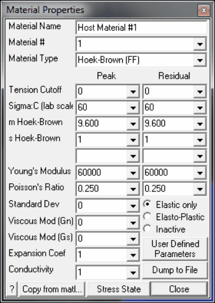
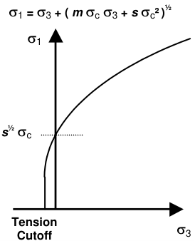

Hoek-Brown material can only be used as a failure criterion for elastic analyzes in Map3D Fault-Slip.

Material Name - specifies a descriptive name for the material.

Material # - specifies the material number.

- Material #1 is reserved for the host material.

- Other material numbers are used to define alternate material zones such as ore, fault gouge, backfill etc.

Material Type - specifies the material type (Mohr-Coulomb, Hoek-Brown, Drucker-Prager, Fault-Gouge, Hyperbolic-Backfill, Quadratic-Backfill, Equilibrated-Gouge, Yielding-Pillar or none).

- Hoek-Brown - defines the failure envelope as a curved line.

- For 3D FF blocks the Hoek-Brown criterion defines strength in terms of principal stresses as follows:

**Hoek-Brown in 3D FF blocks**

- Tension cutoff and sc are specified in units of stress (MPa or psi).

- Only the peak values are used.

Young's Modulus and Poisson's Ratio - specify Young's (rock mass scale - deformation) Modulus in units of stress (MPa or psi).

- Only the peak values are used.

Standard Deviation - specify standard deviation in units of stress (MPa or psi).

- This parameter describes the uncertainty you have in the strength parameters.

- This parameter is only used for plotting the probability of shear failure Plot > Strength Factors > Rockmass Probability N-distribution.

Viscous Modulus ( _Gn_ and _Gs_ ) - These parameters are not used for the Hoek-Brown material.

Expansion Coefficient and Conductivity are only used in Map3D Thermal-Fluid Flow. Map3D Thermal- Fluid Flow can be used to simultaneously solve steady state heat/fluid flow coupled to the stress analysis.

Elastic only - when checked this material will respond elastically only, i.e. strength parameters will not be used.

- This can be used to define zones with different elastic properties and/or initial stress states. This could include for example stiff dykes, soft ore zones, backfill or support elements.

Elasto-Plastic - when checked this material will respond elasto-visco-plastically, i.e. the strength parameters will be used as a flow rule.

- This can be used to define zones with both different elastic properties and strength parameters.

- Note that in Map3D Fault-Slip, only DD elements (i.e. fault gouge) are permitted to respond non- linearly.

- In Map3D Non-Linear the 3D rock mass can also yield plastically.

- Yielding of Hoek-Brown materials is not supported at this time.

Inactive - when checked this material will not be used in the stress analysis and hence will not affect the predicted stresses, strains or displacements.

- This can be used to define zones with different strength parameters to be used when generating contours of strength factors.

User Defined - allows specification of user defined parameters to be used in contouring.

- Different parameters are defined for each material number.

      - Plot > Stress > User

   - These parameters are used with

- This can be used to define zones with different strength parameters to be used when generating contours of strength factors.

Dump to File - allows you to dump all material property data to a file for viewing in Notepad or Excel.

Copy from material - allows you to copy the material properties from one material number to another. All properties including the stress state are copied.

Stress State - specifies the initial (far field) stress state for the material.

- Most materials are inserted into blocks with the same (far field) stress state.

- Materials such as props or backfill are placed at near zero initial stresses.

Related Topics:

Mohr_Coulomb in 3D FF blocks

Drucker-Prager in 3D FF blocks
