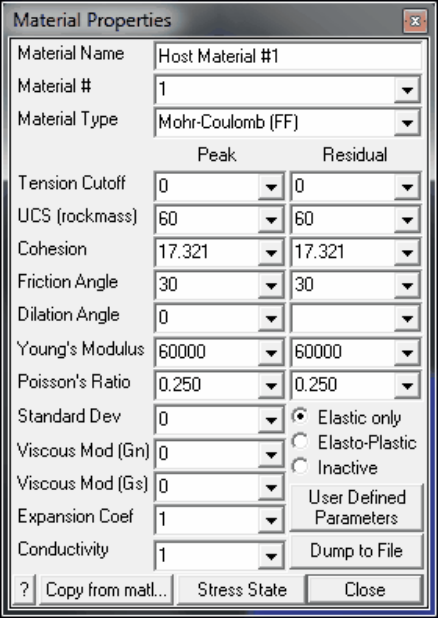
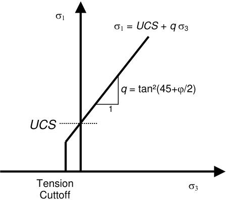
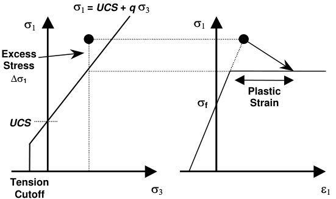
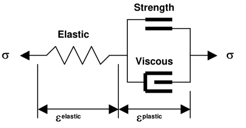

Mohr-Coulomb material can be used to describe non-linear response in 3D FF blocks in Map3D NonLinear. It can also be used as a failure criterion for elastic analyzes in Map3D Fault-Slip.

Material Name - specifies a descriptive name for the material.

Material # - specifies the material number.

- Material #1 is reserved for the host material.

- Other material numbers are used to define alternate material zones such as ore, fault gouge, backfill, softened materials etc.

Material Type - specifies the material type (Mohr-Coulomb, Hoek-Brown, Drucker-Prager, Fault-Gouge, Equilibrated-Gouge, Yielding-Pillar, Hyperbolic-Backfill, Quadratic-Backfill, Softened-Material or none).

- Mohr-Coulomb - defines the failure envelope as a straight line.

- For 3D FF blocks the Mohr-Coulomb criterion defines strength in terms of principal stresses as follows:

#### Mohr-Coulomb in 3D FF blocks

- Tension cutoff and _UCS_ - are specified in units of stress (MPa or psi).

- Friction angle and dilation angle are specified in degrees.

- Cohesion is related to _UCS_ and friction angle by the relationship _UCS_ =2 _Coh_ tan(45+j/2). If Cohesion is specified then _UCS_ is determined from this relation.

- Peak values of these parameters are used up until failure. After yielding, the residual values are used to provide a strain softening response.

- Residual values are ignored in elastic analyzes.

Young's Modulus and Poisson's Ratio - specify Young's (rock mass scale - deformation) Modulus in units of stress (MPa or psi).

- Peak values of these parameters are used up until failure.

- After yielding, the residual values are used. Residual values are ignored in elastic analyzes.

Standard Deviation - specify standard deviation in units of stress (MPa or psi).

- This parameter describes the uncertainty you have in the strength parameters.

- This parameter is only used for plotting the probability of shear failure Plot > Strength Factors > Rockmass Probability N-distribution.

Viscous Modulus ( _Gn_ and _Gs_ ) - These parameters are used only in non-linear analyzes (3D FF blocks in Map3D Non-Linear and DD planes in Map3D Fault-Slip). For 3D FF blocks only _Gs_ is used.

- The viscous modulus describes the creep response. where the creep resistance is determined as the creep coefficient _C_ , times the plastic strain rate. Note that the user must select both the creep coefficient _C_ , and the time step size D _t_ , then specify the quotient of these as the viscous modulus _G_ .

- Specify the viscous modulus in units of stress (MPa or psi).

Expansion Coefficient and Conductivity are only used in Map3D Thermal-Fluid Flow.

- Map3D Thermal-Fluid Flow can be used to simultaneously solve steady state heat/fluid flow coupled to the stress analysis.

Elastic only - when checked this material will respond elastically only, i.e. strength parameters will not be used.

- This can be used to define zones with different elastic properties and/or initial stress states. This could include for example stiff dykes, soft ore zones, backfill or support elements.

Elasto-Plastic - when checked this material will respond elasto-visco-plastically, i.e. the strength parameters will be used as a flow rule.

- This can be used to define zones with both different elastic properties and strength parameters.

- Note that in Map3D Fault-Slip, only DD elements (i.e. fault gouge) are permitted to respond non- linearly.

- In Map3D Non-Linear the 3D rock mass can also yield plastically.

Inactive - when checked this material will not be used in the stress analysis and hence will not affect the predicted stresses, strains or displacements.

- This can be used to define zones with different strength parameters to be used when generating contours of strength factors.

User Defined - allows specification of user defined parameters to be used in contouring.

- Different parameters are defined for each material number.

   - Plot > Stress > User

- These parameters are used with

- This can be used to define zones with different strength parameters to be used when generating contours of strength factors.

Dump to File - allows you to dump all material property data to a file for viewing in Notepad or Excel.

Copy from material - allows you to copy the material properties from one material number to another. All properties including the stress state are copied.

Stress State - specifies the initial (far field) stress state for the material.

- Most materials are inserted into blocks with the same (far field) stress state.

- Materials such as props or backfill are placed at near zero initial stresses.

In elastic analysis the principal stresses are normally used with the Mohr-Coulomb or Hoek-Brown strength criterion to estimate the amount of damage due to over-stressing. One can expect that more excess stress in an elastic analysis would in general correlate with increased amounts of plastic strain in a non-linear analysis. Since none of the parameters have any orientation sensitivity, this criterion is representative for homogeneous rock mass stability.

#### Mohr-Coulomb in 3D FF blocks

Over-stressing can be presented in several ways including:

Plot > Strength Factors > dS1 - Excess Stress

Plot > Strength Factors > dTmax - Excess Stress

Plot > Strength Factor > SF-A - Strength/Stress Plot > Strength Factor > SF-B - Strength/Stress

Plot > Strength Factors > SF-C - Strength/Stress

By contrast, in non-linear analysis the stresses can never exceed the strength unless some creep is used (in this latter case, viscous creep can allow stress states above the failure criterion, thus indicating a lack of static equilibrium). Hence for non-linear analysis one normally directly considers the plastic strain or the plastic strain rate predicted by the model as an indicator of damage.

In 3D FF blocks, the elastic strains are determined from the stresses by

sxx   = sxxf  + [ (1-n) exxelastic + n ( eyyelastic + ezzelastic ) ] _E_ / [ (1+n) (1-2n) ] syy  = syyf + [ (1-n) eyyelastic + n ( ezzelastic + exxelastic  ) ] _E_ / [ (1+n) (1-2n) ] szz   = szzf  + [ (1-n) ezzelastic  + n ( exxelastic + eyyelastic ) ] _E_ / [ (1+n) (1-2n) ] txy  = txyf +  exyelastic _E_ / (1+n) tyz  = tyzf  +  eyzelastic _E_ / (1+n) txz  = txzf  +  exzelastic _E_ / (1+n)

where _E_ and n represent respectively Young's (rock mass scale - deformation) modulus and Poisson's ratio, and sf and tf represent the initial (pre-mining) stress state

In Map3D Non-Linear, if the stress goes above the strength, the plastic strain can be determined by limiting the stress

where

s1 - s1° - _C_ De1plastic /D _t_ = _UCS_ + _q_ ( s3 - s3° - _C_ De3plastic /D _t_ ) s1°  = [ (1-n) e1plastic + n ( e2plastic + e3plastic ) ] _E_ / [ (1+n) (1-2n) ] s2°  = [ (1-n) e2plastic + n ( e3plastic + e1plastic ) ] _E_ / [ (1+n) (1-2n) ] s3°  = [ (1-n) e3plastic + n ( e1plastic + e2plastic ) ] _E_ / [ (1+n) (1-2n) ]

The accumulated plastic strain eplastic, is determined as the sum of the plastic creep increments Deplastic, for all creep steps.

If the stress goes below the tension cutoff, the plastic strain can be determined by limiting the stress

s3 - s3° - _C_ De3plastic /D _t_ = _To_

The plastic volumetric strain can also have a dilation component

evolume = ( e1plastic + e2plastic + e3plastic ) = tan( _dilation angle_ ) e1plastic

The total strain is equal to the sum of the elastic and plastic parts.

The creep response is simulated using a linear (Bingham) creep model.

At each creep step the stress state on all yielding elements (elements where the stress exceeds the strength) is calculated as the strength plus the creep resistance

s = _Strength_ + _C_ Deplastic /D _t_

_C_ = _G_ D _t_

where the creep resistance is determined as the creep coefficient _C_ , times the plastic strain rate. Note that the user must select both the creep coefficient _C_ , and the time step size D _t_ , then specify the quotient of these as the viscous modulus _G_ . The creep resistance can be used simply as a technique for damping the non-linear deformations or for real time dependent creep simulation

#### Analysis > Options > Creep

The strains can be presented in several ways including:

Plot > Strain > Value > Elastic

Plot > Strain > Value > Plastic Plot > Strain > Value > Total

Plot > Strain > E1 - Major principal strain Plot > Strain > E2 - Intermediate principal strain

Plot > Strain > E3 - Minor principal strain

Plot > Strain > Emax - Maximum shear strain

Plot > Strain > Evolume - Volumetric shear strain

Related Topics:

Hoek-Brown in 3D FF blocks

Drucker-Prager in 3D FF blocks
