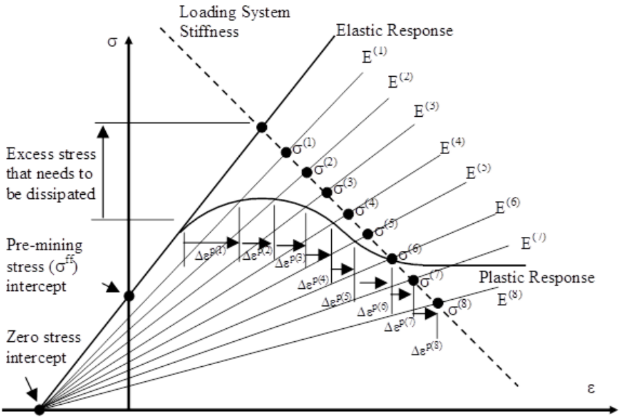
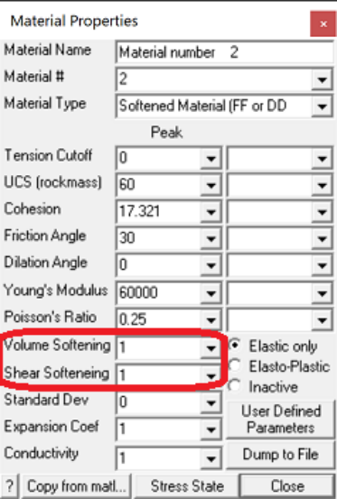
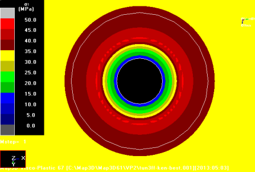
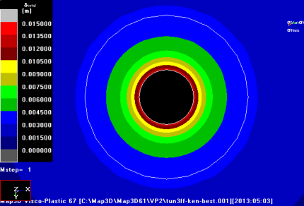
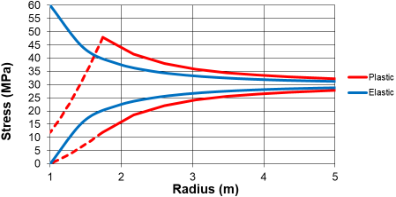
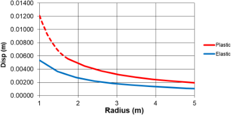
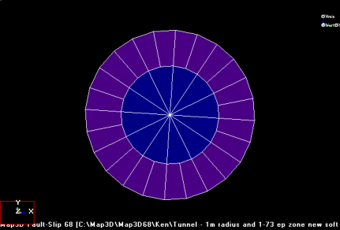
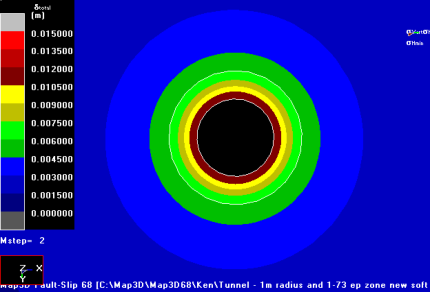
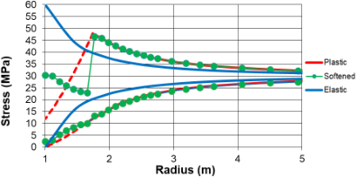
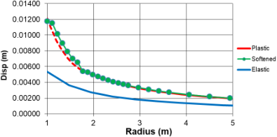

Softened materials can be used to simulate ground yielding and the resulting stress redistribution effects. Although plasticity modelling is undoubtedly the best method of doing this, material softening can also be used to simulate ground yielding, stress redistribution and hence the possible impact on surrounding areas. The advantage of this approach is that it allows the engineer to investigate nonlinear behaviour quickly and easily.

The theory behind softening is explained in detail in **Elastic softening to simulate plastic yielding.pdf** . Following is a brief summary.

In numerical modelling, de-stressing of an elastic rock mass is accomplished by allowing plastic strains. These strains act to dissipate the excess stress indicated by the elastic response. An alternative method to induce plastic deformations is shown in the figure below. Here, the stress-strain modulus is progressively reduced in magnitude. It can be observed that although technically this reduces the stiffness of the elastic stress-strain response, this can be interpreted as being equivalent to increments (Dep ) of plastic strain.

Rock failure is generally understood to be the result of shear failure and can be simulated with shear modulus reduction: whereas volume changes are associated with dilation or compaction depending on the stress conditions and nature of the rock itself. Shear modulus reduction can be used to reduce the stress differential (s1-s3), and bulk modulus reduction can be used to control the volumetric strain

(evolume=e1+e2+e3). This allows independent control of the shear failure process and dilational response. Whether softening is automated or done manually, care must obviously be taken to de-stress by a realistic amount to ensure that the final stress state in the affected pillars satisfies a well calibrated strength criterion.

The non-softened bulk modulus **_B_** and the shear modulus **_G_** can be determined from Young's modulus **_E_** and Poisson's ration as follows:

**_B = E/3/(1-2_** n **_) G = E/2/(1+_** n **_)_**

The softened bulk modulus **_Bs_** and softened shear modulus **_Gs_** are determined using the Volume Softening parameter **_b_** , and Shear Softening parameter **_g_** ,  in the table below such that

**_Bs = B×b Gs = G×g_**

For example, shear softening with **_g=1_** represents no softening, whereas shear softening with **_g=0.5_** represents a reduction in the shear modulus of 50%...

To demonstrate the simplicity of the softening procedure, an example of an overstressed tunnel with side wall yielding. Note that the objective of this example is not to duplicate results from plastic modelling, nor should one expect to be able to do so. However, this will demonstrate side wall softening, de-stressing, stress transfer and yielding. Here it is desired to demonstrate that with softening:

- stresses can be dissipated to surrounding abutments,

- larger strains and displacements associated with plasticity can be generated.

#### Plastic Model Results

Consider a 1 m radius circular tunnel with 30 MPa homogeneous pre-mining stresses. A MohrCoulomb failure criterion has been used throughout with a UCS of 11.9 MPa, friction angle of 30°, Young’s modulus of 6780 MPa and Poisson’s ratio of 0.21 This model has been analysed using Map3D Visco-Plastic. Elastic/perfectly plastic behaviour has been used with dilation rate set to zero. Below, the major principal stress is shown on the left, and displacement is shown n the right.

These Map3D Visco-Plastic model results closely match the closed form analytic solution for the plastic stresses and displacement. For reference, the elastic analytic solution is also shown.

#### Softened Model Results

In order to model the above with softening, a zone around the side walls of the tunnel has been softened as shown below where the drive is shown in blue and softened zone is shown in purple. This softened zone has been chosen to be the same size as the plastic zone determined above (1.74 m radius).

In this case it is desired to demonstrate that plastic closure can be emulated with a simple softened model.

Herein, the elastic shear modulus was softened by a factor of **_g=0.2_** , while the bulk modulus was held constant. Below, the major principal stress is shown on the left, and displacement is shown n the right.

The softened results show an excellent match for both the plastic minor principal stress and displacement. Note that while the actual softened major principal stress values do not match the plastic results in the yield zone in detail, on average they are about the correct magnitude. Also the stress has been redistributed to the elastic “abutment” quite accurately showing nearly the exact amount of stress concentration expected.

While the results for softening do not match the plastic analysis results perfectly, they have obviously simulated yielding of the side wall material and driven the elastic results much closer to those from the plastic model. It would appear that material softening can be used to simulate ground yielding, stress redistribution and hence the possible impact on surrounding areas. The advantage of this approach is that it allows the engineer to investigate non-linear behaviour quickly and easily when compared to plastic modelling. Softened models require very little increased analysis time compared to simple elastic models.

A more detailed description and examples are provided in **Elastic softening to simulate plastic yielding.pdf** .
