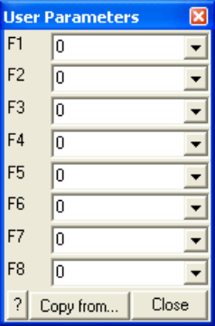

Allows specification of user defined parameters to be used in contouring.

#### Plot > Stress > User

These parameters are used with

Different parameters are defined for each material number. Hence analysis results that are calculated in different alternate material zones will use the user defined parameters appropriate for each zone.
