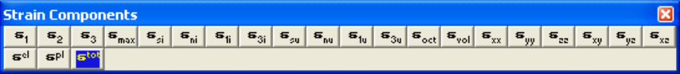

Activate the strain toolbar – after Map3D BEM analysis.

This toolbar is meant to provide quick access to strain components.

Plot > Strain > E1 Major Principal Strain e1 Plot > Strain > E2 Intermediate Principal Strain e2 Plot > Strain > E3 Minor Principal Strain e3 Plot > Strain > Emax Maximum Shear Strain emax = ½( e3 - e3 )

Plot > Strain > Esi In-plane Maximum Shear Strain esi Plot > Strain > Eni In-plane Normal Strain eni Plot > Strain > E1i In-plane Maximum Strain e1i Plot > Strain > E3i In-plane Maximum Strain e3i Plot > Strain > Esu Ubiquitous-plane Maximum Shear Strain esu Plot > Strain > Enu Ubiquitous-plane Normal Strain enu Plot > Strain > E1u Ubiquitous-plane Maximum Strain e1u Plot > Strain > E3u Ubiquitous-plane Maximum Strain e3u Plot > Strain > Eoct Octahedral Shear Strain eoct = 1/3 [(e1 - e2)² + (e2 - e3)² +(e3 - e1)²]½ Plot > Strain > Evol Volumetric Strain evol = (e1 + e2 + e3) Plot > Strain > Exx Cartesian Strain Component  exx Plot > Strain > Eyy Cartesian Strain Component  eyy Plot > Strain > Ezz Cartesian Strain Component  ezz Plot > Strain > Exy Cartesian Strain Component  exy Plot > Strain > Eyz Cartesian Strain Component  eyz Plot > Strain > Exz Cartesian Strain Component  exz Plot > Strain > Value > Elastic eelastic Plot > Strain > Value > Plastic eplastic Plot > Strain > Value > Total etotal

Notes:

The strain toolbar can only be activated after the model building - CAD Stage

Map3D Analysis Stages.

Any of these components can be added to the contour toolbar if desired

Tools > Configure Contouring Toolbar
