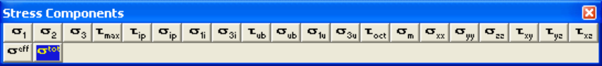

Activate the stress toolbar – after Map3D BEM analysis.

This toolbar is meant to provide quick access to stress components.

Plot > Stress > S1 Major Principal Stress s1 Plot > Stress > S2 Intermediate Principal Stress s2 Plot > Stress > S3 Minor Principal Stress s3 Plot > Stress > Tmax Maximum Shear Stress ½(s1 - s3)

Plot > Stress > Tip In-Plane Shear Stress tip Plot > Stress > Sip In-Plane Normal Stress sip Plot > Stress > S1i In-Plane Maximum Stress si1 Plot > Stress > S3i In-Plane Minimum Stress si3 Plot > Stress > Tub Ubiquitous-Plane Shear Stress tub Plot > Stress > Sub Ubiquitous-Plane Normal Stress sub Plot > Stress > S1u Ubiquitous-Plane Maximum Stress s1u Plot > Stress > S3u Ubiquitous-Plane Minimum Stress s3u Plot > Stress > Toct Octahedral Shear Stress toct = 1/3 [(s1 - s2)² + (s2 - s3)² +(s3 - s1)²]½ Plot > Stress > Smean Mean Stress smean = 1/3 (s1 + s2 + s3)

Plot > Stress > Sxx Cartesian Stress Component sxx Plot > Stress > Syy Cartesian Stress Component syy Plot > Stress > Szz Cartesian Stress Component szz Plot > Stress > Txy Cartesian Stress Component txy Plot > Stress > Tyz Cartesian Stress Component tyz

Plot > Stress > Txz Cartesian Stress Component txz

Plot > Stress > Value > Seff Effective Stress seff

Plot > Stress > Value > Stotal Total Stress stotal

Notes:

The stress toolbar can only be activated after the model building - CAD Stage

Map3D Analysis Stages

Any of these components can be added to the contour toolbar if desired

Tools > Configure Contouring Toolbar
