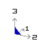
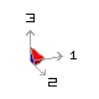

The orientation of the far field principal stress state is indicated by the stress orientation icon located at the upper right corner of the display.

In the view above, the s1 axis points mostly into the screen and a bit to the right, the s2 axis points mostly to the right and a bit out of the screen, and the s3 axis points straight up. Note that the backside of the icon is shaded in blue.

In the view above, the s1 axis points mostly to the right and a bit into the screen, the s2 axis points mostly out of the screen and a bit to the right, and the s3 axis points straight up. Note that the inside of the icon is shaded in red.

Note that the length of the axes are scaled according to the magnitude of the principal stress components.

The pre-mining principal stress components are specified using "CAD > Properties > Material Properties > Stress State".
