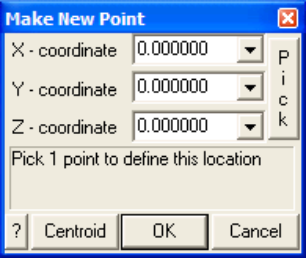

Creates a new visualization point. Refer to Visualization for  a description of the visualization routines available in Map3D.

Visualization points can be displayed as light source shaded spheres with diameter and/or colour varying as magnitude, and contoured on a plane to display density etc.

Each point can be tagged with a series of:

- numeric values (e.g. colour, magnitude, orientation etc.)

- text messages

- file names (e.g. graphics files, documents, spreadsheets etc.)

Upon left clicking on a point, the location, magnitude and text message are displayed on the status bar.

Right clicking on a point activates the Visual Database. This feature can be used to display a database of useful geologic information such as grade, rock mass quality etc.

Upon activating the feature, the user will be prompted to supply the coordinates of the new visualization point.

Note that if a visualization file is already active, this new point will be added to the file. If there is no active visualization file the user will be prompted open one and this new point will be added to the file.

X, Y and Z coordinate - specifies the coordinates of the visualization point.

Pick - activates the cursor cross-hairs allowing interactive selection of the coordinates from the model.

To assist in visually selecting points from the model, all snap functions are available.

#### CAD > Snap

Once selected, the coordinates of the visualization point are displayed in the dialogue box.

Centroid - activates the cursor so the user can select an entity from the model. The coordinates will be calculated at the centre of the selected entity.

OK - completes editing of the coordinates and creates and displays the visualization point.

Once the visualization point is created, the user can now right click on the point to add text messages and/or file names.

- The text message and file name are displayed in the status bar across the bottom of the screen by picking an event with the left mouse button.

- They can also be edited by picking an event with the right mouse button.

- Picking with the right mouse button also allows for display of the file if the file name has been associated with an application (refer to Windows documentation on how to "Associate a file with a program").
