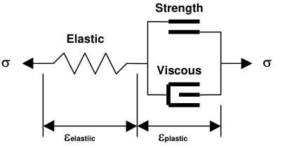

进行弹-黏-塑性蠕变分析。

此功能仅用于非线性分析（Map3D Non-Linear 中的三维 FF 块体和 Map3D Fault-Slip 中的 DD 平面）。蠕变模型既可以仅作为抑制非线性变形的技术使用，也可以在激活此蠕变选项后用于实时的时间相关蠕变模拟。

在每个蠕变步，所有屈服单元（应力超过强度的单元）上的应力状态按强度加蠕变阻力计算。这限制了每个屈服单元上塑性蠕变增量 Deplastic 的大小

s = _Strength_ + _C_ Deplastic /D _t_

_C_ = _G_ D _t_

其中蠕变阻力等于蠕变系数 _C_ 乘以塑性应变率 Deplastic /D _t_ 。请注意，用户必须同时选择蠕变系数 _C_ 和时间步长 D _t_ ，然后将二者之商指定为黏性模量 _G_ 。蠕变增量对应力 s 的贡献即为超额应力，由下式给出

Ds  = _C_ Deplastic /D _t_

所有屈服单元的最大超额应力由 Plot > Surface Components > Ferr 表示

如果激活此蠕变选项，Map3D 在每个采矿步只执行一次蠕变增量。因此，经过的时间可由当前时间步编号 _is_ （Analysis Dialogue）与用户定义的时间步长 D _t_ 的乘积确定。

总经过时间 = _is_ D _t_

用户可能希望在不增加任何新开采的情况下重复若干采矿步，以便让模型蠕变指定的步数。

如果未激活此蠕变选项，Map3D 会执行所需数量的蠕变增量，直到 _fer_ 降至应力容差 _STOL_ 以下，然后再进入下一个采矿步。

无论哪种情况，累积塑性应变 eplastic 都等于所有蠕变步的塑性蠕变增量 Deplastic 之和。

相关主题：

Plot > Surface Components > DTs Excess Shear Stress

Plot > Surface Components > DEs Incremental Shear Strain

Plot > Surface Components > Ts Shear Stress

Plot > Surface Components > Es Shear Strain

必须在进行 Map3D BEM 分析之前选中此功能

Analysis > BEM Analysis
