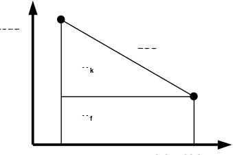
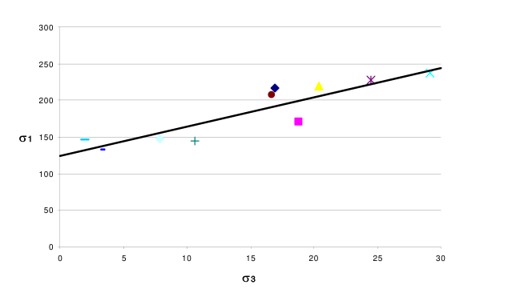
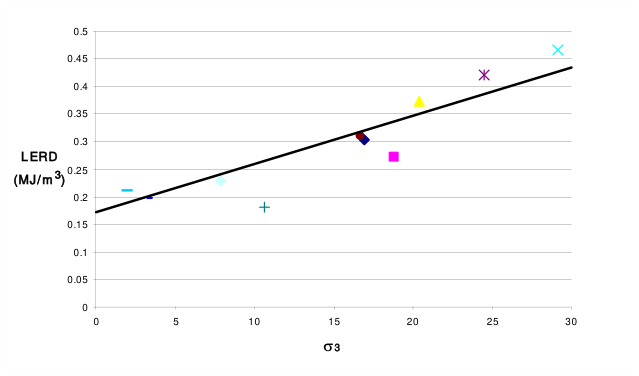
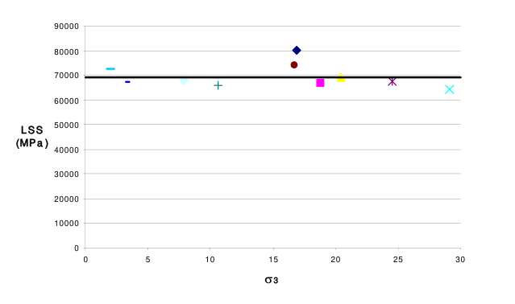

在 Map3D BEM 分析期间计算能量释放率和加载系统刚度。

此例程使您能够在任意所需位置计算能量释放率（ _ERR_ ），并为控制计算方式提供了很大的灵活性。另一种

方法是仅在开挖面前方计算 _ERR_ ，见 Plot > Surface Components > ERR

选择 LERD/LSS 时，系统会提示您输入数据文件名，LERD/LSS 计算结果将写入该文件。此文件的默认扩展名为“.ERR”。

结果将按以下格式写入该文件：

如果试验块构建为 3D 块（使用 FF 单元）

**Block# Volume Area   Wk  Wf  Ev  LSS   x y z** s **1  t1  p1** s **2  t2  p2** s **3  t3  p3**

其中 s **i  ti  pi** 表示一个主应力分量及其走向和倾伏角。

如果试验块构建为平面特征（使用 DD 单元）

**Block# Volume Area   Wk  Wf  Ev  LSS   x y z** t **s  ts  ps** s **n  tn  pn**

其中 t **s  ts  ps** 表示最大面内剪应力及其走向和倾伏角，s **n  tn  pn** 表示法向应力及其走向和倾伏角。

在这两种情况下， **x y z** 均为计算应力所在试验块中心的坐标。

**Wk  Wf** 和 **LSS** 的定义见下文。

**Ev** 是 LERD/ERR 计算过程中发生的体积变化。

此外，还将计算当前开采步所进行的新开挖所对应的总能量释放。请注意，进行此计算无需指定任何试验块。结果将按如下方式报告：

#### Stp# Volume Area Wk Wf Ev LSS

加载系统刚度（ _LSS_ ）和局部能量释放密度（ _LERD_ ）是预测岩体屈服期间响应性质的有用指标。在模型中的不同位置，由于几何效应，这些指标预计会发生变化。在

_LSS_ 比屈服岩石的峰后响应更硬的位置，可以预期会出现随开采推进而依次发展的受控破坏。然而，在 _LSS_ 比屈服岩石的峰后响应更软的位置，则可以预期会出现不受控的破坏。可用的过剩能量大小预计与事件的震级相关。

要确定数值模型中的 _LSS_ 或 _LERD_ ，必须使模型发生挠曲并观察加载系统的响应。这是通过使用以下功能为 LERD/LSS 计算指定 Material Code 来实现的

#### CAD > Edit > Entity Properties > Matl Code LERD/LSS

此特殊的 Material Code 用于暂时改变试验区域内的材料属性或边界条件，使模型以某种方式变形。

由于预计 _LSS_ 会随位置而变化，因此必须在所有感兴趣的位置进行此操作。通过仔细监测此变形过程中加载系统的响应，即可计算 _LSS_ 以及所传递的各种能量。

考虑一个简单的例子：一个断层面穿过采场区域，并提出这样的问题：“如果该断层发生屈服，它会如何响应？”可以简单地代入一个较低的摩擦角，观察岩体如何变形。我们将断层处于正常摩擦角的模型称为“阶段 I”，将同一模型但断层处于某个降低后的摩擦角称为“阶段 II”。在断层面上的某个位置，可以预期出现以下类型的响应。

_LSS_ 就是荷载变形响应曲线的斜率。可作为动能释放的最大能量是标记为 Wk 的上三角形的面积（预计该值与观测到的事件震级相关）。断层摩擦变形中可耗散的最小能量是标记为 Wf 的下矩形的面积（预计该值与在事件震源处观测到的破坏程度相关）。必须在断层面上的所有位置进行此计算，才能得到因摩擦角降低而传递的总能量。请注意，根据材料属性的设置方式，可能存在法向变形（随剪切响应而发生的膨胀），这必须计入能量计算。

对于两条巷道之间的矿柱，也可以进行同样的计算。对于这种情况，我们将矿柱完好的模型称为“阶段 I”。为使模型发生挠曲，可以在矿柱中代入另一种材料，并将其称为“阶段 II”。然后即可重复上述关于 Wk 和 Wf 的所有计算和解释。请注意，与上文一样，能量计算中既包含法向分量的贡献，也包含剪切分量的贡献。

由于 Map3D 计算作用在边界单元上的应力，因此总能量传递可以计算为应力在所有单元上经其变形的积分。在上述矿柱的例子中，如果我们确实开挖矿柱以得到阶段 II，然后用 Wk 除以矿柱的体积，就得到局部能量释放密度（ _LERD_ ）。已发现它与剧烈破坏事件高度相关。（请注意，对于薄层状开采，如果用 Wk 除以面积（在开采平面内），则得到经典的能量释放率 _ERR_ ）。

为强化这一概念，我们来看一个实际例子。考虑在若干年的开采过程中发生的多次矿柱岩爆。对于每次破坏，都运行了一个数值模型，以确定破坏发生的时间和位置处的应力状态。如果将所有这些应力预测值绘制在 s **1** 对 s **3** 的坐标轴上，则得到如下结果：

该图表明，每次岩爆发生时的应力状态与线性强度准则之间存在很强的相关性。该数据的相关系数为 0.90。换一种说法，s **1** 预测的平均误差约为 17 MPa，由此得到的变异系数仅为 9%。

岩爆发生时各位置的 _LERD_ 同样显示，每次岩爆发生时的应力状态与线性准则之间存在很强的相关性。该数据的相关系数为 0.88。

换一种说法， _LERD_ 预测的平均误差约为 0.045 MPa/mª，由此得到的变异系数仅为 14%。

虽然 Wk 和 Wf 分量可以按此方式轻松计算，但 _LSS_ 的定义却没有这么直接。不过，可以按如下方式确定具有代表性的 _LSS_ ：

确定需要计算 _LSS_ 的代表性区域。这通过构建一个应包含预期屈服区的试验块来完成。

您可以像构建任何其他特征一样构建试验块，但需要通过使用以下功能为 LERD/LSS 计算指定所需的 Material Code，将该块标识为“试验块”

#### CAD > Edit > Entity Properties > Matl Code LERD/LSS

开采步的 Material Code 应根据您希望在开采顺序中如何处理该区域来设置。这些块可用作替代材料区，并可根据需要进行开挖。

假定该试验块充填了一种虚拟材料，其峰后刚度与加载系统的响应完全一致，并且试验块的行为可以用下式描述

s **1 =** **_LSS_** e **1** s **2 =** **_LSS_** e **2** s **3 =** **_LSS_** e **3**

则能量密度可计算为

**½ (** s **1** e **1 +** s **2** e **2 +** s **3** e **3 )**

平均能量密度可估算为

**( Wk + Wf ) /** **_Volume_**

因此，加载系统刚度可由下式确定

**_LSS_ = ½ (** s **1² +** s **2² +** s **3² )** **_Volume_ / ( Wk + Wf )**

如果对上述数据进行此计算，则得到下图。

岩爆发生时各位置的 _LSS_ 显示出与应力无关的稳定数值。 _LSS_ 预测的平均误差约为 4730 MPa，由此得到的变异系数仅为 7%。

仅当应力在整个试验块内均匀分布时，此 _LSS_ 计算才具有代表性。如果并非如此，则与 _LSS_ 的相关性较差。

#### 注意

必须在进行离散化分析之前选中此功能

Analysis > Discretization
