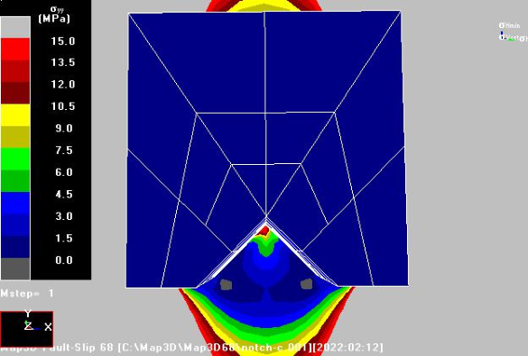

在 Map3D BEM 分析期间使用高阶边界单元。

边界元法采用数值近似来描述应力或位移不连续的表面分量强度在边界上的分布方式。最简单的假设是认为这些表面分量在每个边界单元上均匀分布。Map3D 的使用经验表明，除少数涉及显著弯曲效应的问题外，这种近似均可得到准确的结果。即使对于后一类问题，除边界表面附近外，在所有位置仍可得到准确的结果。

要在涉及显著弯曲效应的问题中获得边界附近的准确结果，必须采用高阶边界单元。对于大跨度且形状不规则的问题，弯曲效应通常变得很重要。这在边界上的折角附近尤为重要，此类折角可能由各种特征之间的相交产生。

当 **linear** 和 **quad** 均未选中时，应力或位移不连续的表面分量强度按 **常数** 值分布。

选中 **linear** 选项时，应力或位移不连续的表面分量强度在边界单元上采用一阶多项式分布。对于三角形，使用以下分布

_a + b x + c y_

对于四边形，使用以下分布

_a + b x + c y + d xy_

选中 **quad** 选项时，应力或位移不连续的表面分量强度在边界单元上采用二阶多项式分布。对于三角形，使用以下分布

_a + b x + c y + d x_ ² _+ e xy + f y_ ²

对于四边形，使用以下分布

_a + b x + c y + d x_ ² _+ e xy + f y_ ² _+ g x_ ²y _+ h x_ ² _y_ ² _+ i y_ ²x

注意：

必须在进行 Map3D BEM 分析之前选中此功能

#### Analysis > BEM Analysis

此选项会增大问题规模，从而增加分析时间，因为高阶单元在边界表面上需要更多的插值节点。

如果用户不确定其模型对这种近似的敏感程度，建议对实际模型的某个子集分别在使用和不使用线性单元的情况下运行，以便比较。

在下面的示例中，图示了一个带有凹口的开挖。分别针对 **linear** 和 **quad** 均未选中、选中 **linear**、选中 **quad** 这三种情况绘制了垂直应力等值线。请注意，采用常数分布时，凹口尖端处出现了异常的应力集中。使用 **linear** 分布可消除此效应，使用 **quad** 分布则可进一步减弱此效应。

#### linear 分布

**quad** 分布

