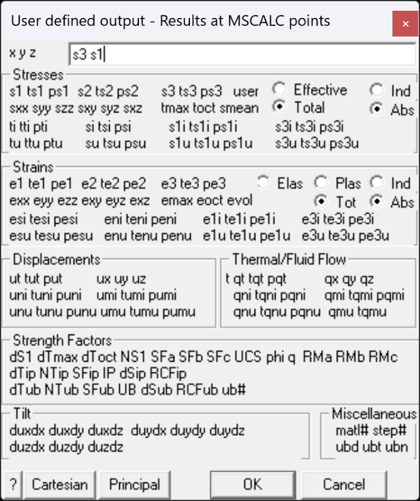

在 Map3D BEM 分析期间计算用户定义点处的结果。

分析结果可以在用户定义的坐标位置处计算。

选择 MSCALC 时，系统会提示您输入数据文件名和所需的输出格式，如下所示。

#### 数据文件格式：

数据文件就是一个文本文件（*.txt），其中列出需要计算结果的坐标位置。

该文件的格式要求每行一组坐标

x1 y1 z1 x2 y2 z2 x3 y3 z3 x4 y4 z4 ...

其中 x y z 表示每个点的坐标。

如有需要，您可以指定 x y z dipub ddrub 此外，您还可以指定 x y z dipub ddrub so phi

这里 dipub ddrub 分别表示所需 UB 平面的倾角和倾向

- 仅当您计算某些 UB 分量（如 su tu）时才会用到

so 和 phi 分别表示黏聚力和摩擦角

- 仅当您计算某些 UB 强度参数（如 sfu rcfu dsu ntu）时才会用到

#### 输出文件格式：

结果将写回同一数据文件，其中 x y z 坐标之后是用户指定的参数。

#### 应力：

s1 ts1 ps1 最大主应力 s1 及其走向和倾伏角。 s2 ts2 ps2 中间主应力 s2 及其走向和倾伏角。 s3 ts3 ps3 最小主应力 s3 及其走向和倾伏角。 user 用户定义值。 sxx syy szz sxy syz sxz 笛卡尔应力分量。 tmax 最大剪应力 tmax=½ ( s1 - s3 ) toct 八面体剪应力 toct=¹/3 [( s1 - s2 )² + ( s2 - s3 )² +( s3 - s1 )²]1/2 smean 平均应力 smean=¹/3 ( s1 + s2 + s3 ) ti tti pti 网格平面内的最大剪应力及其走向和倾伏角。 si tsi psi 网格平面内的法向应力及其走向和倾伏角。 s1i ts1i ps1i 与网格平面相切的最大应力及其走向和倾伏角。 s3i ts3i ps3i 与网格平面相切的最小应力及其走向和倾伏角。 tu ttu ptu 遍布平面内的最大剪应力及其走向和倾伏角。 su tsu psu 垂直于遍布平面的应力及其走向和倾伏角。 s1u ts1u ps1u 与遍布平面相切的最大应力及其走向和倾伏角。 s3u ts3u ps3u 与遍布平面相切的最小应力及其走向和倾伏角。 遍布平面的方向在以下位置指定

Plot > Strength Factors > Ubiquitous Parameters Effective/Total 有效应力或总应力分量。这些选项仅用于 Map3D Thermal-Fluid Flow，因为该程序可以计算稳态孔隙压力分布。 Induced/Absolute 诱发应力是不含开采前应力贡献的应力，表示相对于开采前状态的应力变化。绝对应力是包含开采前应力贡献的应力。

#### 应变：

e1 te1 pe1 最大主应变 e1 及其走向和倾伏角。 e2 te2 pe2 中间主应变 e2 及其走向和倾伏角。 e3 te3 pe3 最小主应变 e3 及其走向和倾伏角。 exx eyy ezz exy eyz exz 笛卡尔应变分量。 emax 最大剪应变 emax=½ ( e1 - e3 ) eoct 八面体剪应变 eoct=¹/3 [( e1 - e2 )² + ( e2 - e3 )² +( e3 - e1 )²]1/2 evol 体积应变 evol=( e1 + e2 + e3 ) esi tesi pesi 网格平面内的最大剪应变及其走向和倾伏角。 eni teni peni 网格平面内的法向应变及其走向和倾伏角。 e1i te1i pe1i 与网格平面相切的最大应变及其走向和倾伏角。 e3i te3i pe3i 与网格平面相切的最小应变及其走向和倾伏角。 esu tesu pesu 遍布平面内的最大剪应变及其走向和倾伏角。 enu tenu penu 垂直于遍布平面的应变及其走向和倾伏角。 e1u te1u pe1u 与遍布平面相切的最大应变及其走向和倾伏角。 e3u te3u pe3u 与遍布平面相切的最小应变及其走向和倾伏角。 Elastic/Plastic/Total 弹性、塑性或总应变分量。这些选项仅用于 Map3D Non-Linear，因为该程序可以计算非线性应变。 Induced/Absolute 诱发应变是不含开采前贡献的应变，表示相对于开采前状态的应变变化。绝对应变是包含开采前应变贡献的应变。

#### 位移：

ut tut put 总位移及其走向和倾伏角。 ux uy uz 笛卡尔位移分量。 uni tuni puni 垂直于网格平面的位移及其走向和倾伏角。 umi tumi pumi 与网格平面相切的最大位移及其走向和倾伏角。 unu tunu punu 垂直于遍布平面的位移及其走向和倾伏角。 umu tumu pumu 与遍布平面相切的最大位移及其走向和倾伏角。

#### 流动：

t 温度/水头。

qt tqt pqt 总流量及其走向和倾伏角。 qx qy qz 笛卡尔流量分量。

qni tqni pqni 垂直于网格平面的位移及其走向和倾伏角。

qmi tqmi pqmi 与网格平面相切的最大位移及其走向和倾伏角。 qnu tqnu pqnu 垂直于遍布平面的位移及其走向和倾伏角。 qmu tqmu pqmu 与遍布平面相切的最大位移及其走向和倾伏角。

#### 强度：

- ds1 超限最大主应力 Ds1 = s1 - ( _UCS_ + _q_ s3 )

- dtmax 超限最大剪应力 Dtmax = ½(s1 - s3) - [ _UCS_ + ½(s1+s3) ( _q_ -1) ]/( _q_ +1) = [s1 - ( _UCS_ + _q_ s3) ]/( _q_ +1)

- dtoct 超限八面体剪应力 Dtoct = toct - [ _UCS_ + ( _q_ –1) smean ] Ö(2) /( _q_ +2)

- NS1 使用正态分布 N(Ds1 /std) 的概率

- SF-A 强度/应力可确定为 ( _UCS_ + _q_ s3 )/ s1

- SF-B 强度/应力可确定为 ( _UCS_ + _q_ s3 - s3 )/(s1 - s3)

- SF-C 强度/应力可确定为 [ _UCS_ + ½(s1+s3) ( _q_ -1) ]/[ ½(s1 - s3)( _q_ +1) ]

- dTip 超限面内剪应力 Dtip = tip - [ Cohesion + sip tan(j) ]

- NTip 使用正态分布 N(Dtip /std) 的概率

- SFip 强度/应力可确定为 [ Cohesion + sip tan(j) ] / tip

- dSip 超限面内壁面应力 Dsip = [ 3 s1i - s3i ] - UCS

- RCFip 面内壁面应力的岩石状况系数 RCFip = [ 3 s1i - s3i ]/UCS

- dTub 超限遍布平面剪应力 Dtub

- NTub 使用正态分布 N(Dtub /std) 的概率

- SFub 强度/应力可确定为 [ Cohesion + sub tan(j) ] / tub

- dSub 超限 ub 平面壁面应力 Dsub = [ 3 s1ub - s3ub ] - UCS

- RCFub ub 平面壁面应力的岩石状况系数 RCFip = [ 3 s1ub - s3ub ]/UCS

- UB# 绘制 Dtub 值最大的 UB 组编号（1、2 或 3）

#### 其他：

matl# 该点所在材料的编号。主体材料为材料编号 1。在使用多种材料的问题中，可以在替代材料区内计算结果。

step# 开采步编号。

ubd, ubt, ubn 分别表示遍布平面的倾角、倾向和法线。

#### 其他选项：

Cartesian   配置为输出笛卡尔应力分量。 Principal   配置为输出主应力分量。

#### 注意：

必须在进行离散化分析之前选中此功能

Analysis > Discretization.

可以指定任意数量的点。

模型将根据所指定点的位置进行离散化。
