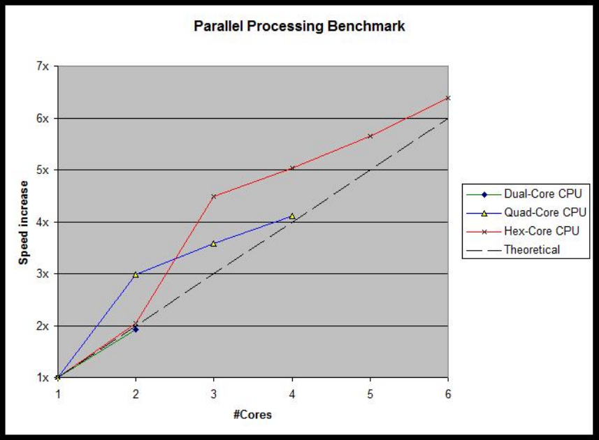

显示处于活动状态的内核/线程数。

借助多处理器/多驱动器选项，Map3D 完全支持并行处理和并行磁盘 I/O。

如果您已获得使用多处理器/多驱动器选项的许可，Map3D 将在所有可用处理器之间并行分配并执行所有分析过程。

**CPU：** 近年的 CPU 已有双核、四核和六核版本。Map3D V58 现已支持并行处理，可实现更快的计算速度。这使矩阵组装和网格组装时间缩短了 6 倍以上。多 CPU 计算机的速度会更快。

下面的并行处理基准测试清楚地表明，您可以预期双核 CPU 的性能提高两倍以上，

四核提高 4 倍以上，六核提高 6 倍以上。在启用超线程的 CPU 中，同一内核上叠加 2 个计算线程。这就是 Map3D-MP 实际取得的性能优于理论最大值的原因。

要获得这些性能提升，需要同时提高处理能力和/或磁盘 I/O 速率 Analysis > Options > Drive #.
