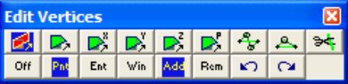

可通过选择任一编辑功能（如按钮），或直接右键单击任意顶点来启动此例程。

启动任何实体编辑例程时，系统会首先提示您创建待编辑的顶点列表。

   - 如果选中了 Tools > Shift-key Selection，则必须按住 Shift 键才能进行多重选择。

   - 默认情况下，所选实体会添加到列表中；但如果按住 Ctrl 键，所选实体将从列表中移除。

   - 按住 Shift 键或 Ctrl 键时，可拖出一个选择窗口。

   - 按空格键会自动激活上次使用的编辑功能。

- 右键单击时按住 Alt 键，会自动重复上次使用的编辑功能。

该工具栏用于控制列表创建过程中的各项功能。

中止编辑。

逐个选取顶点来选择顶点。

通过选取顶点组来选择顶点。

包含所选窗口内的所有实体。

- 只有整个实体都位于窗口内时，才会被选中。

- 也可以按住 Shift 键或 Ctrl 键并拖出交叉窗口来激活此功能。

所选实体将添加到列表中。

所选实体将从列表中移除。

撤销上一次选择。

重做上一次选择。

选好所需实体后，可以选择以下任一编辑按钮：

CAD > Edit > Stretch Vertices

CAD > Edit > Move Vertices to Point

CAD > Edit > Move Vertices to X CAD > Edit > Move Vertices to Y CAD > Edit > Move Vertices to Z CAD > Edit > Move Vertices to Plane CAD > Edit > Smooth Construction Lines CAD > Edit > Remove Construction Vertex CAD > Edit > Subdivide Construction Lines

- 双击任意顶点以执行高亮显示的功能，

- 右键单击可查看选项列表。

完成任何编辑操作后，您有一次撤销修改的机会，方法是选择

#### Undo

您也可以恢复相同的选择集并再次修改同一组实体，方法是选择

Redo

您可以使用以下命令调整双击时间

Tools > Double Click Time
