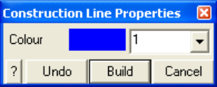

编辑构造线颜色。

启动此例程时，系统会首先提示您创建待编辑的实体列表

- 如果选中了 Tools > Shift-key Selection，则必须按住 Shift 键才能进行多重选择。

- 该工具栏的用法详见“创建待编辑实体列表”

- 按空格键会自动激活上次使用的编辑功能。

选好所需实体后，可以选择以下任一编辑按钮：

CAD > Edit > Entity Properties 编辑块体类型、颜色、开采顺序，CAD > Edit > Erase Entities 删除所选实体，CAD > Edit > Move Entities 移动所选实体，CAD > Edit > Copy Entities 复制所选实体，CAD > Edit > Scale Entities 缩放所选实体，CAD > Edit > Rotate Azimuth 旋转所选实体的方位角，CAD > Edit > Rotate Dip 旋转所选实体的倾角，CAD > Edit > Dump to File 将所选实体转储到文件，CAD > Edit > Group 将所选实体合并为单个块体，

- 双击任意顶点以执行高亮显示的功能，

- 右键单击可查看选项列表。

如果对话框中的任一字段显示为 "Variable"，说明所选的某些块体在该字段上的属性不同。若要保持这些属性不变（即各块体互不相同），请将该字段保留为 "Variable"。若要为所有所选块体更改该字段的值，请输入所需的值。

Colour - 指定用于显示构造线的颜色编号。

- 共有 10 种显示颜色，编号依次为 1 至 10，

11 至 20，

21 至 30，依此类推，

- 因此以下编号显示相同的颜色：

- 1、11、21……，2、22、32……，3、23、33……，依此类推。

OK - 完成构造线编辑，并应用所有已更改的属性。

Cancel - 中止实体编辑。

完成任何编辑操作后，您有一次撤销修改的机会，方法是选择

#### Undo

您也可以恢复相同的选择集并再次修改同一组实体，方法是选择

#### Redo

您可以使用以下命令调整双击时间

#### Tools > Double Click Time

有关在模型构建中使用构造线的示例，请参阅：

模型构建教程
