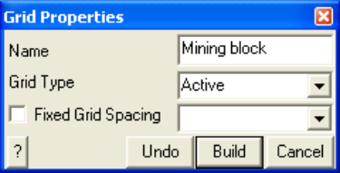

编辑网格名称和最大间距。

启动此例程时，系统会首先提示您创建待编辑的实体列表

- 如果选中了 Tools > Shift-key Selection，则必须按住 Shift 键才能进行多重选择。

- 该工具栏的用法详见“创建待编辑实体列表”

- 按空格键会自动激活上次使用的编辑功能。

选好所需实体后，可以选择以下任一编辑按钮：

CAD > Edit > Entity Properties 编辑块体类型、颜色、开采顺序，CAD > Edit > Erase Entities 删除所选实体，CAD > Edit > Move Entities 移动所选实体，CAD > Edit > Copy Entities 复制所选实体，CAD > Edit > Scale Entities 缩放所选实体，CAD > Edit > Rotate Azimuth 旋转所选实体的方位角，CAD > Edit > Rotate Dip 旋转所选实体的倾角，CAD > Edit > Dump to File 将所选实体转储到文件，CAD > Edit > Group 将所选实体合并为单个块体，

- 双击任意顶点以执行高亮显示的功能，

- 右键单击可查看选项列表。

如果对话框中的任一字段显示为 "Variable"，说明所选的某些块体在该字段上的属性不同。若要保持这些属性不变（即各块体互不相同），请将该字段保留为 "Variable"。若要为所有所选块体更改该字段的值，请输入所需的值。

Name - 指定网格的描述性名称。

Grid Type - 指定网格为激活（用于应力分析）还是未激活（不用于应力分析）。

Maximum Spacing - 指定允许的最大间距。

- 该参数可用于对所选网格强制采用精细的均匀离散。指定此值时务必极其谨慎，因为取值过小很容易导致问题规模急剧增大。

- 一般情况下，该参数应留空（即不使用），离散化交由 _AG_ 参数处理。后者只在需要分析结果的位置加密单元，从而优化单元的使用并最大限度地减小问题规模。

CAD > Properties Control Parameters.

- 如果该字段留空，则不使用此参数。

OK - 完成块体编辑，并应用所有已更改的属性。

Cancel - 中止实体编辑。

完成任何编辑操作后，您有一次撤销修改的机会，方法是选择

Undo

您也可以恢复相同的选择集并再次修改同一组实体，方法是选择

Redo

您可以使用以下命令调整双击时间

Tools > Double Click Time
