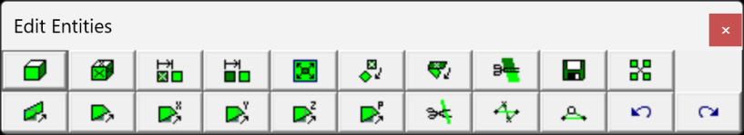

激活 Edit 工具栏。

该工具栏用于快速访问 Map3D 边界元分析模型构建与编辑阶段所使用的编辑功能 Analysis > Go to CAD

编辑功能分为两组，具体取决于您要修改块体还是坐标。

#### 修改块体：

CAD > Edit > Entity Properties 编辑块体类型、颜色、开采顺序等。CAD > Edit > Erase Entities 删除所选实体。CAD > Edit > Move Entities 移动所选实体。CAD > Edit > Copy Entities 复制所选实体。CAD > Edit > Scale Entities 缩放所选实体。

CAD > Edit > Rotate Azimuth 旋转所选实体的方位角。

CAD > Edit > Rotate Dip 旋转所选实体的倾角。CAD > Edit > Slice Entities 切分所选实体。

CAD > Edit > Dump to File 将所选实体转储到文件。CAD > Edit > Group 将所选实体合并为单个块体。

#### 修改坐标：

CAD > Edit > Stretch Vertices 拉伸所选顶点。CAD > Edit > Move Vertices to Point 将所选顶点移动到某一点。CAD > Edit > Move Vertices to X 移动所选顶点的 x 坐标。CAD > Edit > Move Vertices to Y 移动所选顶点的 y 坐标。CAD > Edit > Move Vertices to Z 移动所选顶点的 z 坐标。CAD > Edit > Move Vertices to Plane 将所选顶点移动到某一平面。

CAD > Edit > Subdivide Construction Lines 细分构造线。

CAD > Edit > Smooth Construction Lines 平滑构造线。CAD > Edit > Remove Construction Vertex 移除构造线顶点。

#### Undo - Redo

完成任何编辑操作后，您有一次撤销修改的机会，方法是选择

#### Undo

您也可以恢复相同的选择集并再次修改同一组实体，方法是选择

Redo

按空格键会自动激活上次使用的编辑功能。
