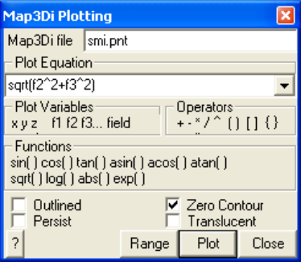

此选项用于可视化 Map3Di 数据。

#### Map3Di File：

Map3Di 数据文件是一种 ASCII 数据文件，默认扩展名为 ".PNT"。

有关数据格式的详细信息，请参阅 CAD > Properties > Map3Di。

有关数据格式的详细信息，请参阅 Visualization > Plane > Make Map3Di File。

#### Plot Equation：

定义要绘制的参数。

下拉窗口最多可存储 20 个不同的方程。这些方程会在 Map3D 会话之间保存在 map3d.ini 文件中。

#### Plot Variables：

f1 f2 f3… - 事件文件中的数据字段。

#### Functions：

sin() cos() tan() - 正弦、余弦和正切三角函数。asin() acos() atan() - 反三角函数。sqrt() - 平方根函数。log() - 自然对数函数。abs() - 绝对值。

exp() - 指数函数（反对数）。

#### Location：

x y z - 网格点的坐标。

#### Operators：

+ - * / ^   加、减、乘、除和乘方运算符。请注意，运算顺序为先乘方，再乘除，最后加减。

() [] &#123;&#125;   括号类型。括号必须成对匹配。

>   最大值。例如，如果绘图方程指定为 f1 > 10，则绘制 f1 和 10 中较大的一个。

&lt;   最小值。例如，如果绘图方程指定为 f1 &lt; 10，则绘制 f1 和 10 中较小的一个。

#### Point Plotting Options：

Outlined – 勾勒 Map3Di 数据块的轮廓。

#### Other：

Persist – 选中后，每次对模型进行重新定向、平移或缩放时，都会重新绘制这些点。由于对大型模型而言这可能很耗时，因此该选项不一定适用。Translucent - 将点绘制为半透明球体。

Zero Contour - 取消选中时，低于最小等值线范围的等值线不会绘制。这在只关注等值线范围上部时很有用。Range – 指定半径缩放和等值线绘制的最小值、最大值和间隔。

Plot - 重新生成绘图。该按钮可放置在 View 工具栏（Tools > View Toolbar Configure）或 Contour 工具栏（Tools > Contour Toolbar Configure）上。
