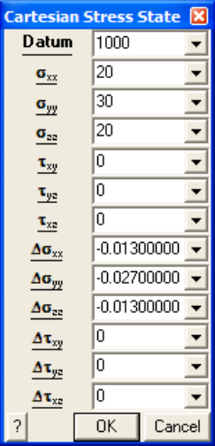

开采前应力状态按随深度线性变化来指定，可使用笛卡尔分量或主应力分量。

各笛卡尔分量随深度的变化描述为线性变化（以 sxx 分量为例）：

- sxx + Dsxx ( _z_ - _Datum_ )

要确定这些分量的合适取值，用户必须首先选择一个深度

- ( _z_ = _Datum_ )

该深度处的应力值已知。这些应力值即为

sxx  syy  szz  txy  tyz  txz

常数值。

随后可将各分量随深度的变化指定为

Dsxx  Dsyy  Dszz  Dtxy  Dtyz  Dtxz

变化值。如果坐标系设置为 _z_ 向上为正，则变化值应指定为负值，以使应力随深度增大。

例如，如果已知 sxx 分量在 _z_ = -1000m 处的值为

30 MPa

且按下式变化（_z_ 向上为正）

- 0.027 MPa/m

则应指定

Datum = -1000 sxx = 30 Dsxx = -0.027
