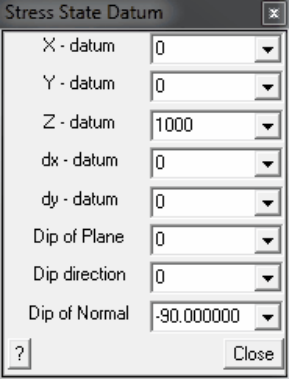

各应力分量的变化描述为主应力分量或笛卡尔分量的线性变化。

如有需要，可通过定义倾斜基准面，将其指定为沿 x、y 和 z 方向的变化。该功能适用于地形具有明显主导坡度的位置。

要定义倾斜基准面，需要指定基准面上的一点（_X-datum_、_Y-datum_ 和 _Z-datum_），

以及该平面的坡度。坡度以 X 方向（_dx-datum_）和 Y 方向（_dydatum_）的梯度表示。

为方便用户，平面的坡度可以使用平面的“倾角”和“倾向”来指定，也可以使用平面法线的“倾向”和“法线倾角”来指定。梯度由后面这些值自动确定，公式如下：

_dx-datum_ = -sin(q) sin(j) _dy-datum_ = -cos(q) sin(j)

因此

tan(q)= _dx/dy_ tan(j)=sqrt( _dx_ ^2+ _dy_ ^2)

按这种方式定义后，应力既随深度变化，也随水平位置变化。
