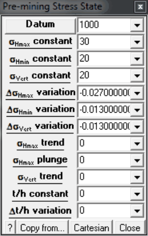
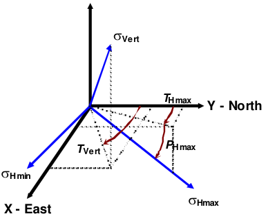

Datum - 开采前应力状态按随深度线性变化来指定，可使用主应力分量或笛卡尔分量。

Copy from... - 可从另一种材料复制应力状态。

- 仅复制应力状态。

- 其他材料属性保持不变。

Cartesian - 开采前应力状态按随深度线性变化来指定，可使用主应力分量或笛卡尔分量。

三个主应力分量称为 _Hmax_、_Hmin_ 和 _Vert_ 分量。

- sHmax 为最大（近）水平应力。

- sHmin 为最小（近）水平应力。

- sVert 为（近）垂直应力。

这些应力分量相互垂直。

水平分量和垂直分量不必严格水平或垂直。sHmax 的走向和倾伏角可通过 _THmax_ 和 _PHmax_ 调整。sVert 的走向可通过 _TVert_ 调整。

这些分量随深度的变化均描述为线性变化（以 sHmax 分量为例）：

sHmax + DsHmax ( _z_ - _Datum_ )

要确定这些分量的合适取值，用户必须首先选择一个应力值已知的深度 _z_。

_Datum_ 应设置为该 _z_ 值。

该深度处的应力大小由以下常数值指定

sHmax sHmin sVert

随后可通过以下变化值指定各分量随深度的变化

DsHmax DsHmin DsVert

如果坐标系设置为 _z_ 向上为正，则变化值应指定为负值，以使应力随深度增大。

例如，如果已知 _Hmax_ 分量在 _z_ = 1000m 处的值为

30 MPa

且按下式变化（_z_ 向上为正）

0.027 MPa/m

则应指定

Datum = 1000 sa = 30 Dsa = -0.027

最后，_Hmax_ 分量的走向和倾伏角以及 _Vert_ 分量的走向唯一确定了应力状态的方位。

参数

_t/h_ constant

D _t/h_ variation

指环境温度/水头分布，其指定方式与应力相同。
