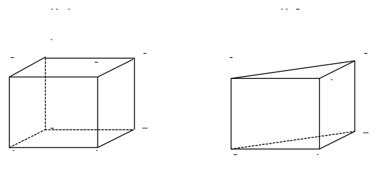
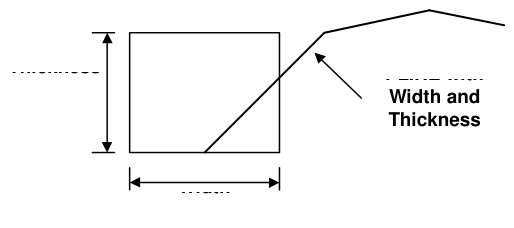
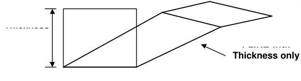
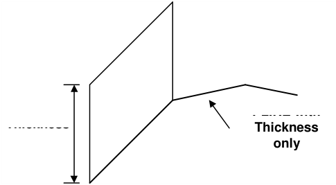
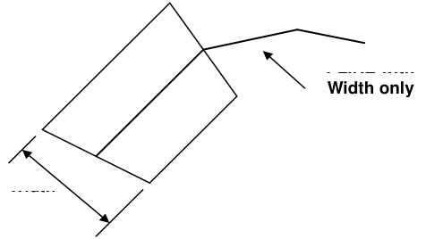
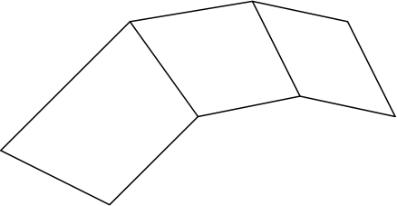
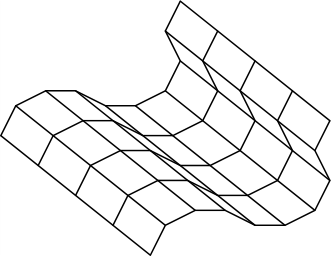

DXF 格式是一种 AutoCAD 图形交换文件，扩展名为 ".DXF"。

该格式适用于与其他 CAD 软件交换模型数据。

#### 三维块体类型的 AutoCAD 实体

生成与 Map3D 兼容的数据，最可靠的方法是使用三维 AutoCAD 实体。这类实体生成的块体，其结构与 Map3D 的三维 FF 块体完全相同，因此可直接传入 Map3D。使用该命令时可保证所有表面封闭，因为每个三维实体都定义了一个封闭块体。在 AutoCAD 中有多种方法可生成此类对象，如下所述。

#### 3DMESH

定义三维 AutoCAD 实体的推荐方法是使用 3DMESH 命令，并将 AutoCAD 的 THICKNESS 和 WIDTH 均设为零。这些 3DMESH 可以指定任意所需的 M 和 N 值。如果 N 设为 3 或 4，这些实体将作为块体导入 Map3D。该方法最为通用，但指定起来也最复杂，因为必须沿巷道全长定义巷道底板和顶板的布局。

#### 带 WIDTH 和 THICKNESS 的 PLINE、POLYLINE 或 ELLIPSE

要生成截面为规则矩形、高度均匀的巷道或采场，最简单的方法是使用 AutoCAD 的 PLINE 命令。只需先为巷道定义一个 AutoCAD UCS（用户坐标系），然后使用 AutoCAD 的 PLINE 命令定义巷道底板标高中心线。接着使用 AutoCAD 的 PEDIT 命令指定巷道宽度。可以指定恒定宽度，也可以在每个顶点处指定变化的宽度。巷道的 AutoCAD COLOUR（Map3D 块体编号）和 AutoCAD THICKNESS（巷道高度）通过 AutoCAD 的 CHANGE PROPERTIES 命令指定。AutoCAD 的 POLYLINE 和 ELLIPSE 命令同样可用于创建具有指定 AutoCAD WIDTH 和 THICKNESS 的巷道。

#### 仅带 THICKNESS 的 PLINE、POLYLINE 或 SOLID

定义矩形截面巷道或采场的另一种简单方法，是使用 AutoCAD 的 PLINE、POLYLINE 或 SOLID 命令，并指定 AutoCAD THICKNESS（巷道高度），同时将 AutoCAD WIDTH 设为零（见图 32）。该方法比 PLINE 更为通用，但指定起来也更复杂，因为必须沿巷道全长定义巷道的平面布置。如果使用 AutoCAD 的 PLINE 或 POLYLINE 命令，则必须用 3 条或 4 条线段构成一个闭合环。

#### 其他三维 AutoCAD 实体

AutoCAD 提供了生成多种三维对象的例程，包括球体、圆环体、长方体、圆锥体等。如有需要，这些对象均可使用。用户须负责封闭半球体和圆锥体等形状的开口端。

#### 二维板类型的 AutoCAD 实体

与 Map3D 兼容的数据也可以用二维 AutoCAD 实体来指定。该方法不如上述方法可靠，因为不再保证所有表面封闭。用户必须用一系列表面板（均指定相同的 AutoCAD 颜色编号）来定义开挖空间，这些板必须沿边缘相接，并以连续的表面外壳完全包围开挖空间。这些表面的结构与 Map3D 的表面板完全相同。使用该方法时无法保证所有表面封闭，因为用户可能遗漏某个表面片，从而在开挖表面上形成孔洞。用户必须注意放置所有板，使所有表面完全闭合。

#### 仅带 THICKNESS 的 LINE、PLINE、3DPOLY、POLYLINE 和 ELLIPSE

这些实体可用于定义二维板。只需先为板定义一个 AutoCAD UCS（用户坐标系），然后使用 AutoCAD 的 LINE、PLINE、3DPOLY、POLYLINE 或 ELLIPSE 命令之一定义板的边缘。AutoCAD COLOUR（Map3D 块体编号）和 AutoCAD THICKNESS（板宽）通过 AutoCAD 的 CHANGE PROPERTIES 命令指定。AutoCAD WIDTH 必须设为零。

#### 仅带 WIDTH 的 LINE、PLINE、3DPOLY、POLYLINE 和 ELLIPSE

使用这些实体时，先用 AutoCAD 的 LINE、PLINE、3DPOLY、POLYLINE 或 ELLIPSE 命令之一定义板的中心线，然后使用 AutoCAD 的 PEDIT 命令指定宽度。可以指定恒定宽度，也可以在每个顶点处指定变化的宽度。AutoCAD THICKNESS 必须设为零。

#### 3DFACE、POLYLINE 或 LWPOLYLINE

也可以使用 AutoCAD 的 3DFACE 命令生成二维表面。该方法更为通用，但由于必须指定 AutoCAD 3DFACE 的所有角点，因此也更为复杂。

#### 3DMESH

使用 N 大于 4 的各类 3DMESH（如 Rulesurf、Tabsurf、Revsurf 等）可以生成复杂的二维表面。对于这些形状，DXF 转换例程会创建一系列 3DFACE 来描述开挖表面。这些表面的结构与 Map3D 的表面板完全相同。由于这类构造具有规则性，因此较容易确保表面封闭。

#### 不支持的 AutoCAD 实体

有一些 AutoCAD 实体不受支持，即 Map3D 并未设计为按其在 AutoCAD 中的显示方式重建这些实体。这些实体包括 CIRCLE、ARC 和 DOUGHNUT 实体。未来的 Map3D 更新可能会支持这些实体。请注意，大多数形状都可以改用 AutoCAD 的 ELLIPSE 命令或 3DMESH 命令生成。

#### AutoCAD DXF 扩展实体数据

DXF 扩展实体数据（EED）是 DXF 规范的一部分。EED 允许您为每个 DXF ENTITY 标记自定义数据属性。下面列出了 Map3D 支持的 EED。

大多数 CAD 系统都允许您将这些 EED 添加到 DXF 中。例如，Deswik 将其称为“属性”，因此在 Deswik 中，您现在可以创建 Map3D 几何体，包括指定 Map3D 块体名称、颜色和开采顺序：

- 使用 DXF-POLYLINE/POLYFACEMESH 导出每个块体——这是 Deswik 的默认设置。

- 建议不要使用 DXF-3DFACE。

- 在 Deswik 中，属性会作为 AutoCAD 扩展实体数据导出到 DXF。

- 属性名称（属性名称不区分大小写）定义如下：`o` MAP3D_BLOCKNAME - 块体名称（默认为空）。

   - MAP3D_BLOCKCOLOR 或 MAP3D_BLOCKCOLOUR - Map3D 颜色编号（默认为 Deswik 定义的颜色编号）。

   - MAP3D_BLOCKTYPE - 1 表示 FF，2 表示 DD，98 表示非激活 FF，99 表示非激活 DD，0 表示网格平面（默认为 1，即 FF）。

   - MAP3D_MSTEP# - # 为开采步编号（默认在第 1 步开采）。

   - Ø 例如，要在开采步 2 开挖，请创建名为 MAP3D_MSTEP2 的属性，然后将属性值指定为 0（开挖）。

   - Ø 例如，要在开采步 3 充填，请创建名为 MAP3D_MSTEP3 的属性，然后将属性值指定为 4（其中 4 是代表充填体的材料编号）。

   - MAP3D_BLOCKNUMBER - 唯一的块体标识编号（默认为每个 DXF-POLYLINE/POLYFACEMESH 或每个 DXF-3DFACE 分配一个不同的唯一编号）。

- 属性名称不区分大小写。

- 所有属性均可定义为字符串（组码 1000）、整数（组码 1070 或 1071）或实数（组码 1040）。

- 所有属性均为可选——未指定时将使用上述默认值。

- 请注意，如果未指定任何 Map3D 定义的属性，只要您使用的是 DXF-POLYLINE/POLYFACEMESH，DXF 即可成功读入。

- Map3D 会直接假定每个 DXF-POLYLINE/POLYFACEMESH 是一个单独的块体。

- 如果使用多个 DXF-3DFACE，Map3D 在将它们归并为块体时可能会遇到困难。

- 仅当相邻块体共用角点且名称相同时才会出现此类问题。

- MAP3D_BLOCKNUMBER 可用于识别属于不同块体的 DXF-3DFACE。
