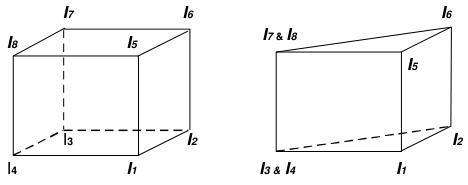
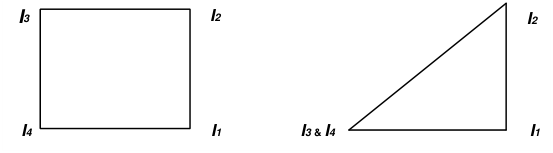
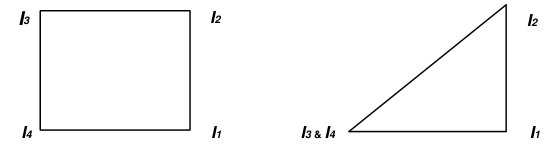
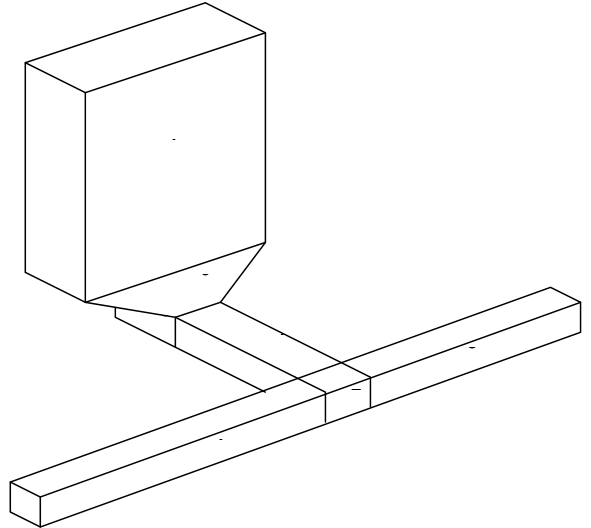
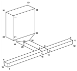
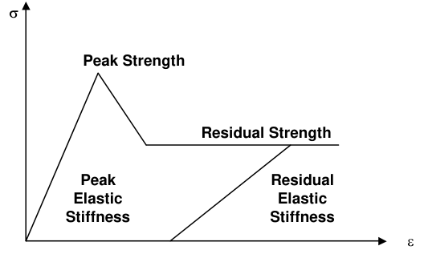

INP 格式是一种可编辑的 ASCII 数据文件，扩展名为 ".INP"。

这是推荐使用的 Map3D 模型格式。该格式支持 Map3D 的全部功能。

文件分为 7 个部分：

1. 作业标题

2. 控制参数

3. 块体定义

4. 坐标定义

5. 材料属性定义

6. 网格定义

7. 开采步定义

注释行必须以星号 "*" 开头，且位于第 1 列。

空行将被跳过。

每行最长为 256 个字符。

数据字段之间可以用逗号或空格分隔。

#### 1. 作业标题

本部分允许用户指定描述性的项目标题：必须指定 1 行数据。无需使用引号。仅使用前 70 个字符。

#### 2. 控制参数

本部分允许用户指定作业控制参数。

#### _NLD,NIT,NPS RPAR,STOL AL,AG DOL,DON DOC,DOE,DOG,DOR_

必须指定 1 行数据。所有参数必须写在同一行。

仅前 7 个参数（ **_NLD,NIT,NPS  RPAR,STOL  AL,AG_** ）必须指定。其余参数将被赋予默认值，这些默认值可能适用于您的应用，也可能不适用。

有关参数的详细说明，请参阅 CAD > Properties > Control Parameters

**_NPS_** 该项指定分析中使用的对称面数量。通常不使用对称面。如果使用对称性，则远场应力（Stress State）必须与对称轴对齐。

**_NPS_** =0   无对称 **_NPS_** =1 _x_ &lt;=> _-x_ ，几何体关于 _y-z_ 平面对称 **_NPS_** =2 _x_ &lt;=> _-x_ 且 _y_ &lt;=> _-y_ ，几何体关于 _y-z_ 和 _x-z_ 平面对称 **_NPS_** =3 _x_ &lt;=> _-x, y_ &lt;=> _-y_ 且 _z_ &lt;=> _-z_ ，几何体关于 _y-z_ 、 _x-z_ 和 _x-y_ 平面对称

**_RPAR_** 在矩阵求解过程中，程序会不断修改松弛参数，力求以尽可能少的迭代次数获得收敛。该参数限制所使用的最大值。对于条件良好的问题，建议使用推荐值 1.2。对于条件很差的问题，应使用 0.8。

#### 3. 块体定义

本部分允许用户定义模型几何体。三维 FF 块体和 DD 平面在此构建。

**_N  'Block_Name' I_ 1** **_,I_ 2** **_,I_ 3** **_,I_ 4** **_I_ 5** **_,I_ 6** **_,I_ 7** **_,I_ 8** **_Type  Thickness,Width_**

每个块体必须指定 1 行数据。

所有参数必须写在同一行。仅前 5 个参数（ **_N I_ 1** **_,I_ 2** **_,I_ 3** **_,I_ 4** ）必须指定。使用 **_N_** =0 结束块体列表。有关参数的详细说明，请参阅

CAD > Build > Block

CAD > Build > FF Loop

#### CAD > Build > DD Loop

- **_N_** 指定块体颜色编号。它用于在设置材料代码时标识该块体，同时也用于设置块体在图形显示中的颜色。应使用不同的颜色编号来表示块体的逻辑分组（例如不同的水平、剖面，或开拓、采场回采等逻辑开采单元）。应让尽可能多的块体使用相同的块体标识编号。

共有 10 种显示颜色。它们依次编号为

1 至 10、11 至 20、21 至 30 等，

因此以下编号显示相同的颜色：

1、11、21……，

- 2、22、32……，

3、23、33……等。

- **_'Block_Name'_** 指定块体的描述性名称（例如 4540 采场）。程序在提供有关块体体积、错误和警告的信息时会使用该名称。块体名称是可选的，但如果使用，必须放在单引号中。任何块体名称仅使用前 20 个字符。

- **_I_ 1** **_,I_ 2** **_,I_ 3** **_,I_ 4** **_I_ 5** **_,I_ 6** **_,I_ 7** **_,I_ 8** 表示构成块体角点的坐标点编号，下文将详细说明。

- **_Type_** 指定要使用的边界单元类型。非激活单元（98 表示非激活 FF，99 表示非激活 DD）可用于显示仅供可视化的特征，这些特征不用于实际应力分析。

- 对于开挖空间、替代材料区、充填采场等三维特征，应使用 **_Type_** =1（虚拟力，Fictitious Force）类型的单元。

- 前 4 个角点（ **_I_ 1** **_,I_ 2** **_,I_ 3** **_,I_ 4** ）表示定义六面体块体一侧（例如底面）的坐标编号。后 4 个角点（ **_I_ 5** **_,I_ 6** **_,I_ 7** **_,I_ 8** ）定义块体的对侧（例如顶面）。角点可按顺时针或逆时针方向输入。任何角点都可以重复，以定义三面体形状和楔形体。通过使用公共坐标编号来指定相邻块体，可将块体连接起来，形成更大、更复杂的开挖形状。

- 如有需要，只使用前 4 个角点（ **_I1,I2,I3,I4_** ），也可以用 3 边或 4 边的表面来构造曲面。后 4 个角点（ **_I5,I6,I7,I8_** ）应指定为零。角点可按顺时针或逆时针方向输入。任何角点都可以重复，以定义三面体形状和楔形体。

- 通过使用公共坐标编号来指定相邻的板，可将这些表面连接起来，形成更大、更复杂的开挖形状。用户必须注意确保构造出完整的封闭表面，不留孔洞，也不缺少任何板。

- 对于层状开采的开挖空间、裂隙和断层面，应使用 **_Type_** =2（位移不连续，Displacement Discontinuity）类型的单元。

- 只使用前 4 个角点（ **_I_ 1** **_,I_ 2** **_,I_ 3** **_,I_ 4** ），用 3 边或 4 边的表面来构造曲面。后 4 个角点（ **_I_ 5** **_,I_ 6** **_,I_ 7** **_,I_ 8** ）应指定为零。角点可按顺时针或逆时针方向输入。任何角点都可以重复，以定义三面体形状和楔形体。

- 通过使用公共坐标编号来指定相邻表面，可将这些表面连接起来，形成更大、更复杂的形状。

- **_Thickness_** 该参数仅用于类型 2（位移不连续）单元，用于指定充填材料的表观厚度（即断层泥、矿层宽度、采宽或矿柱高度）。充填后，该特征的法向位移（闭合）将被限制在此厚度之内。此外，法向位移（闭合）和剪切位移（错动）会除以 _Thickness_，以确定充填材料中产生的应变。该参数应使用与坐标位置相同的单位（即米或英尺）指定。

- **_Width_** 指定允许的最大宽度。

- 该参数可用于对所选实体强制采用均匀离散。指定此值时务必极其谨慎，因为取值过小很容易导致问题规模急剧增大。

- 一般情况下，该参数应留空（即不使用），离散化交由 **_AL_** 和 **_AG_** 参数处理。后两个参数只在需要分析结果的位置加密单元，从而优化单元的使用并最大限度地减小问题规模。

- 有关该参数的使用示例，请参阅 Tabular Mining Example。

#### 简单示例

为说明使用三维构建块体进行模型构建的方法，以一个简单的放矿点布置的构造为例。该模型由 7 个块体组装而成。块体 1、2 和 3 构成出矿巷道，块体 4 构成穿脉，块体 5 和 6 代表放矿点，块体 7 代表采场。Map3D 会识别并删除相邻块体共有的表面。

许多块体可以共用同一个块体编号（颜色），因此可以用一组块体来构造复杂的开挖形状。这里需要重点考虑的是，应使用尽可能少的块体编号，因为块体编号不同的块体之间的所有表面都将保留在数据库中。

如果要使用 Map3D 输入文件规范来构造模型，则需要提供同一放矿点布置的坐标编号。块体编号如下：

- Block Specification

- N 'Block Name' I1,I2,I3,I4 I5,I6,I7,I8 Type,Thic,Width

- 1 'Block 1' 1 2 7 8 9 10 15 16 1 0 0

- 1 'Block 2' 2 3 6 7 10 11 14 15 1 0 0

- 1 'Block 3' 3 4 5 6 11 12 13 14 1 0 0

- 1 'Block 4' 7 6 26 25 15 14 30 29 1 0 0

- 2 'Block 5' 25 26 27 28 29 30 31 32 1 0 0

- 2 'Block 6' 21 22 23 24 25 26 27 28 1 0 0

- 2 'Block 7' 17 18 19 20 21 22 23 24 1 0 0

0

#### 4. 坐标定义

本部分允许用户指定用于定义块体、DD 平面和网格平面角点的坐标位置。

#### _M X,Y,Z_

每个坐标点必须指定 1 行数据。所有参数必须写在同一行。必须指定全部 4 个参数（ **_M X,Y,Z_** ）。使用 N=0 结束坐标列表。

**_M_** 该参数是坐标编号。坐标可按任意顺序输入。

- **_X,Y,Z_** 这些参数表示坐标位置。建议用 **_X_** 表示东向，**_Y_** 表示北向，**_Z_** 表示标高（向上为正）。这些值应以长度单位（米或英尺）指定。

#### 5. 材料属性定义

本部分允许用户指定模型中所用各材料的属性。每种材料的属性以三行为一组定义，依次指定应力状态、本构参数和强度参数。

**_M_ sa, sb, sc   Dsa, Dsb, Dsc** **_Ta,Pa,Tc   Datum   t/h_ ,D** **_t/h Mt   E_ p** **_,E_ r** **_v_ p** **_,v_ r** **_G_ n** **_,G_ s** **_A,C   'Material Name'_**

#### _Mf T_ o p , _T_ o r _UCS_ p , _UCS_ r _Cohesion_ p , _Cohesion_ r fp , fr fi

有关参数的详细说明，请参阅 CAD > Properties > Material Properties

- 每种材料必须指定 3 行数据，使用 _N=0_ 结束列表。

#### 材料属性定义 - 第 1 行 - 应力状态

这一行数据用于设置材料编号 **_N_** 的初始应力状态。材料编号 1 保留给主岩岩体。

**_M_ sa, sb, sc   Dsa, Dsb, Dsc** **_Ta,Pa,Tc   Datum   t/h_ ,D** **_t/h_**

每种材料必须指定 1 行数值数据。所有参数必须写在同一行。仅前 4 个参数（ **_M_ sa, sb, sc** ）必须指定。有关参数的详细说明，请参阅 Stress State

#### 材料属性定义 - 第 2 行 - 本构属性

本构属性有五种不同的指定方式，

**_Mt_ =1** **_E_ p** **_,E_ r** **_v_ p** **_,v_ r** **_G_ n** **_,G_ s** **_0,0   A,C   'Material Name'_**

- 其中 **_E_ p** **_,E_ r** **_v_ p** **_,v_ r** 分别表示杨氏模量（岩体尺度的变形模量）和泊松比的峰值与残余值

#### _E_ = 9 _BS_ /(3 _B_ + _S_ )

#### _v_ = (3 _B_ -2 _S_ )/(6 _B_ +2 _S_ )

**_G_ n** **_,G_ s** 分别表示法向和剪切黏性模量，

- **_A,C_** 分别表示膨胀系数和传导率（仅用于 Map3D Thermal-Fluid Flow）。

更多详情请参阅

**Mohr-Coulomb in 3D FF Blocks**

**Mohr-Coulomb in DD Planes**

- **_Mt_ =2** **_B_ p** **_,B_ r** **_S_ p** **_,S_ r** **_G_ n** **_,G_ s** **_0,0   A,C   'Material Name'_**

   - 其中 **_B_ p** **_,B_ r** **_S_ p** **_,S_ r** 分别表示体积模量和剪切模量的峰值与残余值，

**_B_ =** **_E_ (1-2** **_v_ )/3**

**_S_ =** **_E_ / [ 2(1+** **_v_ ) ]**

**_G_ n** **_,G_ s** 分别表示法向和剪切黏性模量，

   - **_A,C_** 分别表示膨胀系数和传导率（仅用于 Map3D Thermal-Fluid Flow）。

- **_Mt_ =3** **_Kn_ p** **_,Kn_ r** **_Ks_ p** **_,Ks_ r** **_G_ n** **_,G_ s** **_0,0   A,C   'Material Name'_**

   - 其中 **_Kn_ p** **_,Kn_ r** **_Ks_ p** **_,Ks_ r** 分别表示法向刚度和剪切刚度的峰值与残余值，

#### _K_ n = _N/Thickness K_ s = _S/Thickness_

**_G_ n** **_,G_ s** 分别表示法向和剪切黏性模量，

- **_A,C_** 分别表示膨胀系数和传导率（仅用于 Map3D Thermal-Fluid Flow）。

该材料类型只能用于 DD 平面。

**_Mt_ =4** **_N_ p** **_,N_ r** **_S_ p** **_,S_ r** **_G_ n** **_,G_ s** **_B,Et   A,C   'Material Name'_**

- 其中 **_N_ p** **_,N_ r** **_S_ p** **_,S_ r** 分别表示法向模量和剪切模量的峰值与残余值，

- **_G_ n** **_,G_ s** 分别表示法向和剪切黏性模量，

- **_A,C_** 分别表示膨胀系数和传导率（仅用于 Map3D Thermal-Fluid Flow）。

该材料类型只能用于 DD 平面。

更多详情请参阅 **Fault-Gouge in DD planes**

**_Mt_ =5** **_N_ p** **_,N_ r** **_S_ p** **_,S_ r** **_G_ n** **_,G_ s** **_B,Et   A,C   'Material Name'_**

- 其中 **_N_ p** **_,N_ r** **_S_ p** **_,S_ r** 分别表示法向模量和剪切模量的峰值与残余值，

- **_G_ n** **_,G_ s** 分别表示法向和剪切黏性模量，

- **_B,Et_** 分别表示压缩极限和过渡应变，

- **_A,C_** 分别表示膨胀系数和传导率（仅用于 Map3D Thermal-Fluid Flow）。

该材料类型只能用于 DD 平面。更多详情请参阅 **Backfill-Hyperbolic in DD planes**

对于主岩岩体和被 FF 单元包围的非均质区，**_Mt_** 的值必须为 1 或 2。对于放入 DD 单元的充填材料，**_Mt_** 可取任意值。

对于弹性分析，仅使用峰值。在非线性分析（Map3D Non-Linear 中的断层滑动或材料屈服）中，残余值仅在材料屈服后使用。

#### 材料属性定义 - 第 3 行 - 强度参数

每种材料必须指定 1 行数值数据。

所有参数必须写在同一行。

如果 **_Mf_** 不为零，则必须指定所有参数。强度参数有四种不同的指定方式：

#### _Mf_ =0

不使用破坏准则。

**_Mf_ =1** **_To_ p** **_,To_ r** **_UCS_ p** **_,UCS_ r** **_Cohesion_ p** **_,Cohesion_ r wp** **_,_ wr wi**

这些参数的详细定义见

**Mohr-Coulomb in 3D FF Blocks**

**Mohr-Coulomb in DD Planes**

**_Mf_ =2** **_To_ p** **_,To_ r sc p** **_,_ sc r** **_m_ p** **_,m_ r** **_s_ p** **_,s_ r** 这些参数的详细定义见

**Hoek-Brown in 3D FF Blocks**

#### _Mf_ =3 _To_ p _,To_ r _UCS_ p _,UCS_ r _Cohesion_ p _,Cohesion_ r wp _,_ wr

这些参数的详细定义见

**Drucker-Prager in 3D FF Blocks**

#### 6. 网格定义

本部分允许用户定义网格平面的位置，分析结果将在这些平面上计算。

**_N  'Gird_Name' I_ 1** **_,I_ 2** **_,I_ 3** **_,I_ 4** **_I_ 5** **_,I_ 6** **_,I_ 7** **_,I_ 8** 0,0,0,0

**_N  'Grid_Name' I_ 1** **_,I_ 2** **_,I_ 3** **_,I_ 4** **_I_ 5** **_,I_ 6** **_,I_ 7** **_,I_ 8** **_Type  Thickness,Width_**

每个块体必须指定 1 行数据。

所有参数必须写在同一行。

使用 **_N_** =0 结束网格列表。

- **_N_** 该参数是网格编号。网格应从 1 开始连续编号，但可按任意顺序输入。

**_I3 I2_**

**_I4 I1_**

- **_'Grid_Name'_** 该参数允许用户指定网格的描述性名称（例如穿过 4540 采场的上盘网格）。程序在提供有关该网格的信息时会使用该名称。网格名称是可选的，但如果使用，必须放在单引号中。任何网格名称仅使用前 20 个字符。

- **_I_ 1** **_,I_ 2** **_,I_ 3** **_,I_ 4** 这些参数表示构成网格角点的坐标点编号。

网格使用 4 边平面构造。角点可按顺时针或逆时针方向输入。

**_I_ 5** **_,I_ 6** **_,I_ 7** **_,I_ 8** 这些参数不使用，应指定为零。**_Thickness_** 该参数不使用，应指定为零。**_Spacing_** 指定允许的最大间距。

- 该参数可用于对网格强制采用均匀离散。指定此值时务必极其谨慎，因为取值过小很容易导致问题规模急剧增大。

- 一般情况下，该参数应设为零（即不使用），离散化交由 **_AL_** 和 **_AG_** 参数处理。后两个参数只在需要分析结果的位置加密单元，从而优化单元的使用并最大限度地减小问题规模。

#### 7. 开采步定义

该项允许用户指定在每个开采步分配给所选实体的材料代码。

#### _'Mining_Step_Title'_

#### _N, Mc_

每个块体定义必须指定 1 行数值数据。

所有参数必须写在同一行。

必须指定 2 个参数（ **_N,Mc_** ）。

开采顺序通过反复指定材料代码列表来定义。每个列表以 **_N_** =0 结束。在每个开采步中，只需指定发生变化的材料代码。在被分配材料代码之前，块体将一直处于非激活状态。

从未被分配材料代码的块体将被赋予块体类型 98 或 99（即非激活），这些块体将包含在数据库中仅供可视化使用，不会用于分析，也不会为这些表面创建交线。

- **_'Mining_Step_Title'_** 该参数允许用户为每个开采步指定描述性名称。程序在提供有关该开采步的信息时会使用该名称。该参数是可选的，但如果使用，必须放在单引号中。

- **_N_** 该参数是块体标识编号，用于标识哪些块体被分配指定的材料代码。这些编号可按任意顺序输入。0 表示每个开采步列表的结束。

**_Mc_** 该参数设置块体的材料代码。**_Mc_** _=0_ 表示表面应力等于零。通常用于表示无应力的开挖表面。

**_Mc=-M_** 负的材料编号会将该材料的初始应力状态作为边界条件插入（施加）。这使您可以指定任意所需的表面荷载条件。这实际上相当于插入一种刚度为零的材料，因此既不能累积应力，也不能释放应力。通常用于表示因支护、充填或主动加压而具有某种内部应力状态的开挖空间。

对于大多数分析，主岩相对于充填体而言刚度极大，因此应力的累积或释放量可以忽略不计。例外情况是非线性材料变形或大面积闭合。

**_Mc=+M_** 正的材料编号 **_M_** 表示按该材料指定的初始应力状态插入材料编号 **_M_**。材料放置时的起始应力状态等于该材料的初始应力状态，之后允许随变形累积或释放应力。应力变化量取决于所插入材料的刚度。该选项用于为类型 1 块体所定义的区域分配替代材料属性，或将断层泥或充填材料放入类型 2 单元（位移不连续）中，以模拟断层或充填的层状开采区。

- 下表给出了一个说明此功能的简单示例：

* Mining Step Specification * Mining Step #1 * N,Mc

'Block #1 is assigned properties of Ore Material #2' 1   2 0

'Block #1 is excavated'

1   0 0 'Block #1 is backfilled with Material #3' 1   3 0
