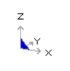
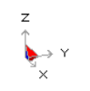

模型的方向由显示窗口左下角的方向图标指示。该图标指示各坐标轴的方向（X 指向东，Y 指向北，Z 向上）。

在上图所示的视图中，Y 轴大部分指向屏幕内并略微偏右，X 轴大部分指向右侧并略微指向屏幕外，Z 轴笔直向上。请注意，图标的背面以蓝色着色。

在上图所示的视图中，Y 轴大部分指向右侧并略微指向屏幕内，X 轴大部分指向屏幕外并略微偏右，Z 轴笔直向上。请注意，图标的内侧以红色着色。

有三种可选的旋转模式：

1. 旋转可应用于当前几何体。该模式允许地平线不水平

2. 旋转的应用方式使地平线始终保持水平，假定 Z+ 轴向上（Tools > Global Transform Z+ up）。这会使鼠标旋转的方向与 Tools > Global Transform Z- up 相反。

3. 旋转的应用方式使地平线始终保持水平，假定 Z- 轴向上（Tools > Global Transform Z- up）。

这会使鼠标旋转的方向与 Tools > Global Transform Z+ up 相反。按住鼠标左键并等待

拖动鼠标指针出现，然后将方向图标拖到所需位置，即可旋转模型。向顶部或底部拖动，模型向上或向下旋转。在屏幕底部附近，向左侧或右侧拖动，模型向左或向右旋转。在屏幕顶部附近，向左侧或右侧拖动，模型沿逆时针或顺时针方向旋转。可使用 Tools > Rotation Toolbar 自定义此操作。

也可通过触摸屏操作旋转模型：用 1 指或 2 指在屏幕上拖动，并通过捏合进行缩放。可使用 Tools > Rotation Toolbar 自定义此操作。

注意：

旋转模型之前，应设置所需的旋转中心

#### View > Centre

可使用以下功能调整拖动等待时间

#### Tools > Drag Wait Time

旋转和平移操作可通过在选择操作之前键入 n# 自动重复。例如，要生成应力图的动画显示，请指定

Plot > Options > Persist Plot > Stress > Sigma:1 View > Rotation Increment > 10 然后从键盘键入 35#

选择向右旋转（通过旋转工具栏或 PageDown 键）

按 Esc 键可取消动画。

输入 0# 将无限重复该操作。按 Esc 键可停止。

相关主题：

平移模型 选择特殊视图位置

#### 索引

#### - 0 -

001 002 ... 文件     510, 600

**- 3 -**

3D 开挖形状     27, 29, 30

#### - A -

中止 Map3D 分析     461 关于 Map3D     2 绝对应变     223, 299 绝对应力     209, 299 精度     45, 308, 381, 462, 482 AG - 网格间距     45, 300, 301, 302, 308, 381, 462 AL - 单元尺寸     45, 300, 301, 308, 381, 462 替代材料区     30

Analysis 对话框     172, 308, 328, 381, 461, 462, 463, 464, 465, 489, 490

Analysis Options 对话框     329, 465, 466, 467, 468, 469, 471, 473, 477, 478, 482, 484, 485, 486, 487, 489

分析结果     164, 171, 172, 173, 186, 510, 524, 600

分析时间     45, 308, 381, 462 动画     184, 508 Map3D 的应用     11 竣工模型     27 自动离散     45, 300, 301, 302, 308, 381, 462 等值线点的平均值     317

#### - B -

充填     30, 33, 477, 487 批处理分析     466

BEM 分析     317, 390, 433, 461, 462, 465, 466, 467, 469, 471, 473, 477, 478, 482, 484, 485, 486, 487, 489, 490, 569, 594, 595, 597, 598

屏幕位图转储     173, 174, 184, 185, 508 块体模型     29, 30 BMP     173, 174, 184, 508 布尔相交     467 边界元法     12, 13, 477, 482, 487, 570

Build 工具栏     331, 335, 341, 348, 358, 360, 362, 364, 365, 366, 367, 368, 369, 436, 494, 507 构建 3D FF 块体     331, 335, 341, 348, 364, 365, 366, 367, 368, 369, 390, 394, 395, 397, 398, 400, 402, 407, 408, 410, 412, 413, 415, 416, 418, 421, 423 构建构造线     362, 364, 365, 366, 367, 368, 369, 498

构建 DD 平面     331, 335, 341, 348, 364, 365, 366, 367, 368, 369, 390, 394, 395, 397, 398, 400, 402, 407, 408, 410, 412, 413, 415, 416, 418, 421, 423

构建场点网格线     358, 360 构建场点网格平面     358, 360, 364, 365, 366, 367, 368, 369, 494, 496

构建场点线平面     364, 365, 366, 367, 368, 369

构建巷道     331, 335, 341, 348, 364, 365, 366, 367, 368, 369 大体积采矿 - 模型构建教程     85

#### - C -

CAD     426, 427, 428, 429 CAD > Build     331, 335, 341, 348, 358, 360, 362, 364, 365, 366, 367, 368, 369 CAD > Build 菜单     494, 507

CAD > Edit     390, 394, 395, 397, 398, 400, 402, 407, 408, 410, 412, 413, 415, 416, 418, 421, 423 CAD > Edit 菜单     495, 496, 498 CAD > Properties     308, 317, 381, 390 CAD > Properties 菜单     313, 314, 386, 387 CAD > Propertiesu     313, 386 CAD > Snap     369, 370, 371, 372, 373, 376, 377, 378, 379

CAD > Snap 菜单     494 CAD 菜单     303, 425 CAD 工具栏     436, 494, 507

笛卡尔应变     221 笛卡尔应力     208 清除构造线数据     169 清除模型数据     165 闭合与重叠检查     467 系数矩阵     471, 484, 485, 487 模型构建中的常见问题     39 结束当前分析     489, 490 执行 BEM 应力分析     462 执行 Map3D 分析     328 配置工具栏     196, 432, 433, 434, 435, 436 控制台模式     466 构造线数据     169, 170, 171, 508, 510, 511 接触与相交分析     464 等值线图选项     304 等值线范围     302 等值线工具栏     432, 433, 594, 595, 597, 598 复制模型数据     397 蠕变 弹-黏-塑性     469 自定义按钮字体     439 自定义颜色     437, 438, 439

**- D -**

DD 平面厚度     496 DD 平面     27, 35, 36 深度缓冲区     440, 441 Deswick     511 数字化仪支持     426, 502 离散化分析     462, 484, 485, 569 离散与集总     45, 300, 301, 302, 308, 381, 462 离散视图的显示     600 离散模型     462 磁盘性能测试     441 磁盘空间要求     45, 308, 381, 462, 484, 485 位移分量     224 位移不连续单元     27, 35, 36 位移工具栏     224 显示已保存的屏幕图像     184, 185, 508

发散解     45, 300, 301, 308, 381, 462 DOC - 矩阵集总     45, 300, 301, 308, 381, 462 DOE - 单元集总     45, 308, 381, 462 DOG - 网格集总     45, 308, 381, 462 DOL - 求解精度     45, 300, 301, 302, 308, 381, 462 DON - 矩阵条件     45, 300, 301, 308, 381, 462 DOR - 单元长宽比     45, 308, 381, 462 模型的拖动旋转     431, 601 模型的拖动平移     431, 599 模型的拖动缩放     431, 599 3D FF 块体中的 Drucker-Prager     232, 238, 240, 243, 246, 248, 251, 254, 256, 533 转储分析结果     175, 180 转储屏幕图像     173, 174, 175, 508 DXF 构造线文件格式     510, 511 屏幕 DXF 转储     174 DXF 模型文件格式     511, 525 DXF 屏幕图像文件格式     174

**- E -** Edit 工具栏     390, 394, 395, 397, 398, 400, 402, 407, 408, 410, 412, 413, 415, 416, 418, 421, 423, 436, 495, 496, 498, 499, 501 编辑模型数据     390, 430, 495, 496, 498, 499, 501 有效应力     209 弹性应变     222, 298 弹-黏-塑性蠕变     469 单元集总     45, 300, 301, 308, 381, 462 单元尺寸     45, 300, 301, 308, 381, 462 能量释放率计算     478 擦除模型数据     394 ESS     200, 202, 203, 205 EVP 文件     443, 446 多余应力     232, 238, 240, 243, 246, 248, 251, 254, 256, 259, 263, 265, 266, 268, 272, 276, 526, 531, 533, 535, 547, 556, 595 膨胀系数与传导率     568 EXTENDED ENTITY DATA     511 将平面拉伸为块体     365

#### - F -

破坏准则     232, 238, 240, 243, 246, 248, 251, 254, 256, 259, 263, 265, 266, 268, 272, 276, 526, 531, 533, 535, 547, 556, 595

远场应力状态设定     503, 505 断层面     36 DD 平面中的 Fault-Gouge     259, 263, 265, 266, 268, 272, 276, 535

虚拟力单元     27, 29 File > Output 菜单     173, 174, 175, 180 File 菜单     164, 165, 166, 167, 168, 169, 170, 171, 172, 173, 184, 185, 186, 507, 508, 524, 525 在模型中查找指定的坐标点     195 流动分量     230 流动法则     526, 535, 547, 556, 568 Flow 工具栏     230 流体/热流动分析     568 徒手绘制 - 模型构建教程     60

DD 平面中的 Hyperbolic-Backfill     259, 263, 265, 266, 268, 272, 276, 556

#### - I -

原位应力状态设定     503, 505 非活动块体     39 诱发应变     223, 299 诱发应力     209, 299 初始应力状态设定     503, 505 初始化所有查看参数     195 INP 模型文件格式     515, 525

面内     259, 263, 265, 266, 268, 272, 276 面内应变     213, 215, 216, 218 面内应力     200, 202, 203, 205 结果解释     15, 23, 478 相交分析     464, 467, 468, 485, 569 简介     2

#### - J -

#### - G -

GIF     173, 174, 184, 508

在当前分析阶段转到图形     463 转到模型构建与编辑阶段     463 网格集总     45, 300, 301, 302, 308, 381, 462 网格选择     303, 425, 436

网格间距     45, 300, 301, 302, 308, 381, 462 地表     35 对模型数据分组     408

#### - H -

Help 菜单     456, 457

隐藏面消除     440, 441 Hide block colours 工具栏     189, 190, 196, 435 Hide Cline Colours 工具栏     190 Hide construction line colours 工具栏     190, 196, 435 Hide 工具栏     186, 196, 435 隐藏模型的各个部分     186 3D FF 块体中的 Hoek-Brown     232, 238, 240, 243, 246, 248, 251, 254, 256, 531

JPEG     173, 174, 184 JPG     173, 174, 184

#### - L -

租用 Map3D     2

局限与不足     15

从文件加载模型     164, 165, 167, 464, 507, 525

从最近的文件加载分析结果     186

从最近使用的目录加载分析结果 524

从重启文件加载分析结果     164, 171 从文件加载构造线数据     169, 170 从最近使用的目录加载模型数据 524

从最近使用的文件加载模型数据     186 加载系统刚度计算     478 局部能量释放率计算     478 集总与离散     45, 300, 301, 302, 308, 381, 462

#### - M -

Map3D     2, 9, 11, 12, 13, 569, 570 Map3D 分析选项     329 Map3Di     314, 387, 453 材料代码     33 材料属性设定     313, 386, 464, 503, 505, 526, 531, 533, 535, 547, 556, 568 矩阵条件     45, 300, 301, 308, 381, 462 矩阵集总     45, 300, 301, 308, 381, 462 矩阵求解     465, 467, 486 最大剪应变     212 最大剪应力     199 平均应力     207 等值线点的平均值     317 菜单命令 - Analysis 对话框     172, 308, 381, 461, 462, 463, 464, 465, 489, 490 菜单命令 – Analysis 对话框     328 菜单命令 - Analysis Options 对话框 465, 466, 467, 468, 469, 471, 473, 477, 478, 482, 484, 485, 486, 487, 489 菜单命令 – Analysis Options 对话框 329

菜单命令 - CAD     426, 427, 428, 429 菜单命令 - CAD > Build     331, 335, 341, 348, 358, 360, 362, 364, 365, 366, 367, 368, 369 菜单命令 - CAD > Build 菜单     494, 507 菜单命令 - CAD > Edit     390, 394, 395, 397, 398, 400, 402, 407, 408, 410, 412, 413, 415, 416, 418, 421, 423

菜单命令 - CAD > Edit 菜单     495, 496, 498 菜单命令 - CAD > Properties     308, 313, 314, 317, 381, 386, 387, 390 菜单命令 - CAD > Snap     369, 370, 371, 372, 373, 376, 377, 378, 379 菜单命令 - CAD > Snap 菜单     494 菜单命令 - CAD 菜单     303, 425 菜单命令  File     169, 170 菜单命令 - File     164, 165, 166, 167, 168, 169, 171, 172, 173, 184, 185, 186 菜单命令 - File > Output     173, 174, 175, 180 菜单命令 - File 菜单     507, 524, 525 菜单命令 - Help 菜单     456, 457

菜单命令 - Plot     302 菜单命令 - Plot > Displacement     224 菜单命令 - Plot > Flow     230 菜单命令 - Plot > Miscellaneous     302 菜单命令 - Plot > Properties     308, 313, 317, 381, 386, 390

菜单命令 - Plot > Strain     210, 212, 213, 215, 216, 218, 220, 221, 222, 223, 226, 298, 299 菜单命令 - Plot > Strength Factors     232, 238, 240, 243, 246, 248, 251, 254, 256, 259, 263, 265, 266, 268, 272, 276

菜单命令 - Plot > Stress     198, 199, 200, 202, 203, 205, 207, 208, 209, 226, 299

菜单命令 - Plot > Surface Components     279, 280, 281, 282, 283, 284, 285, 286, 287, 292, 294, 295, 296, 297, 298, 300, 301

菜单命令 - Plot 菜单     594, 595, 597, 598 菜单命令 – Plot 菜单     304, 317 菜单命令 - Seismic     443, 446, 453, 456, 492 菜单命令 - Tools     196, 430, 431, 432, 433, 434, 435, 436, 437, 438, 439, 440, 441, 442 菜单命令 – Tools 菜单菜单命令 - ToolsTools 菜单     439

菜单命令 - View > Find Coordinate     195 菜单命令 - View > Hide     186 菜单命令 - View > Hide Block Colours     189, 190

菜单命令 - View > Hide Cline Colours     190 菜单命令 - View > Initialize     195 菜单命令 - View > Length     196, 435 菜单命令 - View > Pan     196, 435 菜单命令 - View > Render     192, 194, 600 菜单命令 - View > Zoom     196, 435 菜单命令 - View > Zoom Extents     195 菜单命令 - View 菜单     196, 197 菜单命令 -File 菜单     508 合并相邻表面     468 合并彼此靠近的坐标点 467 合并模型数据     507, 525 矿山设计     23 采矿步选择     173 采矿步顺序     33

模型构建     12, 27, 29, 30, 33, 35, 36, 39, 60, 85, 106, 314, 331, 335, 341, 348, 358, 360, 362, 387, 390, 394, 395, 397, 398, 400, 402, 407, 408, 410, 412, 413, 415, 416, 418, 421, 423, 426, 463, 467, 468, 485, 486, 494, 496, 498, 507, 525 模型数据     164, 165, 166, 167, 168, 186, 314, 387, 464, 467, 486, 507, 509, 511, 515, 524, 525, 569 模型方向图标     601 3D FF 块体中的 Mohr-Coulomb     232, 238, 240, 243, 246, 248, 251, 254, 256, 526 DD 平面中的 Mohr-Coulomb     259, 263, 265, 266, 268, 272, 276, 547 移动非常靠近边界表面的场点     473 移动模型数据     395, 412, 413, 415, 416, 418

#### - N -

数值建模     9, 11, 12, 13, 15, 23

#### - O -

屏幕 OBJ 转储     175 OBJ 屏幕图像文件格式     175 八面体剪应变     220 八面体剪应力     207 露天矿坑     36 OpenGL     440, 441 矿体     27, 29, 30 Map3D 概述     9 模型构建概述     12

#### - P -

参数研究     15 屏幕 PDF 3D 转储     175 PDF 3D 屏幕图像文件格式     175 拾取框大小     442 塑性应变     222, 298 Plot > Displacement     224 Plot > Flow     230 Plot > Miscellaneous     302 Plot > Properties     308, 313, 317, 381, 386, 390

Plot > Properties 菜单     313, 386

Plot > Strain     210, 212, 213, 215, 216, 218, 220, 221, 222, 223, 226, 298, 299 Plot > Strength Factors     232, 238, 240, 243, 246, 248, 251, 254, 256, 259, 263, 265, 266, 268, 272, 276 Plot > Stress     198, 199, 200, 202, 203, 205, 207, 208, 209, 226, 299 Plot > Surface Components     279, 280, 281, 282, 283, 284, 285, 286, 287, 292, 294, 295, 296, 297, 298, 300, 301 Plot 菜单     302, 303, 304, 317, 425, 594, 595, 597, 598 绘图选项     304 分析过程中绘制表面分量     461, 462 PNG     173, 174, 184, 508 PNT 构造线文件格式     508, 510 分析结果 PNT 转储     175, 180 屏幕 PNT 转储     175, 508 PNT 模型文件格式     509, 525 PNT 屏幕图像文件格式     175, 508 病态问题     45, 300, 301, 308, 381, 462 主应变     210 主应力     198 概率     232, 238, 240, 243, 248, 251, 256, 259, 263, 265, 266, 268, 272, 276 问题规模     45, 308, 381, 462

#### - R -

矩阵存储所需内存     485, 487 绘制等值线的范围     302 最近使用的目录     524 最近使用的文件     186 建模预测的可靠性     15 渲染等值线     304 渲染模型     192, 194 重新编号表面以使体积为正     486 重置所有查看参数     195 重启文件     510, 600 重启分析     172 恢复先前保存的视图位置和等值线范围     185

岩体响应预测     15, 23, 478 减去分析结果     172 旋转模型数据     400, 402 支持与销售     2 旋转模型     197, 431, 601 支护放置     30, 33, 477, 487 Rotation 工具栏     431 Surface Components 工具栏     279, 280, 281, 282, 连续运行多个分析     466 283, 284, 285, 286, 287, 292, 294, 296, 297, 298, 300, 301, 598 **- S -** Surface Components 工具栏     295 表面模型     27, 30 暂停 Map3D 分析     489 销售与支持     2

销售与支持     2 将模型保存到文件     166 将模型另存为新文件名     166, 168 将构造线数据保存到文件     171 将构造线数据另存为新文件名     171 保存模型数据     407 保存当前视图位置和等值线范围 185 缩放模型数据     398 屏幕转储     173, 174, 175, 184, 185, 508 Seismic     443, 446, 453, 456, 492 Seismic 菜单     443, 446, 453, 456, 492 地震矩     317 分析对话框中的平滑滚动     442 平滑构造线     421, 423 Snap 工具栏     369, 370, 371, 372, 373, 376, 377, 378, 379, 436, 494, 502 求解精度     45, 300, 301, 302, 308, 381, 462, 482

#### - T -

板状采矿 - 模型构建教程     106 板状采矿区     36 太沙基观察法     15 测试磁盘性能     441 热/流体流动分析     568 三维开挖形状     27, 29, 30 工具栏     431, 433, 436, 594, 595, 597, 598 Tools 菜单     196, 430, 431, 432, 433, 434, 435, 436, 437, 438, 439, 440, 441, 442 总应变     222, 298 总应力     209 平移和缩放模型     599 平移模型     196, 431 Translation 工具栏     431 教程     60, 85, 106

Solve 工具栏     433, 434 特殊视图位置     197 稳态热/流体流动分析     568 Strain 工具栏     210, 212, 213, 215, 216, 218, 220, 221, 222, 223, 226, 298, 299, 597 强度准则     232, 238, 240, 243, 246, 248, 251, 254, 256, 259, 263, 265, 266, 268, 272, 276, 526, 531, 533, 535, 547, 556, 595 Strength Factors 工具栏     232, 238, 240, 243, 246, 248, 251, 254, 256, 259, 263, 265, 266, 268, 272, 276, 595

#### - U -

泛平面     259, 263, 265, 266, 268, 272, 276 泛平面应变     213, 215, 216, 218 泛平面应力     200, 202, 203, 205 更新结果文件     172 用户定义按钮字体     439 用户定义颜色     437, 438, 439 用户定义等值线图     443, 446, 453, 456, 492 用户定义的分析结果转储     175, 180 用户定义绘图     226 用于应力计算的用户定义点     473

应力方向图标     599 Stress 工具栏     198, 199, 200, 202, 203, 205, 207, 208, 209, 226, 299, 594 拉伸模型数据     410 将非平面四边形细分为三角形 485

#### - V -

View > Hide Block Colours 菜单     189, 190 View > Hide Cline Colours 菜单     190 View > Hide 菜单     186 View > Render 菜单     192, 194, 600 View 菜单     195, 196, 197, 435 View 工具栏     189, 190, 196, 435 查看网格平面     303, 425, 436 查看采矿步     173 屏幕 VRML 转储     175 VRML 屏幕图像文件格式     175

#### - W -

屏幕 WRL 转储     175 WRL 屏幕图像文件格式     175 [www.map3d.com/how_to_buy](https://www.map3d.com/how_to_buy)     2

#### - Z -

z 缓冲     440, 441 缩放以显示所有实体     195 缩放模型     197, 431
